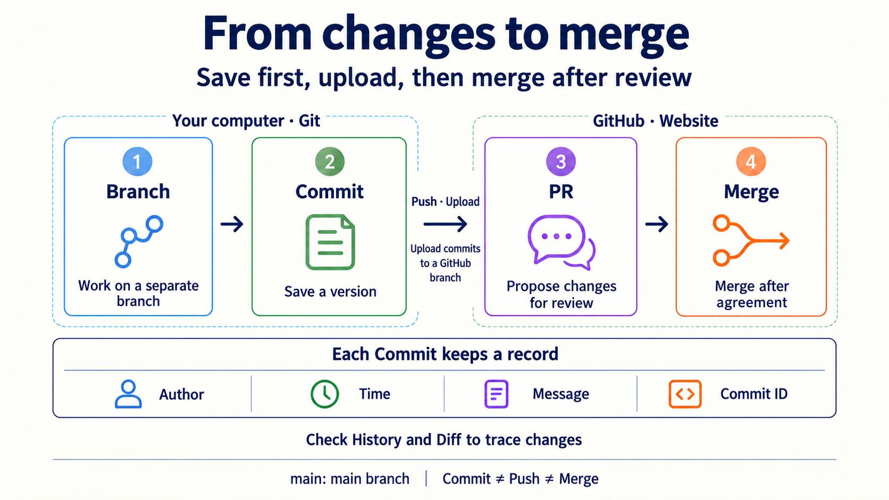
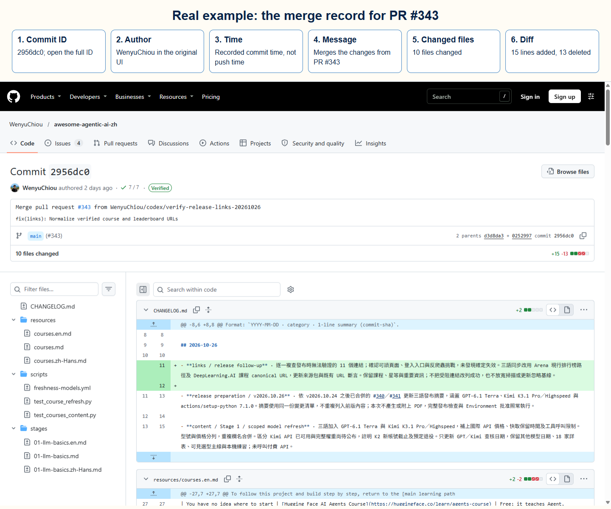
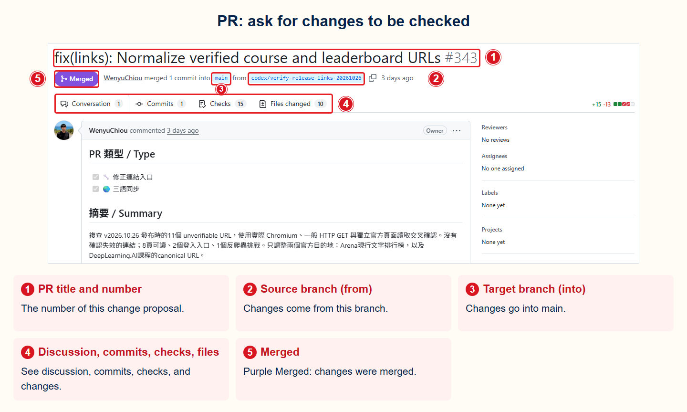
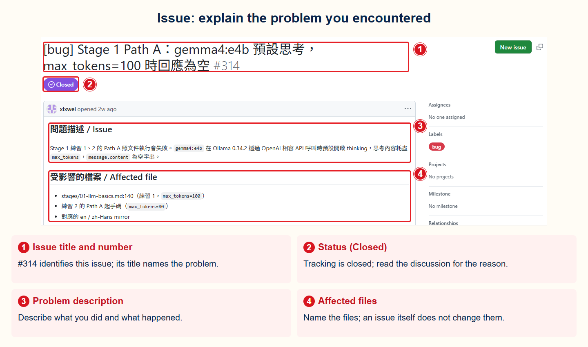

# Stage 0 — Foundations

> [繁體中文](./00-foundations.md) | **English** | [简体中文](./00-foundations.zh-Hans.md)

This stage checks four tools that you will use later. If you already know them, skip ahead. If not, try the practice below once.

## When to skip this stage

Check these four things. You do not need to memorize commands. You do need to find information and finish each task yourself:

- [ ] Use **Python** to get public data from an **API** (Application Programming Interface), then find a value in the **JSON** (JavaScript Object Notation).
- [ ] Use **Git** to copy a project (`clone`), create a work line (**branch**), save a version (**commit**), and send it online (**push**). When two changes collide, know what a **merge conflict** is and what to keep.
- [ ] Use a **CLI (command-line interface)** to change folders, create files, and run a Python script.
- [ ] Read **YAML** and JSON. Both are text formats for saving data.

If all four are easy, go straight to [Stage 1 — LLM Basics](01-llm-basics.en.md). If one is uncertain, do the main practice here. Open the extra sections only when you need them.

## 📌 Learning Goals

After this stage, you can:

- Get data from an API with Python and read the needed part of the JSON.
- Run a program from a **terminal** and find the file it created.
- Recognize a project **repository**, inspect its version history, and save a version with Git.
- Recognize YAML, JSON, and an **API token** (secret text that lets a program sign in), and know what must not be shared.

## 🔑 Core Terms

First learn the tools for running programs and exchanging data. Then see how projects save and share changes online.

<div class="reader-core-terms" role="region" tabindex="0" aria-label="Foundations core terms">
<table align="center">
  <thead><tr><th scope="col">Group</th><th scope="col">Term</th><th scope="col">Plain explanation</th><th scope="col">Use or boundary in this chapter</th></tr></thead>
  <tbody>
    <tr><th scope="rowgroup" rowspan="4" align="center" valign="middle">Programs and execution</th><td><strong>Python</strong></td><td>A programming language used to write instructions and run programs.</td><td>The main exercise uses Python to get data.</td></tr>
    <tr><td><strong>Terminal</strong></td><td>A window for entering and viewing text commands.</td><td>Run the main exercise here.</td></tr>
    <tr><td><strong>CLI (Command-Line Interface)</strong></td><td>An interface for interacting with a program using text commands.</td><td>For example, enter a Python command.</td></tr>
    <tr><td><strong>Shell</strong></td><td>A command interpreter, such as PowerShell or Bash, that interprets and runs commands.</td><td>It usually runs in a terminal.</td></tr>
  </tbody>
  <tbody>
    <tr><th scope="rowgroup" rowspan="4" align="center" valign="middle">Data and interfaces</th><td><strong>API (Application Programming Interface)</strong></td><td>An interface that lets programs interact with another program or service according to rules.</td><td>Not limited to websites.</td></tr>
    <tr><td><strong>JSON (JavaScript Object Notation)</strong></td><td>A text format for structured data.</td><td>The exercise reads API data in JSON; it is not a script.</td></tr>
    <tr><td><strong>YAML (YAML Ain’t Markup Language)</strong></td><td>Another text data format, often used for configuration.</td><td>Indentation matters; it is not a script.</td></tr>
    <tr><td><strong>API token</strong></td><td>A secret credential, like a key, that lets a program prove its identity.</td><td>Do not publish or upload it; the main exercise needs none.</td></tr>
  </tbody>
  <tbody>
    <tr><th scope="rowgroup" rowspan="3" align="center" valign="middle">Platform and project</th><td><strong>GitHub</strong></td><td>A platform for sharing code, tools, teaching materials, and online resources; many open-source projects collaborate there.</td><td>Public does not always mean open source; read the use permissions.</td></tr>
    <tr><td><strong>Git</strong></td><td>A tool that records file versions and can run on your own computer.</td><td>Git and GitHub are different things.</td></tr>
    <tr><td><strong>Repository (Repo)</strong></td><td>A place holding a project's files and version history.</td><td>This project is a repository.</td></tr>
  </tbody>
  <tbody>
    <tr><th scope="rowgroup" rowspan="3" align="center" valign="middle">Explore a project</th><td><strong>README</strong></td><td>An introductory document that usually explains a project and how to start.</td><td>Read it first to find your starting point.</td></tr>
    <tr><td><strong>License</strong></td><td>A document explaining how others may use, change, or share a work.</td><td>Check its terms and whether it is open source.</td></tr>
    <tr><td><strong>Issue</strong></td><td>A project page for discussing a problem, suggestion, or task.</td><td>Observe first; you need not post.</td></tr>
  </tbody>
  <tbody>
    <tr><th scope="rowgroup" rowspan="5" align="center" valign="middle">Changes and collaboration</th><td><strong>Branch</strong></td><td>A separate line of work; <strong>main</strong> is often the shared main line.</td><td>You can make changes on your own line first.</td></tr>
    <tr><td><strong>Commit</strong></td><td>Like a labeled project snapshot: it saves selected changes with an author, time, message, and identifier (hash).</td><td>Saving in an editor is not a commit; history can branch.</td></tr>
    <tr><td><strong>Push</strong></td><td>Send local version records to the corresponding branch on GitHub.</td><td>This does not automatically merge into main.</td></tr>
    <tr><td><strong>Pull Request (PR)</strong></td><td>Propose changes for others to review and discuss whether to accept.</td><td>Opening a PR does not mean it has been merged.</td></tr>
    <tr><td><strong>Merge</strong></td><td>Combine changes from one line of work into another.</td><td>After review and agreement, changes can be merged into main.</td></tr>
  </tbody>
</table>
</div>

**History** is the project's saved version record; it can branch and is not necessarily a straight timeline. A **Diff** compares content before and after changes. A commit's author name, time, message, and identifier help trace it, but the author label alone does not prove identity.

For example: fix a typo on a branch → make a local commit → push the branch to GitHub → open a PR for review → merge into main after agreement. Each step has a different purpose; a PR does not automatically merge.



For more, see [GitHub's introduction](https://docs.github.com/en/get-started/using-github/hello-world), [licensing guidance](https://docs.github.com/en/repositories/managing-your-repositorys-settings-and-features/customizing-your-repository/licensing-a-repository), and [Git version history](https://git-scm.com/book/en/v2/Git-Basics-Viewing-the-Commit-History).

### Put your edited document on GitHub

Suppose you want to edit your own `README.md`. Use your own practice repository; [GitHub's Hello World guide](https://docs.github.com/en/get-started/using-github/hello-world) helps you create one. <strong>Clone</strong> means downloading the project files and version history to your computer. The steps below start in a cloned practice repository on `main`; first follow [GitHub’s Git setup guide](https://docs.github.com/en/get-started/git-basics/set-up-git) to install Git and authenticate, then [clone your practice repository](https://docs.github.com/en/repositories/creating-and-managing-repositories/cloning-a-repository). In the terminal, move into that project folder before entering commands.

1. **Start your own line of work.** Run `git switch -c docs/my-first-update` to create and switch to a branch. A <strong>Branch</strong> is a line of changes starting from a shared version, rather than another copy of the folder; `docs/my-first-update` is its name.
2. **Edit, save, and check.** Edit `README.md`, save the file, and run the project's required checks. Use `git status` to see which files changed and `git diff` to inspect the changes. You have not made a new commit yet.
3. **Select what to record.** Run `git add README.md`. The <strong>Staging Area</strong> is the list of changes selected for your next commit. This selects the current changes; if you edit the file again, stage those new changes again.
4. **Record a version on your computer.** Run `git commit -m "docs: clarify the introduction"`. This saves the staged changes as a **Commit**; the quoted text is its message. It is still on your computer and has not been uploaded.
5. **Upload this branch.** Run `git push -u origin docs/my-first-update`. <strong>origin</strong> is the name of the remote GitHub repository in this example; `-u` remembers the link between the local and remote branches. **Push** sends versions to that branch, without merging them into `main`.
6. **Open a PR for review.** On GitHub, open a Pull Request with `docs/my-first-update` as the source and `main` as the target. <strong>Review</strong> means inspecting differences, asking questions, and checking results; complete the project’s required checks and approvals before someone with permission performs **Merge**. You can check and merge your own practice repository yourself; read the contribution guide for a shared project.
7. **Bring the merged result back to your computer.** Once the PR is merged and `git status` shows a clean working tree, run `git switch main`, then `git pull --ff-only`. <strong>Pull</strong> brings remote updates into your local `main`. If it fails, read the error before trying to overwrite anything.

To change someone else's project without write permission, you usually <strong>Fork</strong>, creating a copy under your account, and open a PR from that copy. See [GitHub's contribution guide](https://docs.github.com/en/get-started/exploring-projects-on-github/contributing-to-a-project). An **Issue** is a discussion about a problem or suggestion; it is not required for every edit.

### Read a real change

These are historical records from this project. Match each numbered red box to the explanation below its image; on a phone, open the original image to zoom. Each language has its own annotations; the original GitHub interface text is unchanged.

**1. Commit: see what this version records.** [Open Commit `2956dc0`](https://github.com/WenyuChiou/awesome-agentic-ai-zh/commit/2956dc0b4960f6fecf5d3ab00f8b89bacc886e18). This record came from merging PR #343; ordinary commits can also record changes that have not been merged.



- **① Commit ID (SHA)**: `2956dc0` is the short ID; the original page shows the full value.
- **② Author and time**: the screen shows the author. Git also records a Committer, who may be different. Commit time is not push time, and an author name alone does not prove identity.
- **③ Message**: this record says it merges PR #343; follow the link to the proposal.
- **④ Branch**: the screen shows `main`. A branch is a line of work; a commit is one recorded version.
- **⑤ File count**: this change touches 10 files, not 10 commits.
- **⑥ Diff**: this example adds 15 lines and removes 13 in total. Box ⑥ shows added lines with green +. Open the full diff to find removed lines with red −; red rectangles are only teaching annotations.

**2. PR and Merge: see where the changes came from and went.** [Open PR #343](https://github.com/WenyuChiou/awesome-agentic-ai-zh/pull/343).



- **① PR number**: `#343` identifies this proposal, separately from a commit ID.
- **② Source (from) and ③ target (into)**: this merged changes from `codex/verify-release-links-20261026` into `main`.
- **④ Inspection tabs**: Conversation shows discussion, Commits shows version records, Checks shows automated results, and Files changed shows differences. The number of checks does not mean they all passed.
- **⑤ Merged**: the purple status means the changes were merged; pushing or opening a PR alone does not do this. Review is human inspection; Checks are usually automated.

**3. Issue: explain the problem first.** [Open Issue #314](https://github.com/WenyuChiou/awesome-agentic-ai-zh/issues/314). This is a past bug report; here we only study how it describes a problem.



- **① Title and number**: name the problem first so others can find the discussion again using `#314`.
- **② Closed**: tracking has ended. Read the replies or timeline to learn why; it does not always mean the problem was fixed.
- **③ Description and ④ file locations**: describe what you did, what happened, what you expected, and the relevant files so others can understand or reproduce it. Scroll down for replies and actions; an issue itself does not edit files.

## 🛠 Hands-on Practice: Build a Small GitHub Data Tool

**Outcome:** Have Python get public data from GitHub, show it on screen, write it to a file, and save the result with Git. This main practice needs no account, API token, or paid service.

First spend five minutes observing in a browser: [open this project](https://github.com/WenyuChiou/awesome-agentic-ai-zh), find its README, License, and Issues, then open its commit history. Choose a commit and inspect its author, time, message, identifier, and diff. A publicly displayed author email is a label in the record, not a login credential, and cannot alone verify the author’s identity. You do not need to create an Issue or PR.

### 1. Create the program

Create a new folder. Save the following as `github_profile.py`:

```python
import json
import sys
from pathlib import Path
from urllib.request import Request, urlopen

if hasattr(sys.stdout, "reconfigure"):
    sys.stdout.reconfigure(encoding="utf-8", errors="replace")

url = "https://api.github.com/users/torvalds"
request = Request(url, headers={"User-Agent": "stage-0-practice"})

with urlopen(request, timeout=10) as response:
    profile = json.load(response)

result = f"{profile['login']} has {profile['followers']} followers"
print(result)
Path("result.txt").write_text(result + "\n", encoding="utf-8")
```

An API is an entry that lets a program get data. JSON is the data format received this time.

### 2. Run the program

In a terminal, enter that folder and run:

```bash
python github_profile.py
```

The screen shows the account and follower count. The folder also gets `result.txt`. The count changes, so your screen does not need to match someone else's.

### 3. Save the result with Git

```bash
git init
git add github_profile.py result.txt
git commit -m "Add GitHub profile checker"
```

If Git asks for your name or email the first time, follow the prompt and run `git commit` again. This information is an author label for the version, not a password.

## ✅ Completion Check

- [ ] The terminal shows a GitHub account and follower count.
- [ ] `result.txt` contains the same result.
- [ ] `git log --oneline` shows the commit you just made, and you can find a change and its Diff in the project History.
- [ ] The program and commit contain no password or API token.

When all four are done, go to [Stage 1 — LLM Basics](01-llm-basics.en.md). If you are stuck, open the section below that matches the problem. You do not need to read everything.

<details markdown="1">
<summary>⏱️ Time, environment, and why this stage exists</summary>

**Time:** If all of this is new, allow 1–2 weeks, about 5–15 hours. If you already know some parts, practice only what is new.

**Environment:** Prepare a supported Python 3, Git, a text editor, and a terminal. A terminal is a window for typing text commands. On Windows, use PowerShell. On macOS or Linux, use the system terminal.

First check that the tools run:

```bash
python --version
git --version
```

Later AI-agent lessons use Python, Git, the command line, and configuration files. Stage 0 does not teach everything. It helps you find what is unfamiliar and points you to a place to learn it.

</details>

<details markdown="1">
<summary>🧰 Extra practice: Python, Git, command line, and YAML/JSON</summary>

Do only the items you do not know yet:

1. **Python:** Replace `torvalds` in the main-practice URL with your own GitHub account or another public account. Check that the program still reads `login` and `followers`.
2. **Git:** Create a new branch (a work line that does not directly change the original version), change the output text, and make another commit. Then put the practice in your own remote Git project and run `git push`.
3. **Command line:** Create `src`, `tests`, and `docs` folders. Run the main practice from different paths and find where `result.txt` was actually written.
4. **JSON:** Save the API response to a file. Find the `name`, `public_repos`, and `followers` fields.
5. **YAML:** Create a small configuration file with `username` and `output_file`. Practice indentation, strings, and Boolean values. YAML cares about spaces, so do not indent with Tab.

When an error appears, read the last line first. Then check the current folder, file name, and Python version. Change one thing at a time so you know which change helped.

</details>

<details markdown="1">
<summary>🔐 Optional: try GitHub API authentication safely</summary>

The main practice needs no token. A token is secret text that lets GitHub recognize you. Do this only if you want to understand a signed-in API.

1. Follow [GitHub's official guide](https://docs.github.com/en/authentication/keeping-your-account-and-data-secure/managing-your-personal-access-tokens) to create a fine-grained personal access token. “Fine-grained” means you can grant only the permissions you need.
2. Use the shortest useful expiration. Add no extra permissions. `GET /user` does not require a permission for a fine-grained token.
3. Put the token in the `GITHUB_TOKEN` environment variable. An environment variable is a temporary place where a computer holds data for a program. Never write the token in Python, Markdown, screenshots, terminal history, or a Git commit.
4. Call `https://api.github.com/user` twice. The first call has no token and should return `401`, meaning you are not signed in. The second call has the token and should return `200`, meaning GitHub accepted the request.
5. When finished, revoke the token in GitHub settings and clear the environment variable.

Bash can avoid showing the input on screen:

```bash
read -s GITHUB_TOKEN && export GITHUB_TOKEN
curl -sS -o /dev/null -w "No token: %{http_code}\n" \
  -H "Accept: application/vnd.github+json" \
  https://api.github.com/user
curl -sS -o /dev/null -w "With token: %{http_code}\n" \
  -H "Authorization: Bearer $GITHUB_TOKEN" \
  -H "Accept: application/vnd.github+json" \
  https://api.github.com/user
unset GITHUB_TOKEN
```

PowerShell 7.1 and later can do this:

```powershell
$env:GITHUB_TOKEN = Read-Host -MaskInput "Paste token"
$withoutToken = Invoke-WebRequest -Uri https://api.github.com/user `
  -Headers @{ Accept = "application/vnd.github+json" } `
  -SkipHttpErrorCheck
$withToken = Invoke-WebRequest -Uri https://api.github.com/user -Headers @{
  Authorization = "Bearer $env:GITHUB_TOKEN"
  Accept = "application/vnd.github+json"
} -SkipHttpErrorCheck
"No token: $($withoutToken.StatusCode)"
"With token: $($withToken.StatusCode)"
Remove-Item Env:GITHUB_TOKEN
```

A token is like a temporary key used by a program. Anyone who gets it may act as you. Fewer permissions and a shorter expiration are safer.

</details>

<details markdown="1">
<summary>🗺️ Terms and the agent landscape</summary>

- **CLI (command-line interface):** Type text commands in a terminal to control a computer.
- **API (application programming interface):** An entry that lets two programs exchange data using fixed rules.
- **JSON/YAML:** Two text formats for structured data. JSON is common in APIs. YAML is common in configuration files.
- **Git:** A tool that records file versions. A commit is one version snapshot with a note.

For other unfamiliar words, check the [glossary](../resources/glossary.en.md). To see why an agent may appear in a terminal, a chat app, or a device, read the [Agent Landscape](../resources/agent-paradigms.en.md). Neither is required before the main practice.

</details>

## 🎯 Curated Learning Resources

Use an entry that matches the skill you need. You do not need to read all 18 resources.

<small>Learning resources and GitHub verification guidance checked: 2026-08-27 UTC</small>

`Recommendation` is the learning priority, not a GitHub popularity number. Under the project rules, ⭐⭐⭐⭐⭐ means “you will get stuck without it”; everything below is supplemental, so it honestly uses ⭐⭐⭐⭐ (strongly recommended) or ⭐⭐⭐ (solid reference), without fake five-star ratings.

<table align="center">
  <thead><tr><th scope="col">Topic</th><th scope="col">Resource</th><th scope="col">Who it's for</th><th scope="col">Recommendation</th><th scope="col">Why recommended / Notes</th></tr></thead>
  <tbody>
    <tr><th scope="rowgroup" rowspan="5" align="center" valign="middle">Python</th><td><a href="https://github.com/ehmatthes/pcc_3e">Python Crash Course</a></td><td>Want to follow a book from the beginning</td><td align="center" valign="middle">⭐⭐⭐⭐</td><td>Code and exercises are free; the complete book must be purchased.</td></tr>
    <tr><td><a href="https://realpython.com/">Real Python</a></td><td>Know a little and want to look up one topic</td><td align="center" valign="middle">⭐⭐⭐⭐</td><td>Articles are grouped by topic, so they are easy to find when needed.</td></tr>
    <tr><td><a href="https://www.youtube.com/c/Coreyms">Corey Schafer YouTube</a></td><td>Like English videos</td><td align="center" valign="middle">⭐⭐⭐</td><td>Uses videos to move from basic syntax to practical use.</td></tr>
    <tr><td><a href="https://www.boot.dev/">Boot.dev</a></td><td>Like learning by doing</td><td align="center" valign="middle">⭐⭐⭐</td><td>Some content is free; the complete backend path is paid.</td></tr>
    <tr><td><a href="https://docs.python.org/zh-tw/3/tutorial/">Python official Traditional Chinese tutorial</a></td><td>Finished the first exercise and want correct syntax</td><td align="center" valign="middle">⭐⭐⭐⭐</td><td>Official reference material; it expects some programming knowledge.</td></tr>
  </tbody>
  <tbody>
    <tr><th scope="rowgroup" rowspan="4" align="center" valign="middle">Git</th><td><a href="https://git-scm.com/book/en/v2">Pro Git book</a></td><td>Want to understand Git fully</td><td align="center" valign="middle">⭐⭐⭐⭐</td><td>Free, complete reference book.</td></tr>
    <tr><td><a href="https://www.atlassian.com/git/tutorials">Atlassian Git Tutorials</a></td><td>Want to understand branch, merge, and work order with pictures</td><td align="center" valign="middle">⭐⭐⭐⭐</td><td>Common workflows explained with diagrams.</td></tr>
    <tr><td><a href="https://git-scm.com/book/en/v2/Git-Basics-Undoing-Things">Pro Git — Undoing Things</a></td><td>Made a Git mistake and want to recover safely</td><td align="center" valign="middle">⭐⭐⭐⭐</td><td>Explains which actions can lose data before showing how to recover.</td></tr>
    <tr><td><a href="https://github.com/k88hudson/git-flight-rules">git-flight-rules</a></td><td>Need more answers than the basics give</td><td align="center" valign="middle">⭐⭐⭐</td><td>Collects more Git problems and ways to handle them.</td></tr>
  </tbody>
  <tbody>
    <tr><th scope="rowgroup" rowspan="3" align="center" valign="middle">CLI / Shell</th><td><a href="https://github.com/jlevy/the-art-of-command-line">The Art of Command Line</a></td><td>Want to learn the command line in order</td><td align="center" valign="middle">⭐⭐⭐⭐</td><td>Goes from beginner commands to more advanced use.</td></tr>
    <tr><td><a href="https://learn.microsoft.com/en-us/training/modules/introduction-to-powershell/">Microsoft Learn — PowerShell</a></td><td>Use Windows and want to start from the first step</td><td align="center" valign="middle">⭐⭐⭐⭐</td><td>Microsoft's official PowerShell beginner course.</td></tr>
    <tr><td><a href="https://github.com/tldr-pages/tldr">tldr pages</a></td><td>Only want to see how one command is used</td><td align="center" valign="middle">⭐⭐⭐⭐</td><td>Short, copyable examples explain common commands.</td></tr>
  </tbody>
  <tbody>
    <tr><th scope="rowgroup" rowspan="3" align="center" valign="middle">REST API</th><td><a href="https://developer.mozilla.org/en-US/docs/Web/HTTP">MDN — HTTP</a></td><td>Want to know how an API sends data</td><td align="center" valign="middle">⭐⭐⭐⭐</td><td>Mozilla's maintained reference for HTTP.</td></tr>
    <tr><td><a href="https://learning.postman.com/">Postman Learning Center</a></td><td>Want to try an API with a graphical tool</td><td align="center" valign="middle">⭐⭐⭐⭐</td><td>See sent requests and received data without writing code first.</td></tr>
    <tr><td><a href="https://github.com/httpie/cli">HTTPie</a></td><td>Want to call an API from the command line</td><td align="center" valign="middle">⭐⭐⭐</td><td>Commands are often easier to read than raw curl commands.</td></tr>
  </tbody>
  <tbody>
    <tr><th scope="rowgroup" rowspan="3" align="center" valign="middle">YAML / JSON</th><td><a href="https://yaml.org/">YAML official site</a></td><td>Need to check the correct YAML syntax</td><td align="center" valign="middle">⭐⭐⭐</td><td>Official entry point for syntax and the formal specification.</td></tr>
    <tr><td><a href="https://www.json.org/json-en.html">JSON introduction</a></td><td>Meeting JSON for the first time</td><td align="center" valign="middle">⭐⭐⭐⭐</td><td>Short examples explain how JSON holds data.</td></tr>
    <tr><td><a href="https://github.com/jqlang/jq">jq</a></td><td>Want to organize JSON from the command line</td><td align="center" valign="middle">⭐⭐⭐⭐</td><td>Filters and organizes data returned by an API.</td></tr>
  </tbody>
</table>

---

> ✅ **Done with Stage 0?** Continue to [**Stage 1 — LLM Basics**](01-llm-basics.en.md) to make your first LLM API call and learn about token, context window, and cost estimation.
