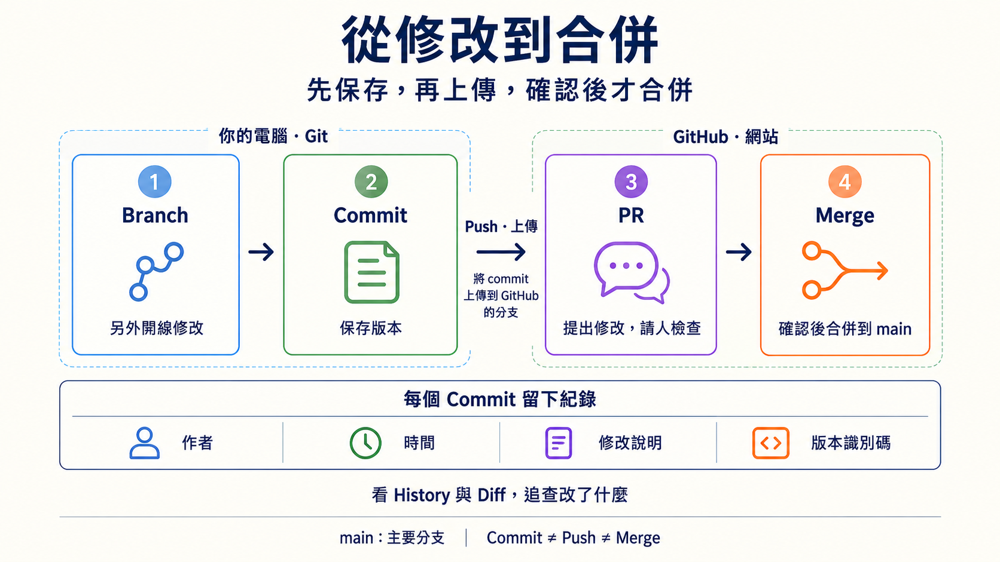
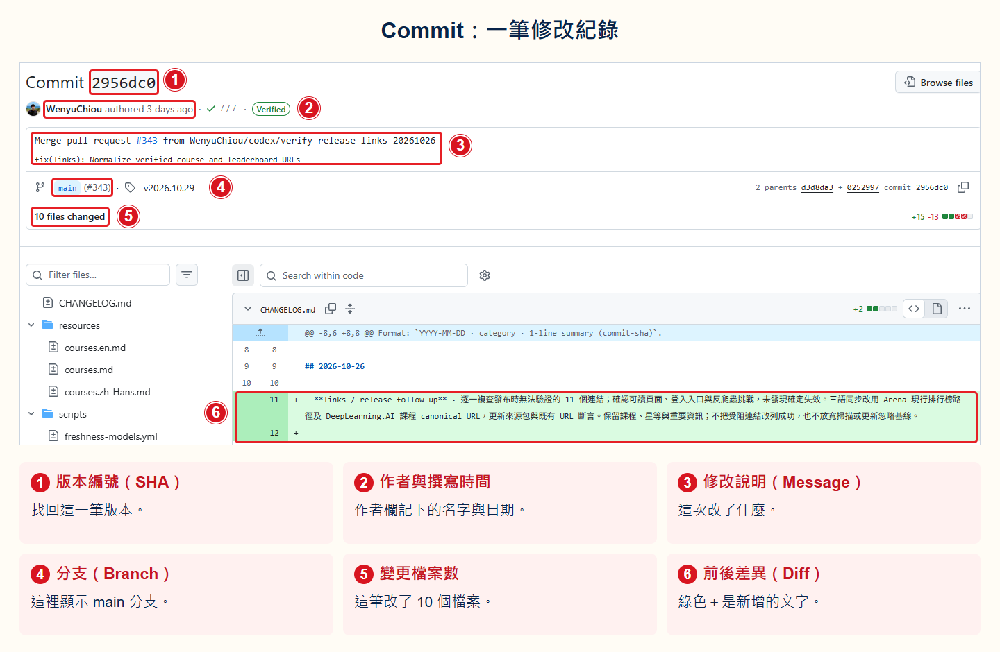
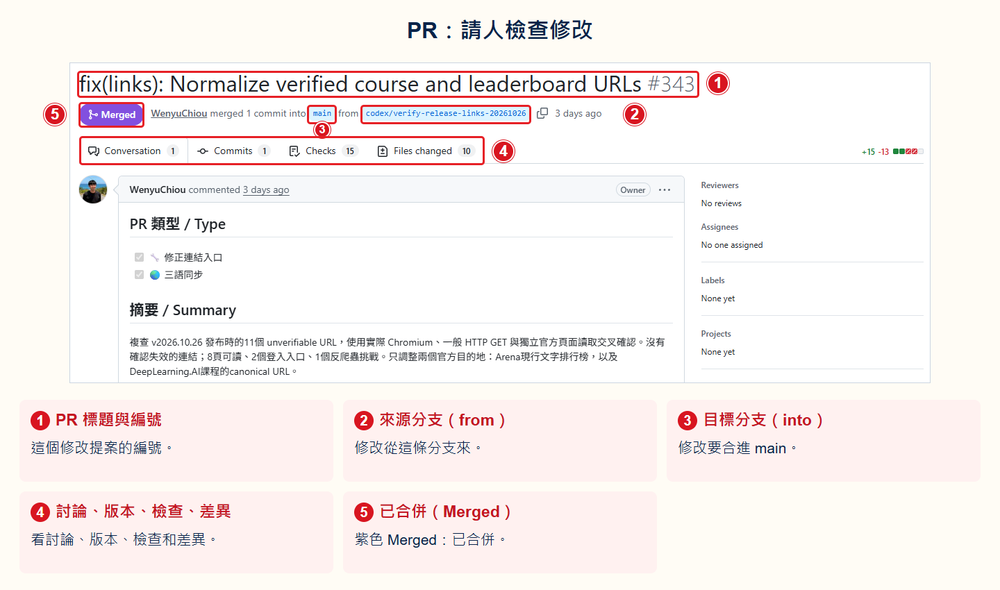
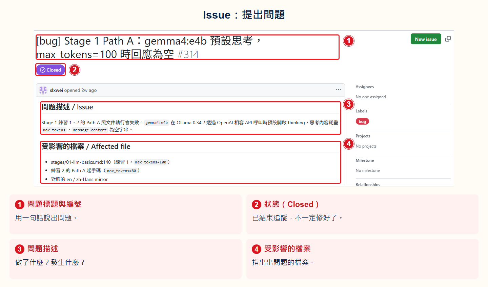

# Stage 0 — 基礎準備（Foundations）

> **繁體中文** | [简体中文](./00-foundations.zh-Hans.md) | [English](./00-foundations.en.md)

這一關先檢查：你會不會使用後面一定會用到的四種工具？會就直接跳過。不會也沒關係，照著下面的小練習做一次。

## 何時可以跳過這個階段

看看下面四件事。你不需要背指令，但要能自己查資料並完成：

- [ ] 用 **Python** 向 **API** (Application Programming Interface) 拿公開資料，再從 **JSON** (JavaScript Object Notation) 裡找出一個值。
- [ ] 用 **Git** 複製專案（clone）、開工作線（**branch**）、保存版本（**commit**），再把版本送到網路上（**push**）。兩次修改撞在一起時，知道要留下什麼（合併衝突）。
- [ ] 用 **CLI（命令列介面）** 切換資料夾、建立檔案並執行 Python 程式。
- [ ] 看懂 **YAML** 與 JSON。它們都是用文字保存資料的格式。

四項都做得到，就直接前往 [Stage 1 — LLM 基礎](01-llm-basics.md)。只要有一項不確定，就完成本頁的主練習；需要時再展開補充內容。

## 📌 學習目標

完成這一關後，你可以：

- 讓 Python 從 API 拿資料，再讀出 JSON 裡需要的部分。
- 從終端機執行程式，並找到程式建立的檔案。
- 認出專案儲存庫、查看版本歷史，並用 Git 保存一個版本。
- 認出 YAML、JSON 與 **API token**（讓程式登入的秘密文字），知道哪些內容不能公開。

## 🔑 核心名詞

先認識執行程式和交換資料的工具，再看專案網站如何保存及分享修改。

<div class="reader-core-terms" role="region" tabindex="0" aria-label="基礎核心名詞">
<table align="center">
  <thead><tr><th scope="col">分類</th><th scope="col">名詞</th><th scope="col">白話解釋</th><th scope="col">本章用途或界線</th></tr></thead>
  <tbody>
    <tr><th scope="rowgroup" rowspan="4" align="center" valign="middle">程式與執行</th><td><strong>Python</strong></td><td>程式語言；用它寫出指令，再執行程式。</td><td>主練習用 Python 取得資料。</td></tr>
    <tr><td><strong>Terminal（終端機）</strong></td><td>讓你輸入和查看文字指令的視窗。</td><td>在這裡執行主練習。</td></tr>
    <tr><td><strong>CLI（Command-Line Interface，命令列介面）</strong></td><td>用文字指令與程式互動的介面。</td><td>例如輸入 Python 指令。</td></tr>
    <tr><td><strong>Shell（指令解讀器）</strong></td><td>解讀並執行輸入的指令，例如 PowerShell 或 Bash。</td><td>它通常在終端機中運作。</td></tr>
  </tbody>
  <tbody>
    <tr><th scope="rowgroup" rowspan="4" align="center" valign="middle">資料與介面</th><td><strong>API（Application Programming Interface，應用程式介面）</strong></td><td>讓程式依規則與另一個程式或服務互動的介面。</td><td>不只用於網站。</td></tr>
    <tr><td><strong>JSON（JavaScript Object Notation）</strong></td><td>以文字表示結構化資料的格式。</td><td>主練習讀取 API 回傳的資料；不是程式腳本。</td></tr>
    <tr><td><strong>YAML（YAML Ain’t Markup Language）</strong></td><td>另一種文字資料格式，常用於設定。</td><td>縮排有意義；不是程式腳本。</td></tr>
    <tr><td><strong>API token</strong></td><td>讓程式證明身分的秘密憑證，像一把鑰匙。</td><td>不要公開或上傳；主練習不需要。</td></tr>
  </tbody>
  <tbody>
    <tr><th scope="rowgroup" rowspan="3" align="center" valign="middle">平台與專案</th><td><strong>GitHub</strong></td><td>分享程式碼、工具、教材與線上資源的平台，許多開源專案在這裡協作。</td><td>公開不代表一定是開源；要查看授權。</td></tr>
    <tr><td><strong>Git</strong></td><td>記錄檔案版本的工具，可以在自己的電腦上使用。</td><td>Git 與 GitHub 是不同的東西。</td></tr>
    <tr><td><strong>Repository（Repo）</strong></td><td>存放一個專案檔案及版本紀錄的地方，也叫儲存庫。</td><td>本頁專案就是一個 repository。</td></tr>
  </tbody>
  <tbody>
    <tr><th scope="rowgroup" rowspan="3" align="center" valign="middle">認識專案</th><td><strong>README</strong></td><td>專案的介紹文件，通常說明用途和如何開始。</td><td>先讀它，找到學習入口。</td></tr>
    <tr><td><strong>License</strong></td><td>授權文件，說明別人可以如何使用、修改或分享作品。</td><td>是否開源與使用條件要看實際授權。</td></tr>
    <tr><td><strong>Issue</strong></td><td>專案中用來討論問題、建議或待辦事項的頁面。</td><td>先觀察，不必發表。</td></tr>
  </tbody>
  <tbody>
    <tr><th scope="rowgroup" rowspan="5" align="center" valign="middle">修改與協作</th><td><strong>Branch</strong></td><td>一條獨立的修改工作線；<strong>main</strong> 常是大家共用的主要工作線。</td><td>可先在自己的工作線修改。</td></tr>
    <tr><td><strong>Commit</strong></td><td>像替專案拍一張有說明的快照，保存選定的修改與作者、時間、說明、識別碼（hash）。</td><td>編輯器的儲存不等於 commit；歷史可以分支。</td></tr>
    <tr><td><strong>Push</strong></td><td>把本機的版本紀錄送到 GitHub 上對應的工作線。</td><td>送出不會自動合併到 main。</td></tr>
    <tr><td><strong>Pull Request（PR）</strong></td><td>提出一組修改，讓其他人檢查並討論是否接受。</td><td>提出 PR 不代表修改已合併。</td></tr>
    <tr><td><strong>Merge</strong></td><td>把一條工作線的修改合併到另一條工作線。</td><td>檢查並同意後，才能將修改合進 main。</td></tr>
  </tbody>
</table>
</div>

**History（版本歷史）** 是專案保存的版本紀錄；它可以分支，不一定是一條依時間排列的直線。**Diff（差異）** 比較修改前後的內容。Commit 中的作者名稱、時間、說明與識別碼有助追查，但作者標籤本身不能證明身分。

例如：在 branch 修正一個錯字 → 在本機做 commit → push 到 GitHub 的 branch → 提出 PR 請人檢查 → 同意後 merge 進 main。每一步有不同用途；PR 不會因此自動合併。



想繼續查閱，可看 [GitHub 官方入門](https://docs.github.com/en/get-started/using-github/hello-world)、[授權說明](https://docs.github.com/en/repositories/managing-your-repositorys-settings-and-features/customizing-your-repository/licensing-a-repository)與 [Git 版本歷史](https://git-scm.com/book/en/v2/Git-Basics-Viewing-the-Commit-History)。

### 把改好的文件放上 GitHub

你想修改一份文件，怎麼讓別人看到？

1. <strong>Branch（分支）</strong>：開一條自己的修改工作線。
2. <strong>修改與存檔</strong>：改好文件，存檔並檢查。
3. <strong>git add／Staging Area（暫存區）</strong>：選出這次要記錄的修改。
4. <strong>Commit（版本紀錄）</strong>：在電腦留下一筆修改紀錄。
5. <strong>Push（上傳）</strong>：把版本送到 GitHub 的分支。
6. <strong>PR → Review → Merge</strong>：提出修改、檢查，確認後合進 `main`。
7. <strong>Pull（取得更新）</strong>：把 GitHub 的更新帶回電腦。

<details markdown="1">
<summary>想自己試一次？看指令</summary>

先在自己的[練習專案](https://docs.github.com/en/get-started/using-github/hello-world)操作，照[設定指南](https://docs.github.com/en/get-started/git-basics/set-up-git)裝好 Git 並連上 GitHub。

<strong>Clone（複製專案）</strong>：把檔案與版本歷史下載到電腦，見[官方步驟](https://docs.github.com/en/repositories/creating-and-managing-repositories/cloning-a-repository)。

<strong>origin</strong> 是這個例子中 GitHub 儲存庫的名稱。先在終端機進入專案資料夾，從 `main` 開始。

```bash
git switch -c docs/my-first-update
```

開好分支後，修改 `README.md` 並存檔，再依序執行：

```bash
git status
git diff
git add README.md
git commit -m "docs: clarify the introduction"
git push -u origin docs/my-first-update
```

到 GitHub 開 PR：來源選 `docs/my-first-update`，目標選 `main`。<strong>Review（審查）</strong>就是檢查修改。自己的練習專案可自行檢查；合作專案依它的批准規則。

PR 合併後，用 `git status` 確認沒有未提交的修改，再執行：

```bash
git switch main
git pull --ff-only
```

沒有別人專案的寫入權限？先 <strong>Fork</strong>，在自己帳號建立副本，見[官方教學](https://docs.github.com/en/get-started/exploring-projects-on-github/contributing-to-a-project)。

</details>

### 看一筆真實修改

看本專案的截圖，照紅框編號找位置。手機可開原圖放大。

**1. Commit：一筆修改紀錄。** [Commit 原頁](https://github.com/WenyuChiou/awesome-agentic-ai-zh/commit/2956dc0b4960f6fecf5d3ab00f8b89bacc886e18)



- <strong>① 版本編號（SHA）</strong>：找回這一筆版本。
- <strong>② 作者與撰寫時間</strong>：作者欄記下的名字與日期。
- <strong>③ 修改說明（Message）</strong>：這次改了什麼。
- <strong>④ 分支（Branch）</strong>：這裡顯示 main 分支。
- <strong>⑤ 變更檔案數</strong>：這筆改了 10 個檔案。
- <strong>⑥ 前後差異（Diff）</strong>：綠色＋是新增的文字。

**2. PR：請人檢查修改。** [PR #343 原頁](https://github.com/WenyuChiou/awesome-agentic-ai-zh/pull/343)



- <strong>① PR 標題與編號</strong>：這個修改提案的編號。
- <strong>② 來源分支（from）</strong>：修改從這條分支來。
- <strong>③ 目標分支（into）</strong>：修改要合進 main。
- <strong>④ 討論、版本、檢查、差異</strong>：看討論、版本、檢查和差異。
- <strong>⑤ 已合併（Merged）</strong>：紫色 Merged：已合併。

**3. Issue：提出問題。** [Issue #314 原頁](https://github.com/WenyuChiou/awesome-agentic-ai-zh/issues/314)



- <strong>① 問題標題與編號</strong>：用一句話說出問題。
- <strong>② 狀態（Closed）</strong>：已結束追蹤，不一定修好了。
- <strong>③ 問題描述</strong>：做了什麼？發生什麼？
- <strong>④ 受影響的檔案</strong>：指出出問題的檔案。

<details markdown="1">
<summary>再認識幾個小差別</summary>

- <strong>作者（Author）</strong>是修改的作者；<strong>提交者（Committer）</strong>是記錄版本的人，兩者可能不同。
- Commit 時間不是 Push 上傳時間。
- 紅框是教學標記；Diff 的紅色減號才表示刪除。
- Checks 看自動檢查；Conversation 看討論；Files changed 看差異。
- PR 編號與 Commit 的版本編號是不同的東西。

</details>

## 🛠 動手練習：做一個 GitHub 資料小工具

**成果：** 讓 Python 從 GitHub 拿公開資料，把結果顯示在畫面上、寫進檔案，再用 Git 保存。這個主練習不需要帳號、API token 或付費服務。

先花五分鐘用瀏覽器觀察：[打開本專案](https://github.com/WenyuChiou/awesome-agentic-ai-zh)，找出 README、License 和 Issues，再打開 commit 歷史，選一筆查看作者、時間、說明、識別碼與 diff。公開顯示的作者 email 是紀錄中的標籤，不是登入憑證，也不能單憑它驗證作者身分。不需要建立 Issue 或 PR。

### 1. 建立程式

建立一個新資料夾，並把下面內容存成 `github_profile.py`：

```python
import json
import sys
from pathlib import Path
from urllib.request import Request, urlopen

if hasattr(sys.stdout, "reconfigure"):
    sys.stdout.reconfigure(encoding="utf-8", errors="replace")

url = "https://api.github.com/users/torvalds"
request = Request(url, headers={"User-Agent": "stage-0-practice"})

with urlopen(request, timeout=10) as response:
    profile = json.load(response)

result = f"{profile['login']} 有 {profile['followers']} 位追蹤者"
print(result)
Path("result.txt").write_text(result + "\n", encoding="utf-8")
```

API 是程式拿資料的入口。JSON 是這次收到的資料格式。

### 2. 執行程式

在終端機進入該資料夾，執行：

```bash
python github_profile.py
```

畫面會顯示帳號與追蹤者數量，資料夾裡也會多出 `result.txt`。追蹤者數量會改變，不需要和別人的畫面一樣。

### 3. 用 Git 保存成果

```bash
git init
git add github_profile.py result.txt
git commit -m "Add GitHub profile checker"
```

如果 Git 第一次要求姓名或 email，依畫面提示設定後，再執行一次 `git commit`。這些資料是版本的作者標籤，不是密碼。

## ✅ 完成檢查

- [ ] 終端機顯示 GitHub 帳號與追蹤者數量。
- [ ] `result.txt` 有相同的結果。
- [ ] `git log --oneline` 看得到剛才的 commit，也能在專案的 History 找到一筆修改及其 Diff。
- [ ] 程式與 commit 裡沒有密碼或 API token。

四項都完成，就可以前往 [Stage 1 — LLM 基礎](01-llm-basics.md)。如果卡住，展開下面最接近問題的部分，不必一次讀完。

<details markdown="1">
<summary>⏱️ 展開時間、環境與這一關存在的原因</summary>

**時間**：完全不熟時預留 1–2 週，約 5–15 小時；已經會其中幾項，只補不熟的部分即可。

**環境**：準備仍受支援的 Python 3、Git、文字編輯器與終端機。終端機就是輸入文字指令的視窗。Windows 可使用 PowerShell；macOS 或 Linux 可使用系統終端機。

先確認工具可以執行：

```bash
python --version
git --version
```

後面的 AI agent 教材會直接使用 Python、Git、命令列與設定檔。Stage 0 不會教完所有內容。它只幫你找出還不熟的地方，再告訴你去哪裡補。

</details>

<details markdown="1">
<summary>🧰 展開 Python、Git、命令列與 YAML／JSON 補充練習</summary>

只做你還不熟的項目：

1. **Python**：把主練習網址中的 `torvalds` 換成自己的 GitHub 帳號或其他公開帳號，確認程式仍能讀出 `login` 與 `followers`。
2. **Git**：建立新 branch（不直接改原版本的工作線），修改輸出文字，再做一次 commit。接著把練習放到自己的遠端 Git 專案，並執行 `git push`。
3. **命令列**：建立 `src`、`tests`、`docs` 三個資料夾，從不同路徑執行主練習，並找出 `result.txt` 實際寫到哪裡。
4. **JSON**：把 API 回應存成檔案，找出 `name`、`public_repos` 與 `followers` 三個欄位。
5. **YAML**：建立一個含有 `username` 與 `output_file` 的小設定檔，練習縮排、字串與布林值。YAML 對空格很敏感，不要使用 Tab 縮排。

遇到錯誤時，先讀最後一行錯誤訊息，再確認目前資料夾、檔名與 Python 版本。一次只改一件事，才知道哪個修改有效。

</details>

<details markdown="1">
<summary>🔐 展開選修：安全地體驗 GitHub API 驗證</summary>

主練習不需要 token。Token 是一串讓 GitHub 認出你的秘密文字。只有想理解「登入後的 API」時才做這一題。

1. 依 [GitHub 官方說明](https://docs.github.com/en/authentication/keeping-your-account-and-data-secure/managing-your-personal-access-tokens) 建立 fine-grained personal access token。Fine-grained 表示你可以只開需要的權限。
2. 使用最短的有效期限，不加入額外權限。`GET /user` 對 fine-grained token 不要求任何權限。
3. 把 token 放進環境變數 `GITHUB_TOKEN`。環境變數是電腦暫時保管資料、讓程式讀取的位置。不要把 token 寫進 Python、Markdown、截圖、終端機歷史或 Git commit。
4. 呼叫 `https://api.github.com/user` 兩次。第一次不帶 token，應看到 `401`，意思是尚未登入。第二次帶 token，應看到 `200`，意思是 GitHub 接受了請求。
5. 練習結束後，回到 GitHub 設定頁撤銷 token，並清除環境變數。

Bash 可以這樣避免把輸入顯示在畫面上：

```bash
read -s GITHUB_TOKEN && export GITHUB_TOKEN
curl -sS -o /dev/null -w "No token: %{http_code}\n" \
  -H "Accept: application/vnd.github+json" \
  https://api.github.com/user
curl -sS -o /dev/null -w "With token: %{http_code}\n" \
  -H "Authorization: Bearer $GITHUB_TOKEN" \
  -H "Accept: application/vnd.github+json" \
  https://api.github.com/user
unset GITHUB_TOKEN
```

PowerShell 7.1 以上可以這樣做：

```powershell
$env:GITHUB_TOKEN = Read-Host -MaskInput "Paste token"
$withoutToken = Invoke-WebRequest -Uri https://api.github.com/user `
  -Headers @{ Accept = "application/vnd.github+json" } `
  -SkipHttpErrorCheck
$withToken = Invoke-WebRequest -Uri https://api.github.com/user -Headers @{
  Authorization = "Bearer $env:GITHUB_TOKEN"
  Accept = "application/vnd.github+json"
} -SkipHttpErrorCheck
"No token: $($withoutToken.StatusCode)"
"With token: $($withToken.StatusCode)"
Remove-Item Env:GITHUB_TOKEN
```

Token 就像程式使用的臨時鑰匙。拿到它的人可能以你的身分操作，所以權限越少、期限越短越安全。

</details>

<details markdown="1">
<summary>🗺️ 展開名詞與 Agent 全景補充</summary>

- **CLI（命令列介面）**：在終端機輸入文字指令來操作電腦。
- **API（應用程式介面）**：讓兩個程式用固定規則交換資料的入口。
- **JSON／YAML**：用文字保存結構化資料的兩種格式；JSON 常見於 API，YAML 常見於設定檔。
- **Git**：記錄檔案版本的工具；commit 是一次有說明的版本快照。

看到其他不懂的詞，先查 [術語表](../resources/glossary.md)。想知道 agent 為什麼可能出現在終端機、聊天軟體或裝置上，再看 [Agent 全景地圖](../resources/agent-paradigms.md)。這兩份都不是開始主練習前的必讀內容。

</details>

## 🎯 精選學習資源

需要補某一項能力時再找對應入口；不用把 18 個資源全部讀完。

<small>學習資源與 GitHub 驗證指引查核：2026-08-27 UTC</small>

`推薦度` 是學習優先順序，不是 GitHub 的熱門數字。依專案規則，⭐⭐⭐⭐⭐ 代表「不看會卡住」；下面都是補充資源，所以誠實使用 ⭐⭐⭐⭐（強烈建議）或 ⭐⭐⭐（紮實參考），不用假五星。

<table align="center">
  <thead><tr><th scope="col">主題</th><th scope="col">資源</th><th scope="col">適合誰</th><th scope="col">推薦度</th><th scope="col">為什麼推薦／備註</th></tr></thead>
  <tbody>
    <tr><th scope="rowgroup" rowspan="5" align="center" valign="middle">Python</th><td><a href="https://github.com/ehmatthes/pcc_3e">Python Crash Course</a></td><td>想跟著一本書從頭練習</td><td align="center" valign="middle">⭐⭐⭐⭐</td><td>程式碼免費；完整教材需購買書本。</td></tr>
    <tr><td><a href="https://realpython.com/">Real Python</a></td><td>學過一點，想查一個問題</td><td align="center" valign="middle">⭐⭐⭐⭐</td><td>文章按主題分開，遇到問題時容易查找。</td></tr>
    <tr><td><a href="https://www.youtube.com/c/Coreyms">Corey Schafer YouTube</a></td><td>喜歡看英文影片</td><td align="center" valign="middle">⭐⭐⭐</td><td>用影片從基礎語法帶到實際應用。</td></tr>
    <tr><td><a href="https://www.boot.dev/">Boot.dev</a></td><td>喜歡一邊操作一邊學</td><td align="center" valign="middle">⭐⭐⭐</td><td>部分內容免費；完整後端路線需付費。</td></tr>
    <tr><td><a href="https://docs.python.org/zh-tw/3/tutorial/">Python 官方繁體中文教學</a></td><td>做完第一次練習，想查正確語法</td><td align="center" valign="middle">⭐⭐⭐⭐</td><td>官方參考資料；它預期你已懂一點程式設計。</td></tr>
  </tbody>
  <tbody>
    <tr><th scope="rowgroup" rowspan="4" align="center" valign="middle">Git</th><td><a href="https://git-scm.com/book/en/v2">Pro Git book</a></td><td>想完整理解 Git</td><td align="center" valign="middle">⭐⭐⭐⭐</td><td>免費的官方完整參考書。</td></tr>
    <tr><td><a href="https://www.atlassian.com/git/tutorials">Atlassian Git Tutorials</a></td><td>想用圖看懂 branch、merge 與做事順序</td><td align="center" valign="middle">⭐⭐⭐⭐</td><td>用圖解說明常見工作流程。</td></tr>
    <tr><td><a href="https://git-scm.com/book/en/v2/Git-Basics-Undoing-Things">Pro Git — Undoing Things</a></td><td>Git 操作出錯，想安全復原</td><td align="center" valign="middle">⭐⭐⭐⭐</td><td>先說明哪些操作會丟失資料，再教你如何復原。</td></tr>
    <tr><td><a href="https://github.com/k88hudson/git-flight-rules">git-flight-rules</a></td><td>基本方法不夠，想查更多問題</td><td align="center" valign="middle">⭐⭐⭐</td><td>收錄較多 Git 問題與處理方式。</td></tr>
  </tbody>
  <tbody>
    <tr><th scope="rowgroup" rowspan="3" align="center" valign="middle">CLI／Shell</th><td><a href="https://github.com/jlevy/the-art-of-command-line">The Art of Command Line</a></td><td>想有順序地學命令列</td><td align="center" valign="middle">⭐⭐⭐⭐</td><td>從新手指令一路介紹到較進階的操作。</td></tr>
    <tr><td><a href="https://learn.microsoft.com/en-us/training/modules/introduction-to-powershell/">Microsoft Learn — PowerShell</a></td><td>使用 Windows，想從第一步開始</td><td align="center" valign="middle">⭐⭐⭐⭐</td><td>Microsoft 官方的 PowerShell 入門教材。</td></tr>
    <tr><td><a href="https://github.com/tldr-pages/tldr">tldr pages</a></td><td>只想先看一個指令怎麼用</td><td align="center" valign="middle">⭐⭐⭐⭐</td><td>用短小、可複製的例子解釋常用指令。</td></tr>
  </tbody>
  <tbody>
    <tr><th scope="rowgroup" rowspan="3" align="center" valign="middle">REST API</th><td><a href="https://developer.mozilla.org/en-US/docs/Web/HTTP">MDN — HTTP</a></td><td>想知道 API 背後怎麼傳資料</td><td align="center" valign="middle">⭐⭐⭐⭐</td><td>Mozilla 維護的 HTTP 參考資料。</td></tr>
    <tr><td><a href="https://learning.postman.com/">Postman Learning Center</a></td><td>想用圖形介面試 API</td><td align="center" valign="middle">⭐⭐⭐⭐</td><td>不必先寫程式，也能看到送出與收到的資料。</td></tr>
    <tr><td><a href="https://github.com/httpie/cli">HTTPie</a></td><td>想從命令列呼叫 API</td><td align="center" valign="middle">⭐⭐⭐</td><td>指令通常比原始 curl 寫法容易閱讀。</td></tr>
  </tbody>
  <tbody>
    <tr><th scope="rowgroup" rowspan="3" align="center" valign="middle">YAML／JSON</th><td><a href="https://yaml.org/">YAML 官網</a></td><td>需要查 YAML 的正確寫法</td><td align="center" valign="middle">⭐⭐⭐</td><td>語法與正式規格的官方入口。</td></tr>
    <tr><td><a href="https://www.json.org/json-en.html">JSON 介紹</a></td><td>第一次接觸 JSON</td><td align="center" valign="middle">⭐⭐⭐⭐</td><td>用短例子說明 JSON 怎麼裝資料。</td></tr>
    <tr><td><a href="https://github.com/jqlang/jq">jq</a></td><td>想從命令列整理 JSON</td><td align="center" valign="middle">⭐⭐⭐⭐</td><td>可以篩選與整理 API 傳回的資料。</td></tr>
  </tbody>
</table>

---

> ✅ **走完 Stage 0 了？** 接著前往 [**Stage 1 — LLM 基礎**](01-llm-basics.md)，完成第一次 LLM API 呼叫，並學會 token、context window 與成本估算。
