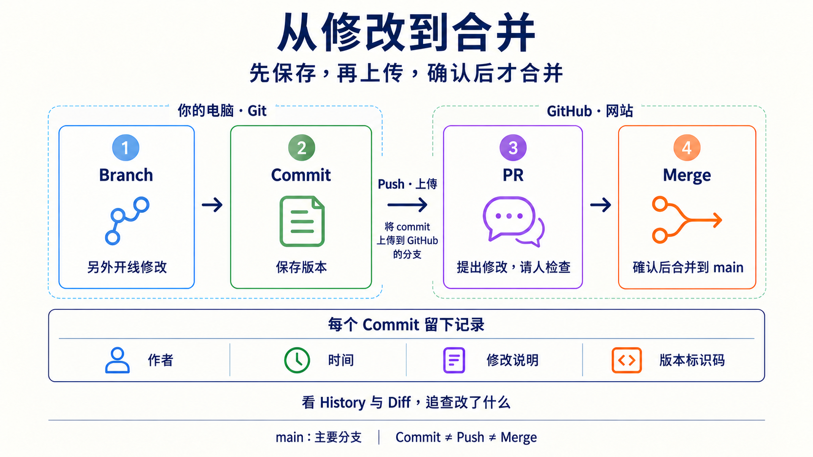
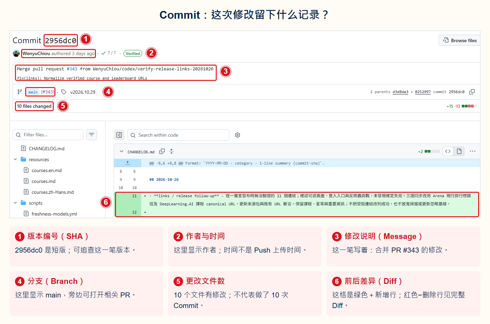
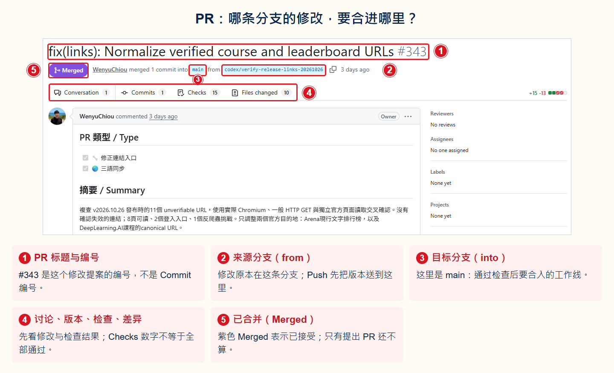
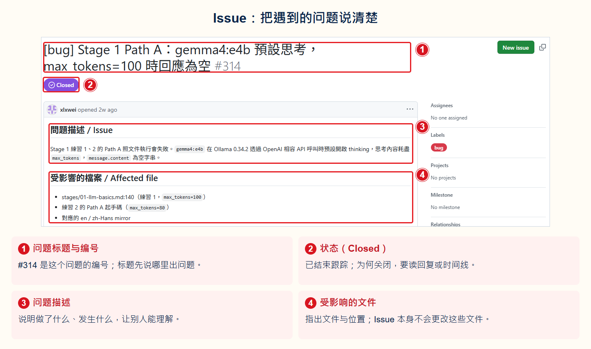

# Stage 0 — 基础准备（Foundations）

> [繁體中文](./00-foundations.md) | [English](./00-foundations.en.md) | **简体中文**

这一关先检查你是否会用后面一定会用到的四种工具。会的话就直接跳过。不会也没关系。照着下面的小练习做一次即可。

## 何时可以跳过这个阶段

看看下面四件事。你不需要背指令。但你要能自己查资料并完成：

- [ ] 用 **Python** 向 **API** (Application Programming Interface) 拿公开资料，再从 **JSON** (JavaScript Object Notation) 里找出一个值。
- [ ] 用 **Git** 复制专案（clone）、开工作线（**branch**）、保存版本（**commit**），再把版本送到网络上（**push**）。两次修改撞在一起时，知道要留下什么（合并冲突）。
- [ ] 用 **CLI（命令行界面）** 切换资料夹、建立文件并执行 Python 程序。
- [ ] 看懂 **YAML** 与 JSON。它们都是用文字保存资料的格式。

四项都能做到，就直接前往 [Stage 1 — LLM 基础](01-llm-basics.zh-Hans.md)。只要有一项不确定，就完成本页的主要练习。需要时再展开补充内容。

## 📌 学习目标

完成这一关后，你可以：

- 让 Python 从 API 获取数据，再读出 JSON 里需要的部分。
- 从终端运行程序，并找到程序创建的文件。
- 认出项目仓库、查看版本历史，并用 Git 保存一个版本。
- 认出 YAML、JSON 和 **API token**（让程序登录的秘密文字），知道哪些内容不能公开。

## 🔑 核心名词

先认识执行程序和交换资料的工具，再看项目网站如何保存及分享修改。

<div class="reader-core-terms" role="region" tabindex="0" aria-label="基础核心名词">
<table align="center">
  <thead><tr><th scope="col">分类</th><th scope="col">名词</th><th scope="col">白话解释</th><th scope="col">本章用途或界线</th></tr></thead>
  <tbody>
    <tr><th scope="rowgroup" rowspan="4" align="center" valign="middle">程序与执行</th><td><strong>Python</strong></td><td>程序语言；用它写出指令，再执行程序。</td><td>主练习用 Python 取得资料。</td></tr>
    <tr><td><strong>Terminal（终端）</strong></td><td>让你输入和查看文字指令的视窗。</td><td>在这里执行主练习。</td></tr>
    <tr><td><strong>CLI（Command-Line Interface，命令行界面）</strong></td><td>用文字指令与程序互动的介面。</td><td>例如输入 Python 指令。</td></tr>
    <tr><td><strong>Shell（命令解释器）</strong></td><td>解读并执行输入的指令，例如 PowerShell 或 Bash。</td><td>它通常在终端中运作。</td></tr>
  </tbody>
  <tbody>
    <tr><th scope="rowgroup" rowspan="4" align="center" valign="middle">资料与介面</th><td><strong>API（Application Programming Interface，应用程序接口）</strong></td><td>让程序依规则与另一个程序或服务互动的介面。</td><td>不只用于网站。</td></tr>
    <tr><td><strong>JSON（JavaScript Object Notation）</strong></td><td>以文字表示结构化资料的格式。</td><td>主练习读取 API 回传的资料；不是程序脚本。</td></tr>
    <tr><td><strong>YAML（YAML Ain’t Markup Language）</strong></td><td>另一种文字资料格式，常用于设定。</td><td>缩排有意义；不是程序脚本。</td></tr>
    <tr><td><strong>API token</strong></td><td>让程序证明身份的秘密凭证，像一把钥匙。</td><td>不要公开或上传；主练习不需要。</td></tr>
  </tbody>
  <tbody>
    <tr><th scope="rowgroup" rowspan="3" align="center" valign="middle">平台与项目</th><td><strong>GitHub</strong></td><td>分享程序码、工具、教材与线上资源的平台，许多开源项目在这里协作。</td><td>公开不代表一定是开源；要查看授权。</td></tr>
    <tr><td><strong>Git</strong></td><td>记录文件版本的工具，可以在自己的电脑上使用。</td><td>Git 与 GitHub 是不同的东西。</td></tr>
    <tr><td><strong>Repository（Repo）</strong></td><td>存放一个项目文件及版本记录的地方，也叫仓库。</td><td>本页项目就是一个 repository。</td></tr>
  </tbody>
  <tbody>
    <tr><th scope="rowgroup" rowspan="3" align="center" valign="middle">认识项目</th><td><strong>README</strong></td><td>项目的介绍文件，通常说明用途和如何开始。</td><td>先读它，找到学习入口。</td></tr>
    <tr><td><strong>License</strong></td><td>授权文件，说明别人可以如何使用、修改或分享作品。</td><td>是否开源与使用条件要看实际授权。</td></tr>
    <tr><td><strong>Issue</strong></td><td>项目中用来讨论问题、建议或待办事项的页面。</td><td>先观察，不必发表。</td></tr>
  </tbody>
  <tbody>
    <tr><th scope="rowgroup" rowspan="5" align="center" valign="middle">修改与协作</th><td><strong>Branch</strong></td><td>一条独立的修改工作线；<strong>main</strong> 常是大家共用的主要工作线。</td><td>可先在自己的工作线修改。</td></tr>
    <tr><td><strong>Commit</strong></td><td>像替项目拍一张有说明的快照，保存选定的修改与作者、时间、说明、识别码（hash）。</td><td>编辑器的储存不等于 commit；历史可以分支。</td></tr>
    <tr><td><strong>Push</strong></td><td>把本机的版本记录送到 GitHub 上对应的工作线。</td><td>送出不会自动合并到 main。</td></tr>
    <tr><td><strong>Pull Request（PR）</strong></td><td>提出一组修改，让其他人检查并讨论是否接受。</td><td>提出 PR 不代表修改已合并。</td></tr>
    <tr><td><strong>Merge</strong></td><td>把一条工作线的修改合并到另一条工作线。</td><td>检查并同意后，才能将修改合进 main。</td></tr>
  </tbody>
</table>
</div>

**History（版本历史）** 是项目保存的版本记录；它可以分支，不一定是一条依时间排列的直线。**Diff（差异）** 比较修改前后的内容。Commit 中的作者名称、时间、说明与识别码有助追查，但作者标签本身不能证明身份。

例如：在 branch 修正一个错字 → 在本机做 commit → push 到 GitHub 的 branch → 提出 PR 请人检查 → 同意后 merge 进 main。每一步有不同用途；PR 不会因此自动合并。



想继续查阅，可看 [GitHub 官方入门](https://docs.github.com/en/get-started/using-github/hello-world)、[授权说明](https://docs.github.com/en/repositories/managing-your-repositorys-settings-and-features/customizing-your-repository/licensing-a-repository)与 [Git 版本历史](https://git-scm.com/book/en/v2/Git-Basics-Viewing-the-Commit-History)。

### 把改好的文件放上 GitHub

假设你要修改自己的 `README.md`。先在自己的练习仓库操作；[GitHub 官方入门](https://docs.github.com/en/get-started/using-github/hello-world)会带你创建仓库。**Clone（克隆项目）**会把项目文件与版本历史下载到电脑。以下从已克隆到电脑、当前位于 `main` 的练习仓库开始；先按 [GitHub 官方 Git 设置](https://docs.github.com/en/get-started/git-basics/set-up-git)安装 Git 并完成验证，再按[克隆项目教程](https://docs.github.com/en/repositories/creating-and-managing-repositories/cloning-a-repository)获取练习仓库。在终端切到该项目文件夹后再输入命令。

1. **开自己的工作线。** 输入 `git switch -c docs/my-first-update`，创建并切换到新分支。**Branch（分支）**像从同一份版本开始的一条修改线，不是另外复制一份文件夹；`docs/my-first-update` 是你取的分支名称。
2. **修改、保存、检查。** 改好 `README.md`，保存文件并完成项目要求的检查。用 `git status` 看哪些文件有变化，再用 `git diff` 看具体差异。此时还没有新的 Commit。
3. **选出这次要记录的文件。** 输入 `git add README.md`。**暂存区（Staging Area）**是“下一笔 Commit 要放哪些修改”的清单。这个命令选入当前的修改；如果之后又改了文件，要重新选入。
4. **在电脑留下记录。** 输入 `git commit -m "docs: clarify the introduction"`。这会把暂存区中的修改存成一笔 **Commit**；引号内是修改说明。它仍在你的电脑，尚未上传。
5. **上传这条分支。** 输入 `git push -u origin docs/my-first-update`。**origin** 是这个例子中 GitHub 远程仓库的名称；`-u` 记住本地分支与远程分支的对应。**Push** 把版本送到该分支，还没有合进 `main`。
6. **提出 PR，等人检查。** 到 GitHub 开 Pull Request，来源选 `docs/my-first-update`，目标选 `main`。**Review（审查）**就是看差异、提问并检查结果；按项目规则完成检查与批准后，再由有权限的人 **Merge**。自己的练习仓库可以自行检查并合并；合作项目先读贡献说明。
7. **把合并结果带回电脑。** 确认 PR 已合并，并用 `git status` 确认工作区干净，再依次输入 `git switch main` 和 `git pull --ff-only`。**Pull（获取远程更新）**让本地 `main` 跟上 GitHub；如果失败，先读错误，别强行覆盖。

要修改别人的项目，却没有写入权限时，通常先 **Fork（创建自己账号下的项目副本）**，再从自己的副本提出 PR，见 [Fork 官方教程](https://docs.github.com/en/get-started/exploring-projects-on-github/contributing-to-a-project)。**Issue** 是问题与建议的讨论页，不是每次修改的必经步骤。

### 看一笔真实修改

下面用本项目的历史记录导读。每个红框都有编号，对照图下说明；手机上可打开原图放大。三语标注各有自己的版本，GitHub 的原始界面文字保持原样。

**1. Commit：看这一笔记录了什么。** [打开 Commit `2956dc0`](https://github.com/WenyuChiou/awesome-agentic-ai-zh/commit/2956dc0b4960f6fecf5d3ab00f8b89bacc886e18)。这是合并 PR #343 留下的记录；普通 Commit 也能记录尚未合并的修改。



- **① 版本编号（SHA）**：`2956dc0` 是短版标识码；原始页面可看完整编号。
- **② 作者与时间**：画面显示作者；Git 也记录提交者（Committer），两者可能不同。Commit 时间不是 Push 时间，作者名称本身也不能证明身份。
- **③ 修改说明**：这一笔写着合并 PR #343；点击链接可追到提案。
- **④ 分支**：这里显示 `main`；分支是工作线，Commit 是其中一笔版本记录。
- **⑤ 文件数量**：这笔更改涉及 10 个文件，不是 10 次 Commit。
- **⑥ Diff（差异）**：本例共新增 15 行、删除 13 行；⑥ 圈的是绿色加号的新增行。打开完整 Diff 可找红色减号的删除行；红色方框只是教学标记。

**2. PR 与 Merge：看修改从哪里合到哪里。** [打开 PR #343](https://github.com/WenyuChiou/awesome-agentic-ai-zh/pull/343)。



- **① PR 编号**：`#343` 代表这个修改提案，与 Commit 的版本编号不同。
- **② 来源（from）与 ③ 目标（into）**：这次把 `codex/verify-release-links-20261026` 的修改合进 `main`。
- **④ 检查入口**：Conversation 看讨论，Commits 看版本记录，Checks 看自动检查结果，Files changed 看差异。Checks 的数量不代表全部通过。
- **⑤ Merged（已合并）**：紫色状态表示已合并；只有 Push 或开 PR 还没到这一步。Review 是人的检查，Checks 通常是自动检查。

**3. Issue：先把问题说清楚。** [打开 Issue #314](https://github.com/WenyuChiou/awesome-agentic-ai-zh/issues/314)。这是一笔过去的错误报告，这里只看它如何描述问题。



- **① 标题与编号**：先说哪里出问题，别人就能用 `#314` 找回这次讨论。
- **② Closed（已关闭）**：表示结束跟踪；要读回复或时间线才知道原因，不一定代表已修好。
- **③ 描述与 ④ 文件位置**：写出做了什么、发生什么、预期结果及相关文件，帮助别人理解或复现。往下可看回复与处理记录；Issue 本身不会修改文件。

## 🛠 动手练习：做一个 GitHub 数据小工具

**成果：** 让 Python 从 GitHub 获取公开数据，把结果显示在屏幕上、写入文件，再用 Git 保存。这项主要练习不需要账号、API token 或付费服务。

先花五分钟用浏览器观察：[打开本项目](https://github.com/WenyuChiou/awesome-agentic-ai-zh)，找出 README、License 和 Issues，再打开 commit 历史，选一笔查看作者、时间、说明、识别码与 diff。公开显示的作者 email 是记录中的标签，不是登入凭证，也不能单凭它验证作者身份。不需要建立 Issue 或 PR。

### 1. 创建程序

创建一个新文件夹。把下面内容保存为 `github_profile.py`：

```python
import json
import sys
from pathlib import Path
from urllib.request import Request, urlopen

if hasattr(sys.stdout, "reconfigure"):
    sys.stdout.reconfigure(encoding="utf-8", errors="replace")

url = "https://api.github.com/users/torvalds"
request = Request(url, headers={"User-Agent": "stage-0-practice"})

with urlopen(request, timeout=10) as response:
    profile = json.load(response)

result = f"{profile['login']} 有 {profile['followers']} 位关注者"
print(result)
Path("result.txt").write_text(result + "\n", encoding="utf-8")
```

API 是程序获取数据的入口。JSON 是这次收到的数据格式。

### 2. 运行程序

在终端进入该文件夹，然后运行：

```bash
python github_profile.py
```

屏幕会显示账号和关注者数量。文件夹里也会多出 `result.txt`。关注者数量会变化。不需要和别人的屏幕一样。

### 3. 用 Git 保存成果

```bash
git init
git add github_profile.py result.txt
git commit -m "Add GitHub profile checker"
```

如果 Git 第一次要求姓名或 email，按屏幕提示设置后，再运行一次 `git commit`。这些信息是版本的作者标签，不是密码。

## ✅ 完成检查

- [ ] 终端显示 GitHub 账号和关注者数量。
- [ ] `result.txt` 中有相同结果。
- [ ] `git log --oneline` 能看到刚才的 commit，也能在项目的 History 找到一笔修改及其 Diff。
- [ ] 程序和 commit 中没有密码或 API token。

四项都完成后，就可以前往 [Stage 1 — LLM 基础](01-llm-basics.zh-Hans.md)。如果卡住，展开下面最接近问题的部分。不必一次读完。

<details markdown="1">
<summary>⏱️ 展开时间、环境与这一关存在的原因</summary>

**时间：** 完全不熟时预留 1–2 周，约 5–15 小时。已经会其中几项的话，只补不熟的部分。

**环境：** 准备仍受支持的 Python 3、Git、文本编辑器和终端。终端就是输入文字指令的窗口。Windows 可以使用 PowerShell。macOS 或 Linux 可以使用系统终端。

先确认工具可以运行：

```bash
python --version
git --version
```

后面的 AI agent 教材会直接使用 Python、Git、命令行和配置文件。Stage 0 不会教完所有内容。它只帮助你找出不熟的地方，再告诉你去哪里补充。

</details>

<details markdown="1">
<summary>🧰 展开 Python、Git、命令行与 YAML／JSON 补充练习</summary>

只做你还不熟的项目：

1. **Python：** 把主要练习 URL 里的 `torvalds` 换成自己的 GitHub 账号或其他公开账号。确认程序仍能读出 `login` 和 `followers`。
2. **Git：** 创建一个新 branch（不直接修改原版本的工作线），修改输出文字，再做一次 commit。接着把练习放到自己的远程 Git 项目，并运行 `git push`。
3. **命令行：** 创建 `src`、`tests`、`docs` 三个文件夹。从不同路径运行主要练习，并找出 `result.txt` 实际写到哪里。
4. **JSON：** 把 API 响应保存成文件，找出 `name`、`public_repos` 和 `followers` 三个字段。
5. **YAML：** 创建一个含有 `username` 和 `output_file` 的小配置文件，练习缩进、字符串和布尔值。YAML 对空格很敏感。不要使用 Tab 缩进。

遇到错误时，先读最后一行错误信息。再确认当前文件夹、文件名和 Python 版本。一次只改一件事。这样才能知道哪个修改有效。

</details>

<details markdown="1">
<summary>🔐 展开选修：安全地体验 GitHub API 验证</summary>

主要练习不需要 token。Token 是一串让 GitHub 认出你的秘密文字。只有想理解“登录后的 API”时才做这一题。

1. 按 [GitHub 官方说明](https://docs.github.com/en/authentication/keeping-your-account-and-data-secure/managing-your-personal-access-tokens) 创建 fine-grained personal access token。Fine-grained 表示你可以只开放需要的权限。
2. 使用最短的有效期限，不加入额外权限。`GET /user` 对 fine-grained token 不要求任何权限。
3. 把 token 放进环境变量 `GITHUB_TOKEN`。环境变量是电脑暂时保存数据、让程序读取的位置。不要把 token 写进 Python、Markdown、截图、终端历史或 Git commit。
4. 调用 `https://api.github.com/user` 两次。第一次不带 token，应返回 `401`，意思是尚未登录。第二次带 token，应返回 `200`，意思是 GitHub 接受了请求。
5. 练习结束后，回到 GitHub 设置页撤销 token，并清除环境变量。

Bash 可以这样避免把输入显示在屏幕上：

```bash
read -s GITHUB_TOKEN && export GITHUB_TOKEN
curl -sS -o /dev/null -w "无 token: %{http_code}\n" \
  -H "Accept: application/vnd.github+json" \
  https://api.github.com/user
curl -sS -o /dev/null -w "有 token: %{http_code}\n" \
  -H "Authorization: Bearer $GITHUB_TOKEN" \
  -H "Accept: application/vnd.github+json" \
  https://api.github.com/user
unset GITHUB_TOKEN
```

PowerShell 7.1 以上可以这样做：

```powershell
$env:GITHUB_TOKEN = Read-Host -MaskInput "Paste token"
$withoutToken = Invoke-WebRequest -Uri https://api.github.com/user `
  -Headers @{ Accept = "application/vnd.github+json" } `
  -SkipHttpErrorCheck
$withToken = Invoke-WebRequest -Uri https://api.github.com/user -Headers @{
  Authorization = "Bearer $env:GITHUB_TOKEN"
  Accept = "application/vnd.github+json"
} -SkipHttpErrorCheck
"无 token: $($withoutToken.StatusCode)"
"有 token: $($withToken.StatusCode)"
Remove-Item Env:GITHUB_TOKEN
```

Token 就像程序使用的临时钥匙。拿到它的人可能以你的身份操作。所以权限越少、期限越短越安全。

</details>

<details markdown="1">
<summary>🗺️ 展开名词与 Agent 全景补充</summary>

- **CLI（命令行接口）：** 在终端输入文字指令来操作电脑。
- **API（应用程序接口）：** 让两个程序按固定规则交换数据的入口。
- **JSON／YAML：** 用文本保存结构化数据的两种格式。JSON 常见于 API。YAML 常见于配置文件。
- **Git：** 记录文件版本的工具。commit 是一次带说明的版本快照。

看到其他不懂的词，先查[术语表](../resources/glossary.zh-Hans.md)。想知道 agent 为什么可能出现在终端、聊天软件或设备上，再看[Agent 全景地图](../resources/agent-paradigms.zh-Hans.md)。这两份都不是开始主要练习前的必读内容。

</details>

## 🎯 精选学习资源

需要补哪一项能力时，再找对应入口。不用把 18 个资源全部读完。

<small>学习资源与 GitHub 验证指引核查：2026-08-27 UTC</small>

`推荐度` 是学习优先顺序，不是 GitHub 的热门数字。按照项目规则，⭐⭐⭐⭐⭐ 代表“没有它就会卡住”；下面都是补充资源，所以诚实使用 ⭐⭐⭐⭐（强烈推荐）或 ⭐⭐⭐（扎实参考），不用假五星。

<table align="center">
  <thead><tr><th scope="col">主题</th><th scope="col">资源</th><th scope="col">适合谁</th><th scope="col">推荐度</th><th scope="col">为什么推荐／备注</th></tr></thead>
  <tbody>
    <tr><th scope="rowgroup" rowspan="5" align="center" valign="middle">Python</th><td><a href="https://github.com/ehmatthes/pcc_3e">Python Crash Course</a></td><td>想跟着一本书从头练习</td><td align="center" valign="middle">⭐⭐⭐⭐</td><td>代码免费并配有练习；完整教材需要购买书籍。</td></tr>
    <tr><td><a href="https://realpython.com/">Real Python</a></td><td>学过一点，想查一个问题</td><td align="center" valign="middle">⭐⭐⭐⭐</td><td>文章按主题分开，遇到问题时容易查找。</td></tr>
    <tr><td><a href="https://www.youtube.com/c/Coreyms">Corey Schafer YouTube</a></td><td>喜欢看英文视频</td><td align="center" valign="middle">⭐⭐⭐</td><td>用视频从基础语法讲到实际应用。</td></tr>
    <tr><td><a href="https://www.boot.dev/">Boot.dev</a></td><td>喜欢一边操作一边学</td><td align="center" valign="middle">⭐⭐⭐</td><td>部分内容免费；完整后端路线需要付费。</td></tr>
    <tr><td><a href="https://docs.python.org/zh-tw/3/tutorial/">Python 官方繁体中文教程</a></td><td>做完第一次练习，想查正确语法</td><td align="center" valign="middle">⭐⭐⭐⭐</td><td>官方参考资料；它预期你已经懂一点编程。</td></tr>
  </tbody>
  <tbody>
    <tr><th scope="rowgroup" rowspan="4" align="center" valign="middle">Git</th><td><a href="https://git-scm.com/book/en/v2">Pro Git book</a></td><td>想完整理解 Git</td><td align="center" valign="middle">⭐⭐⭐⭐</td><td>免费的完整参考书。</td></tr>
    <tr><td><a href="https://www.atlassian.com/git/tutorials">Atlassian Git Tutorials</a></td><td>想用图看懂 branch、merge 和操作顺序</td><td align="center" valign="middle">⭐⭐⭐⭐</td><td>用图解说明常见工作流程。</td></tr>
    <tr><td><a href="https://git-scm.com/book/en/v2/Git-Basics-Undoing-Things">Pro Git — Undoing Things</a></td><td>Git 操作出错，想安全恢复</td><td align="center" valign="middle">⭐⭐⭐⭐</td><td>先说明哪些操作可能丢失资料，再教你如何恢复。</td></tr>
    <tr><td><a href="https://github.com/k88hudson/git-flight-rules">git-flight-rules</a></td><td>基本方法不够，想查更多问题</td><td align="center" valign="middle">⭐⭐⭐</td><td>收录更多 Git 问题与处理方式。</td></tr>
  </tbody>
  <tbody>
    <tr><th scope="rowgroup" rowspan="3" align="center" valign="middle">CLI／Shell</th><td><a href="https://github.com/jlevy/the-art-of-command-line">The Art of Command Line</a></td><td>想有顺序地学命令行</td><td align="center" valign="middle">⭐⭐⭐⭐</td><td>从新手指令一路介绍到较进阶的操作。</td></tr>
    <tr><td><a href="https://learn.microsoft.com/en-us/training/modules/introduction-to-powershell/">Microsoft Learn — PowerShell</a></td><td>使用 Windows，想从第一步开始</td><td align="center" valign="middle">⭐⭐⭐⭐</td><td>Microsoft 官方的 PowerShell 入门教材。</td></tr>
    <tr><td><a href="https://github.com/tldr-pages/tldr">tldr pages</a></td><td>只想先看一个指令怎么用</td><td align="center" valign="middle">⭐⭐⭐⭐</td><td>用短小、可复制的例子解释常用指令。</td></tr>
  </tbody>
  <tbody>
    <tr><th scope="rowgroup" rowspan="3" align="center" valign="middle">REST API</th><td><a href="https://developer.mozilla.org/en-US/docs/Web/HTTP">MDN — HTTP</a></td><td>想知道 API 背后怎么传资料</td><td align="center" valign="middle">⭐⭐⭐⭐</td><td>Mozilla 维护的 HTTP 参考资料。</td></tr>
    <tr><td><a href="https://learning.postman.com/">Postman Learning Center</a></td><td>想用图形界面试 API</td><td align="center" valign="middle">⭐⭐⭐⭐</td><td>不用先写程序，也能看到发送的内容和收到的资料。</td></tr>
    <tr><td><a href="https://github.com/httpie/cli">HTTPie</a></td><td>想从命令行调用 API</td><td align="center" valign="middle">⭐⭐⭐</td><td>指令通常比原始 curl 写法更容易阅读。</td></tr>
  </tbody>
  <tbody>
    <tr><th scope="rowgroup" rowspan="3" align="center" valign="middle">YAML／JSON</th><td><a href="https://yaml.org/">YAML 官网</a></td><td>需要查 YAML 的正确写法</td><td align="center" valign="middle">⭐⭐⭐</td><td>语法和正式规范的官方入口。</td></tr>
    <tr><td><a href="https://www.json.org/json-en.html">JSON 介绍</a></td><td>第一次接触 JSON</td><td align="center" valign="middle">⭐⭐⭐⭐</td><td>用短例子说明 JSON 怎么装资料。</td></tr>
    <tr><td><a href="https://github.com/jqlang/jq">jq</a></td><td>想从命令行整理 JSON</td><td align="center" valign="middle">⭐⭐⭐⭐</td><td>可以筛选和整理 API 返回的资料。</td></tr>
  </tbody>
</table>

---

> ✅ **完成 Stage 0 了吗？** 接着前往 [**Stage 1 — LLM 基础**](01-llm-basics.zh-Hans.md)，完成第一次 LLM API 调用，并学习 token、context window 与成本估算。
