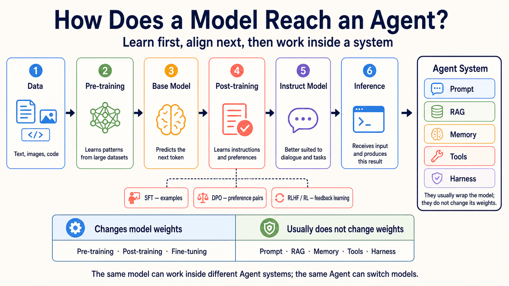

# Stage 1 — LLM Basics

**LLM** (Large Language Model): a model that reads and writes language.

> [繁體中文](./01-llm-basics.md) | **English** | [简体中文](./01-llm-basics.zh-Hans.md)

> Purpose: first see how a model moves from data to an Agent, then use a repeatable local-to-cloud path to call an LLM through an API (application programming interface). You will understand **Token**, **Context Window**, and **Temperature**, and explain model choices using cost and latency.

<!-- freshness: canonical=stages/01-llm-basics.md; verified_on=2026-09-22; scope=models,pricing,availability,deprecations,model-lifecycle; max_age_days=90 -->

## 📌 Learning Goals

By the end of this stage, you can:

- Make your first API call with a local Ollama model, then compare it with Anthropic.
- Explain the order from Pre-training and Post-training to Inference.
- Explain token, context window, and temperature with simple examples.
- Read input and output token counts from a response's `usage` field.
- Explain a model choice using input/output price, latency, and data sensitivity.

## Three Core Terms

### 1. **Token**

A Token is a unit a model reads and writes; APIs often charge by token. Think of a sentence cut into small blocks: a word may be one block or several, and one Chinese character is not always one block. In Exercise 2, read actual input/output token counts to estimate cost. Character counts are not exact because tokenizers differ.

### 2. **Context Window**

A Context Window is the token space for one request. Think of a desk: your prompt and chat history take space, and the model needs room for its answer. The maximum-output limit may be smaller, so check both numbers. Use them to decide when to trim, summarize, or split a long document.

### 3. **Temperature**

Temperature controls how much sampling varies. Imagine choosing the next block from several candidates: a low value favors the most likely candidate, which suits classification and fixed formats; a high value tries less likely candidates more often, which can help brainstorming but may be less stable. This stage treats it as a knob for output stability; it does not add knowledge or guarantee exact reproducibility.

## How a Model Moves from Data to an Agent

Keep this main path in mind:

`Data → Pre-training → Base Model → Post-training → Instruct Model → Inference → Agent system`

- **Pre-training**: the model learns patterns from large amounts of text, images, or code. This changes the model weights.
- **Post-training**: demonstrations, preferences, or feedback teach the model to follow instructions and act more safely. This also changes weights. Common methods include:
  - **SFT** (Supervised Fine-Tuning): teach the model to imitate good inputs and answers.
  - **DPO** (Direct Preference Optimization): teach preferences using pairs of better and worse answers.
  - **RLHF** (Reinforcement Learning from Human Feedback): use human feedback in reinforcement learning.
  - **RL** (Reinforcement Learning): learn from rewards, which can also come from rules.
- **Fine-tuning**: smaller, specialized data is used to continue changing model weights. Post-training is the broad later-training stage; Fine-tuning is one common kind of it.
- **Inference**: after training, the model receives one input and produces one result. This uses the model; it does not retrain it.

**RAG** (Retrieval-Augmented Generation): retrieve relevant material, then answer using it.



**Agent** is not the next model checkpoint in the training process. It is a system that connects a model with Prompt, RAG, Memory, Tools, and Harness. These parts usually work outside the model and do not change its weights.

- **GRPO** (Group Relative Policy Optimization): compare several answers to the same question and learn from their relative results.
- **LoRA** (Low-Rank Adaptation): freeze the original weights and train added low-rank matrices.
- **PEFT** (Parameter-Efficient Fine-Tuning): a group of methods that trains fewer parameters.

For comparisons with Distillation and Quantization, open the [optional model training and adaptation guide](../resources/model-training-guide.en.md). Beginners do not need to train a model in this stage.

## Scene-Based Model Picker

A **Typed Decision Model** returns a predefined choice, score, or probability. TypeSafe AI's **Jev** is one; it cannot chat, summarize, or write code.

**Deciding is not authorization**: code must check permissions; ask a person before sending mail, paying, or deleting files.

| Your situation | Start with | Why |
|---|---|---|
| Learning the API and iterating at zero cost | **Ollama + `gemma4:e4b`** | Runs locally, so each API call costs $0 and the example can be repeated freely. |
| Comparing cloud quality when data may be sent out | **Claude Haiku 5.5 / Sonnet 5.5** | The Anthropic SDK (Software Development Kit, a toolkit of developer tools and libraries) path is simple; pricing is based on input and output tokens. |
| OpenAI Agent API | **GPT-6.1 Sol / GPT-6 Luna** | Sol for harder work; Luna for simpler, repeated work. Test your task and check pricing. |
| Very long documents with images or video | **Gemini 3.8 Flash or Kimi K3** | Check the model's context and multimodal support, then test with your own document. |
| Chinese-language API work with usage control | **DeepSeek V4.1 Flash or GLM-5.3** | Compare official prices, output limits, and availability; do not choose by name alone. |
| Classification, scoring, or routing with fixed choices that code will use directly | **Jev 1.13 (service in early access)** | Returns probabilities for Choice, Score, or Noul questions; send low-confidence or high-risk actions to a person or another model. |
| Privacy, offline use, or self-hosting | **Llama 4, Qwen 3.8, Gemma 4, and other open weights** | Estimate hardware and license requirements, then measure real speed with Ollama or another runtime. |

**Haiku 5.5 (released 2026-10-07; checked 2026-10-08)** suits classification, summarization, and narrowly scoped subagents; evaluate Sonnet/Opus for complex coding agents. Its fixed API ID is `claude-haiku-5-5`, without a date suffix or separate alias. Exercises 1 and 3 use 5.5; the temperature exercise and cross-stage examples retain a Haiku 4.5 compatibility baseline. With adaptive thinking enabled by default, select text by block `type`, preserve thinking blocks, and recount tokens; an ID-only swap is insufficient. See the [announcement](https://www.anthropic.com/claude-haiku-5-5) and [Haiku 5.5 migration guide](https://platform.claude.com/docs/en/models/haiku-5-5/migration-guide).

## 🚪 Entry Conditions

The main path uses local Ollama; before starting, check only your time, tools, and budget.

<details markdown="1">
<summary>🧭 Expand time, prerequisites, environment, and budget</summary>

**Time and prerequisites**

Allow about one week and 5–8 hours. You should be able to run a Python script and understand HTTP/REST at a basic level. An API key is not required for the main path because the exercises use local Ollama. If Python or the command line is still unfamiliar, return to [Stage 0](00-foundations.en.md).

**Environment**

Path A needs [Ollama](https://ollama.com), `pip install openai`, and `ollama pull gemma4:e4b`. On a low-memory machine, use `gemma4:e2b`. Tool-use exercises from Stage 3 onward use `qwen2.5:3b`; do not mix that tag into the chat examples here. Path B needs `pip install anthropic` and `ANTHROPIC_API_KEY`.

**Budget**

The local path costs $0 per call (though it uses electricity and time). For 3–5 runs per exercise, cloud totals vary with prompt length and model; calculate each call from its `usage`, then multiply by the planned count. Each exercise below gives both a per-call reminder and a stage-budget method; these are teaching estimates, not billing guarantees.

</details>

## 📚 Required Reading

Know where these seven official entry points are; open them when needed instead of reading everything first.

Read 1–3 before starting the exercises; consult 4–7 when you need model, tokenizer, or local-runtime details:

1. [OpenAI: how models are developed](https://openai.com/policies/how-chatgpt-and-our-foundation-models-are-developed/) — the relationship between data, training, and models.
2. [Google Machine Learning: LLM tuning](https://developers.google.com/machine-learning/crash-course/llm/tuning) — the boundary between Prompt Engineering, Fine-tuning, and Distillation.
3. [Anthropic Claude model overview](https://platform.claude.com/docs/en/models/overview) — model names, context, and pricing entry point.
4. [OpenAI API models](https://developers.openai.com/api/docs/models) — model and pricing fields.
5. [Google Gemini models](https://ai.google.dev/gemini-api/docs/models) — GA/Preview status and context.
6. [Hugging Face LLM Course: Tokenizers](https://huggingface.co/learn/llm-course/chapter6/1) — how tokenizers split text.
7. [Ollama](https://ollama.com) — installing and serving local models.

## 🛠 Hands-On Exercises

### Exercise 1: LLM API (hello world)

**Outcome:** Make a short core call, receive a response, and read output tokens from `usage`. Per-call budget: Ollama $0; Anthropic Haiku: calculate from this call's input/output usage and the 5.5 rates of $0.10/$0.50 for prompts up to 100K tokens ($0.50/$2.50 above 100K). Stage budget: local runs remain $0; add the actual usage from 3–5 cloud runs.

<details markdown="1" open>
<summary>📋 <b>Starter — Path A (local Ollama <code>gemma4:e4b</code>, default)</b> (copy to <code>practice_1.py</code> and run <code>python practice_1.py</code>)</summary>

```python
# Requires: pip install openai      (use the OpenAI-compatible SDK with Ollama)
# Before running: ollama pull gemma4:e4b && ollama serve
import sys
if hasattr(sys.stdout, "reconfigure"):
    sys.stdout.reconfigure(encoding="utf-8", errors="replace")

from openai import OpenAI

client = OpenAI(
    base_url="http://localhost:11434/v1",
    api_key="ollama",  # Ollama does not validate this placeholder
)

r = client.chat.completions.create(
    model="gemma4:e4b",
    max_tokens=100,
    reasoning_effort="none",
    messages=[{"role": "user", "content": "Introduce yourself in one sentence."}],
)

# === Self-check ===
choice = r.choices[0]
text = choice.message.content or ""
print("Response:", text)
print("usage:", r.usage)

assert choice.finish_reason == "stop" and text.strip(), f"Expected complete non-empty response; got finish_reason={choice.finish_reason!r}"
assert r.usage.completion_tokens > 0, "Output tokens must be greater than zero"
print("✅ Exercise 1 passed — Ollama gemma4:e4b answered locally at $0 per call")
```

</details>

<details markdown="1">
<summary>📋 <b>Starter — Path B (Anthropic API, optional)</b> (copy to <code>practice_1_anthropic.py</code>)</summary>

```python
# Requires: pip install anthropic
# Environment variable: export ANTHROPIC_API_KEY=sk-ant-...
import sys
if hasattr(sys.stdout, "reconfigure"):
    sys.stdout.reconfigure(encoding="utf-8", errors="replace")

import anthropic

client = anthropic.Anthropic()
msg = client.messages.create(
    model="claude-haiku-5-5",
    max_tokens=4096,
    output_config={"effort": "low"},
    messages=[{"role": "user", "content": "Introduce yourself in one sentence."}],
)

# === Self-check ===
text = "".join(block.text for block in msg.content if block.type == "text")
print("Response:", text)
print("usage:", msg.usage)

assert msg.stop_reason in ("end_turn", "max_tokens"), f"Unexpected stop_reason: {msg.stop_reason}"
assert len(text) > 0, "The response must not be empty"
assert msg.usage.input_tokens > 0 and msg.usage.output_tokens > 0, "Token counts must be greater than zero"
print("✅ Exercise 1 passed — the Anthropic API call succeeded")
```

</details>

### Exercise 2: Tokens

**Outcome:** Repeat one prompt and observe how language, temperature, and output length affect token use. Per-call budget: Ollama $0; Anthropic Haiku: calculate from that call's input/output usage and official rates. Stage budget: local is $0; add the actual `usage` from 3–5 repeated Path B tests.

<details markdown="1" open>
<summary>📋 <b>Starter — Path A (local Ollama <code>gemma4:e4b</code>, default)</b> (copy to <code>practice_2.py</code>)</summary>

```python
# Requires: pip install openai     (use the OpenAI-compatible SDK with Ollama)
# Before running: ollama pull gemma4:e4b && ollama serve
import sys, statistics
if hasattr(sys.stdout, "reconfigure"):
    sys.stdout.reconfigure(encoding="utf-8", errors="replace")

from openai import OpenAI

client = OpenAI(base_url="http://localhost:11434/v1", api_key="ollama")

PROMPTS = {
    "Chinese": "用一句話描述一隻貓在做什麼。",
    "English": "Describe in one sentence what a cat is doing.",
}

N = 10  # Keep N small on a slow computer; increase it after this works
for label, prompt in PROMPTS.items():
    output_tokens = []
    for _ in range(N):
        r = client.chat.completions.create(
            model="gemma4:e4b",
            max_tokens=80,
            reasoning_effort="none",
            temperature=1.0,  # Raise temperature to observe variation
            messages=[{"role": "user", "content": prompt}],
        )
        choice = r.choices[0]
        text = choice.message.content or ""
        assert choice.finish_reason == "stop" and text.strip(), f"Discard incomplete/empty output (finish_reason={choice.finish_reason!r})"
        output_tokens.append(r.usage.completion_tokens)
    print(f"\n[{label}] prompt: {prompt}")
    print(f"  input tokens: {r.usage.prompt_tokens}")
    print(f"  output tokens — min={min(output_tokens)} max={max(output_tokens)} mean={statistics.mean(output_tokens):.1f} stdev={statistics.stdev(output_tokens):.1f}")

# === Self-check ===
assert len(output_tokens) == N and all(n > 0 for n in output_tokens), "Every output token count must be nonzero"
print("\n✅ Exercise 2 passed — output tokens were observed for two languages at $0 locally")
print("💡 Token counts depend on the tokenizer and actual content. Do not estimate them only from character counts or assume one language always uses more.")
```

</details>

<details markdown="1">
<summary>📋 <b>Starter — Path B (Anthropic API, optional)</b> (copy to <code>practice_2_anthropic.py</code>)</summary>

```python
# Requires: pip install anthropic
import sys, statistics
if hasattr(sys.stdout, "reconfigure"):
    sys.stdout.reconfigure(encoding="utf-8", errors="replace")

import anthropic

client = anthropic.Anthropic()
PROMPTS = {"Chinese": "用一句話描述一隻貓在做什麼。", "English": "Describe in one sentence what a cat is doing."}

for label, prompt in PROMPTS.items():
    output_tokens = []
    for _ in range(20):
        msg = client.messages.create(model="claude-haiku-4-5", max_tokens=80, temperature=1.0,
                                     messages=[{"role": "user", "content": prompt}])
        output_tokens.append(msg.usage.output_tokens)
    print(f"[{label}] input={msg.usage.input_tokens} output min/max/mean={min(output_tokens)}/{max(output_tokens)}/{sum(output_tokens)/len(output_tokens):.1f}")
```

The Anthropic call uses `client.messages.create()`, `usage.input_tokens`, and content blocks, which differ from the OpenAI-compatible fields in Ollama. Calculate the call's cost from its returned token counts.

</details>

### Exercise 3: Pricing / Latency

**Outcome:** Measure token cost and waiting time separately for the same small task. Per-call budget: Ollama $0; Anthropic Haiku: calculate from this call's input/output usage and official rates. Stage budget: local is $0; for Path B, run once to get actual counts, then multiply by your planned count.

<details markdown="1" open>
<summary>📋 <b>Starter — Path A (local Ollama <code>gemma4:e4b</code>, measure latency)</b> (copy to <code>practice_3.py</code>)</summary>

```python
# Requires: pip install openai
# Before running: ollama pull gemma4:e4b && ollama serve
import sys, time
if hasattr(sys.stdout, "reconfigure"):
    sys.stdout.reconfigure(encoding="utf-8", errors="replace")

from openai import OpenAI

client = OpenAI(base_url="http://localhost:11434/v1", api_key="ollama")

# Measure latency and output tokens five times
latencies = []
output_tokens = []
for _ in range(5):
    t0 = time.time()
    r = client.chat.completions.create(
        model="gemma4:e4b",
        max_tokens=200,
        messages=[{"role": "user", "content": "Hello! Please introduce yourself."}],
    )
    latencies.append(time.time() - t0)
    output_tokens.append(r.usage.completion_tokens)

# Summary statistics
avg_latency = sum(latencies) / len(latencies)
out_tok_avg = sum(output_tokens) / len(output_tokens)  # five-run average
tps = out_tok_avg / avg_latency if avg_latency > 0 else 0

print(f"model: gemma4:e4b (local)")
print(f"5-run latency (sec): min={min(latencies):.2f} max={max(latencies):.2f} mean={avg_latency:.2f}")
print(f"avg output: {out_tok_avg} tokens, about {tps:.1f} tokens/sec")
print(f"\n1000-call cost: $0 (local); estimated time: {avg_latency * 1000 / 60:.1f} minutes")

# === Self-check ===
assert avg_latency > 0, "Latency must be greater than zero"
assert out_tok_avg > 0, "Output tokens must be greater than zero"
print(f"\n✅ Exercise 3 passed — the local model costs $0 per call but needs about {avg_latency * 1000 / 60:.0f} minutes for 1000 calls")
print("💡 For Anthropic Path B, estimate 1000-call cost from actual input/output usage and official rates, then compare it with local waiting time.")
```

</details>

<details markdown="1">
<summary>📋 <b>Starter — Path B (Anthropic API, calculate cost)</b> (copy to <code>practice_3_anthropic.py</code>)</summary>

```python
# Requires: pip install anthropic
import sys
if hasattr(sys.stdout, "reconfigure"):
    sys.stdout.reconfigure(encoding="utf-8", errors="replace")

import anthropic

# Anthropic public pricing (USD per 1M tokens) — recheck before running: https://www.anthropic.com/pricing
PRICING = {
    "claude-haiku-5-5":   {"input": 0.10, "output":  0.50},
    "claude-sonnet-5-5":  {"input": 2.00, "output": 10.00},
    "claude-opus-5-5":    {"input": 4.00, "output": 20.00},
    "claude-fable-5-1":   {"input": 10.00, "output": 50.00},
}

def rates_for(model, input_tokens):
    if model == "claude-haiku-5-5" and input_tokens > 100_000:
        return {"input": 0.50, "output": 2.50}
    return PRICING[model]

client = anthropic.Anthropic()
MODEL = "claude-haiku-5-5"

msg = client.messages.create(model=MODEL, max_tokens=4096,
                             output_config={"effort": "low"},
                             messages=[{"role": "user", "content": "Hello! Please introduce yourself."}])
in_tok, out_tok = msg.usage.input_tokens, msg.usage.output_tokens
rates = rates_for(MODEL, in_tok)
cost_one = (in_tok * rates["input"] + out_tok * rates["output"]) / 1_000_000

print(f"model: {MODEL}")
print(f"single: input={in_tok} output={out_tok} → ${cost_one:.6f}")
print("1000-call rate-only illustration (not measured cross-model costs):")
for name in PRICING:
    r = rates_for(name, in_tok)
    c = (in_tok * r["input"] + out_tok * r["output"]) / 1_000_000 * 1000
    print(f"  {name:<22} ${c:.4f}")

# === Self-check ===
assert cost_one > 0, "A cloud LLM call must have a positive cost"
print(f"\n✅ Exercise 3 passed (Anthropic) — this call is costed; cross-model figures compare rates only and require fresh token measurements")
```

</details>

## 🎯 Curated Projects

### Recommended Capstone: Personal document-summary cost/quality comparer

Build a small command-line tool that reads 3–5 text passages you are allowed to use, summarizes them with Ollama and one Anthropic model, records input/output tokens, latency, and estimated cost, and uses a fixed checklist to mark omitted facts. It connects this stage's three core terms and model picker without requiring RAG or an agent.

<details markdown="1">
<summary>📦 Capstone acceptance checklist and other project entries</summary>

The finished project should show:

- Both paths and model names for the same input.
- Input/output tokens, latency, and per-call cost for each call.
- A fixed quality checklist rather than a purely subjective choice.
- When to use local versus cloud, and how to batch when context is insufficient.

The table below keeps the 17 original extension entries. They are optional, not required work. A recommendation is an editorial judgment, not GitHub popularity: `⭐⭐⭐⭐⭐` means skipping it would block the stage. Because every entry here is supplementary, the table honestly uses `⭐⭐⭐⭐`, `⭐⭐⭐`, or `⭐⭐` for historical reference and omits volatile star counts.

<table>
  <thead><tr><th scope="col">Category</th><th scope="col">Resource</th><th scope="col">Link</th><th scope="col">Recommendation</th><th scope="col">Use / status</th></tr></thead>
  <tbody>
    <tr><th scope="rowgroup" rowspan="4">Official API intro</th><td>Anthropic Cookbook</td><td><a href="https://github.com/anthropics/claude-cookbooks">GitHub</a></td><td>⭐⭐⭐⭐</td><td>Claude API notebooks for tool use, batch, and prompt cache.</td></tr>
    <tr><td>Anthropic Courses</td><td><a href="https://github.com/anthropics/courses">GitHub</a></td><td>⭐⭐⭐⭐</td><td>Archived official courses: read older examples, then check the current API Quickstart below before building.</td></tr>
    <tr><td>OpenAI Cookbook</td><td><a href="https://github.com/openai/openai-cookbook">GitHub</a></td><td>⭐⭐⭐⭐</td><td>OpenAI API, structured output, and function-calling examples.</td></tr>
    <tr><td>Anthropic Claude API Quickstart</td><td><a href="https://platform.claude.com/docs/en/get-started">Docs</a></td><td>⭐⭐⭐</td><td>Quick path to a first Claude API call.</td></tr>
  </tbody>
  <tbody>
    <tr><th scope="rowgroup" rowspan="4">Chinese learning</th><td>datawhalechina/happy-llm</td><td><a href="https://github.com/datawhalechina/happy-llm">GitHub</a></td><td>⭐⭐⭐⭐</td><td>Understand LLM principles and training in Chinese.</td></tr>
    <tr><td>datawhalechina/llm-universe</td><td><a href="https://github.com/datawhalechina/llm-universe">GitHub</a></td><td>⭐⭐⭐⭐</td><td>Extends from API basics to knowledge bases and RAG.</td></tr>
    <tr><td>datawhalechina/llm-cookbook</td><td><a href="https://github.com/datawhalechina/llm-cookbook">GitHub</a></td><td>⭐⭐⭐</td><td>Chinese adaptation of an Andrew Ng course; updates are slower.</td></tr>
    <tr><td>jingyaogong/minimind</td><td><a href="https://github.com/jingyaogong/minimind">GitHub</a></td><td>⭐⭐⭐</td><td>Implement a small model from scratch; Apache-2.0.</td></tr>
  </tbody>
  <tbody>
    <tr><th scope="rowgroup" rowspan="2">English course</th><td>Hugging Face — LLM Course</td><td><a href="https://huggingface.co/learn/llm-course/chapter1/1">Course</a></td><td>⭐⭐⭐⭐</td><td>Transformers, tokenizers, and the Hugging Face ecosystem.</td></tr>
    <tr><td>LangChain Academy</td><td><a href="https://academy.langchain.com/">Course</a></td><td>⭐⭐⭐</td><td>Official free course including RAG and agents.</td></tr>
  </tbody>
  <tbody>
    <tr><th scope="rowgroup" rowspan="4">Local runtime</th><td>ollama/ollama</td><td><a href="https://github.com/ollama/ollama">GitHub</a></td><td>⭐⭐⭐⭐</td><td>Local runtime used by this stage's Path A.</td></tr>
    <tr><td>ggml-org/llama.cpp</td><td><a href="https://github.com/ggml-org/llama.cpp">GitHub</a></td><td>⭐⭐⭐⭐</td><td>Understand quantization and the local inference layer.</td></tr>
    <tr><td>mudler/LocalAI</td><td><a href="https://github.com/mudler/LocalAI">GitHub</a></td><td>⭐⭐⭐</td><td>OpenAI-compatible self-hosted service.</td></tr>
    <tr><td>ml-explore/mlx</td><td><a href="https://github.com/ml-explore/mlx">GitHub</a></td><td>⭐⭐⭐</td><td>Machine-learning framework for Apple Silicon.</td></tr>
  </tbody>
  <tbody>
    <tr><th scope="rowgroup" rowspan="3">From-scratch</th><td>Karpathy — Let's build GPT from scratch</td><td><a href="https://www.youtube.com/watch?v=kCc8FmEb1nY">Video</a></td><td>⭐⭐⭐⭐</td><td>Build a GPT from scratch with PyTorch.</td></tr>
    <tr><td>rasbt/LLMs-from-scratch</td><td><a href="https://github.com/rasbt/LLMs-from-scratch">GitHub</a></td><td>⭐⭐⭐⭐</td><td>Work through tokenizers, attention, and training with code.</td></tr>
    <tr><td>karpathy/LLM101n</td><td><a href="https://github.com/karpathy/LLM101n">GitHub</a></td><td>⭐⭐</td><td>Archived course outline; historical reference, not current teaching.</td></tr>
  </tbody>
</table>

**Other projects (by difficulty)**

- Beginner: multilingual token counter, one-sentence summarizer, temperature comparison sheet.
- Intermediate: cross-provider prompt evaluator, retry wrapper, local-model latency dashboard.
- Extension: batched document summarizer, configurable model router, privacy-focused local inference service.

</details>

### Exercise 4: Cross-Provider Comparison

**Outcome:** Compare providers on one prompt and record differences without treating one run as a ranking. Per-call budget: Path A Ollama $0; Path B uses each provider's actual token pricing. Stage budget: local is $0; run one cloud call per provider first, then estimate 3–5 evaluation sets.

<details markdown="1">
<summary>🔬 Exercise 4 details (optional)</summary>

- **Path A (Ollama, main practice):** Use the Ollama call in [`examples/stage-1/04-cross-provider/`](../examples/stage-1/04-cross-provider/) as the local baseline.
- **Path B (Anthropic, optional):** Add the Anthropic SDK to the same dataset; if you add OpenAI or Google too, record model, parameters, tokens, and failures for each.
- Compare style, length, format adherence, and omitted facts. Treat this as a small task evaluation, not an official specification or universal ranking.

The starter runs three SDKs in parallel and skips providers without keys. It is illustrative, not a chapter-length tutorial.

</details>

### Exercise 5: Error Handling

**Outcome:** Write a testable flow for classifying errors, retrying, and stopping. Per-call budget: Path A Ollama $0; Path B costs nothing when it uses mocks. Stage budget: local and mock tests are $0; if you add a cloud integration test, limit it to 1–2 calls and add actual token costs.

<details markdown="1">
<summary>🧰 Exercise 5 details (optional)</summary>

- **Path A (Ollama, main practice):** Run the mock-based tests in [`examples/stage-1/05-error-handling/`](../examples/stage-1/05-error-handling/) first, then observe recoverable network errors against the local endpoint.
- **Path B (Anthropic, optional):** Attach Anthropic exception types to the same retry wrapper; invalid keys and overlong contexts must not retry forever.
- Cover an invalid key, an overlong prompt, and a network interruption. Give exponential backoff a cap and a clear maximum attempt count.

The starter verifies retry logic without actually disconnecting the network. It is illustrative, not a chapter-length tutorial.

</details>

### Exercise 6: Local LLM

**Outcome:** Start Ollama locally and call a local model through an OpenAI-compatible API. Per-call budget: Ollama $0 (plus hardware electricity); Path B uses actual cloud token pricing. Stage budget: local is $0; if you make one Anthropic quality comparison, limit it to 1–3 calls and record `usage`.

<details markdown="1">
<summary>🦙 Exercise 6 details (optional)</summary>

**Path A (Ollama, main runnable path):**

```bash
# 1. Install Ollama: https://ollama.com
ollama pull qwen2.5:3b
ollama serve  # default port: 11434
```

```python
# Requires: pip install openai
# Before running: Ollama is serving and qwen2.5:3b is installed
import sys
if hasattr(sys.stdout, "reconfigure"):
    sys.stdout.reconfigure(encoding="utf-8", errors="replace")

from openai import OpenAI

client = OpenAI(
    base_url="http://localhost:11434/v1",
    api_key="ollama",  # Ollama does not validate this placeholder
)

r = client.chat.completions.create(
    model="qwen2.5:3b",
    messages=[{"role": "user", "content": "Explain ReAct in three sentences."}],
)

text = r.choices[0].message.content
print("Response:", text)

# === Self-check ===
assert len(text) > 10, "The response is too short; Ollama may not be running"
print("✅ Exercise 6 passed — local Ollama responded through an OpenAI-compatible API")
print("💡 This call cost $0, apart from your electricity")
```

**Path B (Anthropic, optional):** Send the same ReAct prompt to `claude-haiku-4-5`, save the response and `msg.usage`, then compare format adherence, latency, and cost with Path A. Do not treat the cloud result as a specification guarantee for the local model.

Without Ollama, replace `base_url` with [LM Studio](https://lmstudio.ai) (`http://localhost:1234/v1`) or a [vLLM](https://github.com/vllm-project/vllm) endpoint. The interface is similar, but model tags and hardware requirements must be checked again.

</details>

<details markdown="1">
<summary>🌐 Complete 18-family table (official specification entries)</summary>

<small>Full table checked: 2026-09-22 UTC. GPT row updated: 2026-10-02 UTC. Claude row updated: 2026-10-08 UTC. Gemini/Muse/Mistral/Jev and GPT electives updated: 2026-10-15 UTC. DeepSeek/Decisions/Clef electives updated: 2026-10-23 UTC.</small>

If an official source gives no reliable public number, the table says “Not published by the official source.” Prices use USD per 1M tokens unless the provider uses another unit.
**Cache** is like reusing a note you already read: reading old content and writing new content may have different prices.

Open the family you need, then check its models, pricing, and limits.

<details class="model-family" markdown="1">
<summary>Claude</summary>

<table data-model-family="Claude">
  <thead><tr><th scope="col">Field</th><th scope="col">Details</th></tr></thead>
  <tbody data-field="models">
    <tr><th scope="rowgroup" rowspan="5">Models</th><td>Fable 5.1 (<code>claude-fable-5-1</code>)</td></tr>
    <tr><td>Mythos 5.1 (<code>claude-mythos-5-1</code>)</td></tr>
    <tr><td>Opus 5.5 (<code>claude-opus-5-5</code>)</td></tr>
    <tr><td>Sonnet 5.5 (<code>claude-sonnet-5-5</code>)</td></tr>
    <tr><td>Haiku 5.5 (<code>claude-haiku-5-5</code>)</td></tr>
  </tbody>
  <tbody data-field="status">
    <tr><th scope="row">Status</th><td>Fable/Opus/Sonnet/Haiku: generally available; Mythos: vetted access only</td></tr>
  </tbody>
  <tbody data-field="context">
    <tr><th scope="row">Context</th><td>1M context / 128K max output</td></tr>
  </tbody>
  <tbody data-field="pricing">
    <tr><th scope="row">Price or license</th><td>Claude API: Fable/Mythos US$10/$50, Opus US$4/$20, Sonnet US$2/$10, Haiku US$0.10/$0.50 (prompt ≤100K), US$0.50/$2.50 (prompt &gt;100K) per million input/output tokens; Sonnet cache read US$0.10, Opus US$0.20, Fable/Mythos US$0.25</td></tr>
  </tbody>
  <tbody data-field="use">
    <tr><th scope="row">Good for</th><td>Long-form, coding, long-running agent workflows</td></tr>
  </tbody>
  <tbody data-field="limits">
    <tr><th scope="row">Limits</th><td>Mythos 5.1 is limited to vetted cybersecurity and life-science users; Sonnet 5.5 changes forced tool choice and temperature settings, so read the migration guide before upgrading existing code; cloud-partner prices differ</td></tr>
  </tbody>
  <tbody data-field="sources">
    <tr><th scope="row">Official source</th><td><a href="https://platform.claude.com/docs/en/models/overview">Claude model overview</a> · <a href="https://platform.claude.com/docs/en/models/opus-5-5/overview">Opus 5.5</a> · <a href="https://platform.claude.com/docs/en/models/sonnet-5-5/overview">Sonnet 5.5</a> · <a href="https://platform.claude.com/docs/en/models/sonnet-5-5/migration-guide">Migration guide</a> · <a href="https://platform.claude.com/docs/en/models/haiku-5-5/overview">Haiku 5.5</a> · <a href="https://platform.claude.com/docs/en/models/haiku-5-5/migration-guide">Haiku 5.5 migration</a> · <a href="https://platform.claude.com/docs/en/about-claude/pricing">Claude API pricing</a></td></tr>
  </tbody>
</table>

</details>

<details class="model-family" markdown="1">
<summary>GPT</summary>

<table data-model-family="GPT">
  <thead><tr><th scope="col">Field</th><th scope="col">Details</th></tr></thead>
  <tbody data-field="models">
    <tr><th scope="rowgroup" rowspan="3">Models</th><td>GPT-6 Astra (<code>gpt-6-astra</code>)</td></tr>
    <tr><td>GPT-6.1 Sol (<code>gpt-6.1-sol</code>)</td></tr>
    <tr><td>GPT-6 Luna (<code>gpt-6-luna</code>)</td></tr>
  </tbody>
  <tbody data-field="status">
    <tr><th scope="row">Status</th><td>Generally available API models; the Free tier is not supported</td></tr>
  </tbody>
  <tbody data-field="context">
    <tr><th scope="row">Context</th><td>1.05M context / 128K max output</td></tr>
  </tbody>
  <tbody data-field="pricing">
    <tr><th scope="row">Price or license</th><td>Standard API, US$ per 1M tokens, input/cache read/cache write/output. Astra $10/$1/$12.50/$50. Sol 6.1 $2/$0.10/$2.50/$10. Luna $0.10/$0.01/$0.125/$0.50</td></tr>
  </tbody>
  <tbody data-field="use">
    <tr><th scope="row">Good for</th><td>Sol 6.1 for coding and multi-step Agent work; Luna for focused, repeated tasks; evaluate Astra's cost-quality tradeoff on your own tasks</td></tr>
  </tbody>
  <tbody data-field="limits">
    <tr><th scope="row">Limits</th><td>Sol 6.1 tool calling requires Responses API; Chat Completions has no tool calling. Above 272K input, the full request uses 2× input/cache and 1.5× output rates. Batch/Flex are half-price, Fast is 2×. Tools may cost extra</td></tr>
  </tbody>
  <tbody data-field="sources">
    <tr><th scope="row">Official source</th><td><a href="https://developers.openai.com/api/docs/models/gpt-6-astra">GPT-6 Astra</a> · <a href="https://developers.openai.com/api/docs/models/gpt-6.1-sol">GPT-6.1 Sol</a> · <a href="https://developers.openai.com/api/docs/models/gpt-6-luna">GPT-6 Luna</a> · <a href="https://developers.openai.com/api/docs/pricing">OpenAI API pricing</a></td></tr>
  </tbody>
</table>

</details>

<details class="model-family" markdown="1">
<summary>Jev (TypeSafe AI)</summary>

<table data-model-family="Jev (TypeSafe AI)">
  <thead><tr><th scope="col">Field</th><th scope="col">Details</th></tr></thead>
  <tbody data-field="models">
    <tr><th scope="rowgroup" rowspan="3">Models</th><td>TypeSafe direct: stable Jev 1.13 (<code>jev-1.13.0</code> / <code>jev-latest</code>)</td></tr>
    <tr><td>Preview Jev 1.14 (<code>jev-1.14.0</code> / <code>jev-preview</code>)</td></tr>
    <tr><td>Cloudflare route: <code>typesafe/jev</code></td></tr>
  </tbody>
  <tbody data-field="status">
    <tr><th scope="row">Status</th><td>1.13: official model; 1.14: Preview. Service remains in early access</td></tr>
  </tbody>
  <tbody data-field="context">
    <tr><th scope="row">Context</th><td>TypeSafe direct: 64K per request, 32K for <code>state</code> plus the longest question. Cloudflare route: 32K</td></tr>
  </tbody>
  <tbody data-field="pricing">
    <tr><th scope="row">Price or license</th><td>TypeSafe direct: US$0.042 per million input tokens, output is unmetered. Cloudflare route: see the Cloudflare dashboard</td></tr>
  </tbody>
  <tbody data-field="use">
    <tr><th scope="row">Good for</th><td>Fixed-choice classification, routing, rubric scoring, and guardrail judgments</td></tr>
  </tbody>
  <tbody data-field="limits">
    <tr><th scope="row">Limits</th><td>Does not generate free-form text; probability is not correctness. Your code and Eval set thresholds, permissions, and fallbacks. 262K long context and images require separate opt-in; experimental, not defaults</td></tr>
  </tbody>
  <tbody data-field="sources">
    <tr><th scope="row">Official source</th><td><a href="https://docs.typesafe.ai/models">TypeSafe model specs</a> · <a href="https://docs.typesafe.ai/introduction">Jev introduction</a> · <a href="https://typesafe.ai/blog/introducing-system-one-models-and-jev">Early-access announcement</a> · <a href="https://developers.cloudflare.com/ai/models/typesafe/jev/">Cloudflare route</a> · <a href="https://docs.typesafe.ai/images">Image limits</a></td></tr>
  </tbody>
</table>

</details>

<details class="model-family" markdown="1">
<summary>Gemini</summary>

<table data-model-family="Gemini">
  <thead><tr><th scope="col">Field</th><th scope="col">Details</th></tr></thead>
  <tbody data-field="models">
    <tr><th scope="rowgroup" rowspan="2">Models</th><td>Gemini 3.8 Flash</td></tr>
    <tr><td>Gemini 4 Argon (<code>gemini-4-argon</code>)</td></tr>
  </tbody>
  <tbody data-field="status">
    <tr><th scope="row">Status</th><td>Flash/Argon: generally available</td></tr>
  </tbody>
  <tbody data-field="context">
    <tr><th scope="row">Context</th><td>Flash: 1,048,576 context / 65,536 max output. Argon: 1,048,576 combined input/output; default synchronous output 65,536</td></tr>
  </tbody>
  <tbody data-field="pricing">
    <tr><th scope="row">Price or license</th><td>US$ per million tokens. Flash: $0.75/$3.75 input/output through 2026-12-31. Argon Standard input/cache/output: $2/$0.10/$10 through 2026-11-30. $4/$0.20/$20 from 2026-12-01</td></tr>
  </tbody>
  <tbody data-field="use">
    <tr><th scope="row">Good for</th><td>Flash for multimodal and Agent practice. Argon for comparing long tasks and coding outcomes</td></tr>
  </tbody>
  <tbody data-field="limits">
    <tr><th scope="row">Limits</th><td>Argon has no free tier. Output up to 1M requires long decode, not the default for every request. This chapter still starts with local models</td></tr>
  </tbody>
  <tbody data-field="sources">
    <tr><th scope="row">Official source</th><td><a href="https://ai.google.dev/gemini-api/docs/models/gemini-3.8-flash">Gemini 3.8 Flash</a> · <a href="https://ai.google.dev/gemini-api/docs/pricing">Gemini API pricing</a> · <a href="https://ai.google.dev/gemini-api/docs/models/gemini-4-argon">Gemini 4 Argon specs</a> · <a href="https://blog.google/innovation-and-ai/models-and-research/gemini-models/gemini-4-argon/">Launch announcement</a></td></tr>
  </tbody>
</table>

</details>

<details class="model-family" markdown="1">
<summary>DeepSeek</summary>

<table data-model-family="DeepSeek">
  <thead><tr><th scope="col">Field</th><th scope="col">Details</th></tr></thead>
  <tbody data-field="models">
    <tr><th scope="rowgroup" rowspan="2">Models</th><td>V4.1 Flash 1017 (<code>deepseek-flash</code>)</td></tr>
    <tr><td>V4 Pro 0813 (<code>deepseek-v4-pro</code>)</td></tr>
  </tbody>
  <tbody data-field="status">
    <tr><th scope="row">Status</th><td>Both APIs are officially available; Flash 1017 also has released weights. Old V4 Flash is retired.</td></tr>
  </tbody>
  <tbody data-field="context">
    <tr><th scope="row">Context</th><td>1M context / 384K max output</td></tr>
  </tbody>
  <tbody data-field="pricing">
    <tr><th scope="row">Price or license</th><td><p>USD (US$) per million tokens; values below are peak/off-peak.</p><p>Flash cache-miss input US$0.30/$0.15, output US$1.20/$0.60, and cache-hit input US$0.006/$0.003.</p><p>Pro cache-miss input US$1.32/$0.66, output US$3.96/$1.98, and cache-hit input US$0.044/$0.022.</p><p>Flash 1017 released weights are MIT; self-hosted hardware and runtime costs are separate.</p></td></tr>
  </tbody>
  <tbody data-field="use">
    <tr><th scope="row">Good for</th><td>Reasoning, coding, high-token workloads</td></tr>
  </tbody>
  <tbody data-field="limits">
    <tr><th scope="row">Limits</th><td><p>The legacy <code>deepseek-v4-flash</code> name still routes to Flash 1017. The legacy <code>deepseek-v4-flash-vision-exp</code> name also routes to the new version. A legacy name working does not mean the old model is still served.</p><p>Peak: Mon–Fri UTC 01:00–04:00 and 06:00–10:00. Chinese public holidays are not peak; other times are off-peak.</p><p>Flash 1017 weights are a large model; do not treat them as a typical laptop starting point.</p></td></tr>
  </tbody>
  <tbody data-field="sources">
    <tr><th scope="row">Official source</th><td><a href="https://api-docs.deepseek.com/quick_start/pricing/">DeepSeek models and pricing</a> · <a href="https://api-docs.deepseek.com/updates/">Changelog</a> · <a href="https://huggingface.co/deepseek-ai/DeepSeek-V4.1-Flash-1017">Flash 1017 official weights</a></td></tr>
  </tbody>
</table>

</details>

<details class="model-family" markdown="1">
<summary>Kimi</summary>

<table data-model-family="Kimi">
  <thead><tr><th scope="col">Field</th><th scope="col">Details</th></tr></thead>
  <tbody data-field="models">
    <tr><th scope="row">Models</th><td><code>kimi-k3</code></td></tr>
  </tbody>
  <tbody data-field="status">
    <tr><th scope="row">Status</th><td>Generally available</td></tr>
  </tbody>
  <tbody data-field="context">
    <tr><th scope="row">Context</th><td>1M</td></tr>
  </tbody>
  <tbody data-field="pricing">
    <tr><th scope="row">Price or license</th><td>API: CNY 2/20/100 per million tokens for cache hit/input/output</td></tr>
  </tbody>
  <tbody data-field="use">
    <tr><th scope="row">Good for</th><td>Chinese long-form, vision input, long context</td></tr>
  </tbody>
  <tbody data-field="limits">
    <tr><th scope="row">Limits</th><td>2.8T parameters; deployment and quotas depend on the platform</td></tr>
  </tbody>
  <tbody data-field="sources">
    <tr><th scope="row">Official source</th><td><a href="https://platform.kimi.com/docs/overview">Kimi overview</a> · <a href="https://platform.kimi.com/">Kimi API pricing</a></td></tr>
  </tbody>
</table>

</details>

<details class="model-family" markdown="1">
<summary>Hunyuan</summary>

<table data-model-family="Hunyuan">
  <thead><tr><th scope="col">Field</th><th scope="col">Details</th></tr></thead>
  <tbody data-field="models">
    <tr><th scope="row">Models</th><td><code>Hy3</code> (TokenHub)</td></tr>
  </tbody>
  <tbody data-field="status">
    <tr><th scope="row">Status</th><td>Generally available</td></tr>
  </tbody>
  <tbody data-field="context">
    <tr><th scope="row">Context</th><td>256K</td></tr>
  </tbody>
  <tbody data-field="pricing">
    <tr><th scope="row">Price or license</th><td>API: CNY 0.25/1/4 per million tokens for cache hit/input/output</td></tr>
  </tbody>
  <tbody data-field="use">
    <tr><th scope="row">Good for</th><td>Chinese reasoning and Tencent Cloud integration</td></tr>
  </tbody>
  <tbody data-field="limits">
    <tr><th scope="row">Limits</th><td><code>hy3-preview</code> shut down on 2026-08-31; Hy4 remains Preview</td></tr>
  </tbody>
  <tbody data-field="sources">
    <tr><th scope="row">Official source</th><td><a href="https://cloud.tencent.com/document/product/1823/130051">TokenHub model list</a> · <a href="https://cloud.tencent.com/document/product/1823/130055">TokenHub pricing</a> · <a href="https://cloud.tencent.com/announce/detail/2391">Hy3 migration notice</a></td></tr>
  </tbody>
</table>

</details>

<details class="model-family" markdown="1">
<summary>MiniMax</summary>

<table data-model-family="MiniMax">
  <thead><tr><th scope="col">Field</th><th scope="col">Details</th></tr></thead>
  <tbody data-field="models">
    <tr><th scope="row">Models</th><td>MiniMax M3</td></tr>
  </tbody>
  <tbody data-field="status">
    <tr><th scope="row">Status</th><td>Open weights</td></tr>
  </tbody>
  <tbody data-field="context">
    <tr><th scope="row">Context</th><td>1M</td></tr>
  </tbody>
  <tbody data-field="pricing">
    <tr><th scope="row">Price or license</th><td>MiniMax API promotional price per million input/cache-read/output tokens: ≤512K US$0.30/$0.06/$1.20; 512K–1M US$0.60/$0.12/$2.40; MiniMax Community License</td></tr>
  </tbody>
  <tbody data-field="use">
    <tr><th scope="row">Good for</th><td>Text, vision, coding, and self-hosting work</td></tr>
  </tbody>
  <tbody data-field="limits">
    <tr><th scope="row">Limits</th><td>Promotions and reseller prices may change; not Apache/MIT</td></tr>
  </tbody>
  <tbody data-field="sources">
    <tr><th scope="row">Official source</th><td><a href="https://huggingface.co/MiniMaxAI/MiniMax-M3">MiniMax M3 model card</a> · <a href="https://platform.minimax.io/subscribe/token-plan?tab=api-enterprise">MiniMax API pricing</a></td></tr>
  </tbody>
</table>

</details>

<details class="model-family" markdown="1">
<summary>Qwen</summary>

<table data-model-family="Qwen">
  <thead><tr><th scope="col">Field</th><th scope="col">Details</th></tr></thead>
  <tbody data-field="models">
    <tr><th scope="rowgroup" rowspan="2">Models</th><td>qwen3.8-max (API)</td></tr>
    <tr><td>Qwen3.8 open-weight variants</td></tr>
  </tbody>
  <tbody data-field="status">
    <tr><th scope="row">Status</th><td>Generally available</td></tr>
  </tbody>
  <tbody data-field="context">
    <tr><th scope="row">Context</th><td>1M</td></tr>
  </tbody>
  <tbody data-field="pricing">
    <tr><th scope="row">Price or license</th><td>API pricing varies by region; for example, Beijing is CNY 12/36 per million input/output tokens; open-weight variants use their own licenses</td></tr>
  </tbody>
  <tbody data-field="use">
    <tr><th scope="row">Good for</th><td>Chinese tasks, multimodal work, self-hosted workflows</td></tr>
  </tbody>
  <tbody data-field="limits">
    <tr><th scope="row">Limits</th><td>API models and open-weight variants must be checked separately for availability and license</td></tr>
  </tbody>
  <tbody data-field="sources">
    <tr><th scope="row">Official source</th><td><a href="https://help.aliyun.com/en/model-studio/qwen3-8-max">Qwen 3.8 Max</a></td></tr>
  </tbody>
</table>

</details>

<details class="model-family" markdown="1">
<summary>GLM</summary>

<table data-model-family="GLM">
  <thead><tr><th scope="col">Field</th><th scope="col">Details</th></tr></thead>
  <tbody data-field="models">
    <tr><th scope="row">Models</th><td>GLM-5.3</td></tr>
  </tbody>
  <tbody data-field="status">
    <tr><th scope="row">Status</th><td>Generally available</td></tr>
  </tbody>
  <tbody data-field="context">
    <tr><th scope="row">Context</th><td>1M (128K output)</td></tr>
  </tbody>
  <tbody data-field="pricing">
    <tr><th scope="row">Price or license</th><td>API: US$1.40/$0.26/$4.40 per million tokens for input/cache hit/output</td></tr>
  </tbody>
  <tbody data-field="use">
    <tr><th scope="row">Good for</th><td>Chinese agents, tool use, reasoning</td></tr>
  </tbody>
  <tbody data-field="limits">
    <tr><th scope="row">Limits</th><td>Text-only; reasoning is always enabled</td></tr>
  </tbody>
  <tbody data-field="sources">
    <tr><th scope="row">Official source</th><td><a href="https://docs.z.ai/guides/llm/glm-5.3">GLM-5.3 docs</a> · <a href="https://docs.z.ai/guides/overview/pricing">GLM API pricing</a></td></tr>
  </tbody>
</table>

</details>

<details class="model-family" markdown="1">
<summary>Yi</summary>

<table data-model-family="Yi">
  <thead><tr><th scope="col">Field</th><th scope="col">Details</th></tr></thead>
  <tbody data-field="models">
    <tr><th scope="row">Models</th><td>Yi-34B / Yi-9B and 200K variants</td></tr>
  </tbody>
  <tbody data-field="status">
    <tr><th scope="row">Status</th><td>Frozen / historical</td></tr>
  </tbody>
  <tbody data-field="context">
    <tr><th scope="row">Context</th><td>200K (some older models)</td></tr>
  </tbody>
  <tbody data-field="pricing">
    <tr><th scope="row">Price or license</th><td>Repository license; current API price not published</td></tr>
  </tbody>
  <tbody data-field="use">
    <tr><th scope="row">Good for</th><td>Reproducing existing Yi experiments and historical self-hosted baselines</td></tr>
  </tbody>
  <tbody data-field="limits">
    <tr><th scope="row">Limits</th><td>Repository does not establish current maintenance or a frontier successor</td></tr>
  </tbody>
  <tbody data-field="sources">
    <tr><th scope="row">Official source</th><td><a href="https://github.com/01-ai/Yi">01.AI Yi repository</a></td></tr>
  </tbody>
</table>

</details>

<details class="model-family" markdown="1">
<summary>Llama</summary>

<table data-model-family="Llama">
  <thead><tr><th scope="col">Field</th><th scope="col">Details</th></tr></thead>
  <tbody data-field="models">
    <tr><th scope="rowgroup" rowspan="2">Models</th><td>Llama 4 Scout / Maverick</td></tr>
    <tr><td>Llama 3.3 70B (more practical older baseline)</td></tr>
  </tbody>
  <tbody data-field="status">
    <tr><th scope="row">Status</th><td>Open weights</td></tr>
  </tbody>
  <tbody data-field="context">
    <tr><th scope="row">Context</th><td>Scout 10M</td></tr>
  </tbody>
  <tbody data-field="pricing">
    <tr><th scope="row">Price or license</th><td>Llama Community License</td></tr>
  </tbody>
  <tbody data-field="use">
    <tr><th scope="row">Good for</th><td>Self-hosting, fine-tuning, ecosystem integration</td></tr>
  </tbody>
  <tbody data-field="limits">
    <tr><th scope="row">Limits</th><td>Scout needs H100-class hardware; license is not Apache/MIT</td></tr>
  </tbody>
  <tbody data-field="sources">
    <tr><th scope="row">Official source</th><td><a href="https://dev.meta.ai/llama">Meta Llama docs</a></td></tr>
  </tbody>
</table>

</details>

<details class="model-family" markdown="1">
<summary>Muse</summary>

<table data-model-family="Muse">
  <thead><tr><th scope="col">Field</th><th scope="col">Details</th></tr></thead>
  <tbody data-field="models">
    <tr><th scope="rowgroup" rowspan="3">Models</th><td>Muse Wonder (<code>muse-wonder-1.0</code>)</td></tr>
    <tr><td>Muse Spark 1.3 (<code>muse-spark-1.3</code> / <code>muse-spark-1.3-contributor</code>)</td></tr>
    <tr><td>Muse Glimmer 30B</td></tr>
  </tbody>
  <tbody data-field="status">
    <tr><th scope="row">Status</th><td>Wonder/Spark: available on API; Glimmer: open weights</td></tr>
  </tbody>
  <tbody data-field="context">
    <tr><th scope="row">Context</th><td>Wonder/Spark: 1,048,576; Glimmer: 131K</td></tr>
  </tbody>
  <tbody data-field="pricing">
    <tr><th scope="row">Price or license</th><td>Per million input/cache-hit/output tokens. Wonder Standard: US$4/$0.20/$20. Spark Standard: US$1.25/$0.15/$4.25. Spark Contributor: US$0.10/$0.002/$0.20, allowing Meta to train on content. Glimmer: Apache 2.0</td></tr>
  </tbody>
  <tbody data-field="use">
    <tr><th scope="row">Good for</th><td>Wonder for comparing long tasks and multi-file coding. Spark for focused cloud tasks; Glimmer for local agents</td></tr>
  </tbody>
  <tbody data-field="limits">
    <tr><th scope="row">Limits</th><td>Product Muse, API models, and open weights differ. Wonder API has no Contributor mode. Wonder Full requires specific Muse Code subscriptions, not max effort. Spark 1.3 audio support remains incomplete</td></tr>
  </tbody>
  <tbody data-field="sources">
    <tr><th scope="row">Official source</th><td><a href="https://dev.meta.ai/docs/models">Meta Model API models</a> · <a href="https://dev.meta.ai/docs/pricing-rate-limits">Pricing and data plans</a> · <a href="https://huggingface.co/meta-models/Muse-Glimmer-30B">Muse Glimmer</a></td></tr>
  </tbody>
</table>

</details>

<details class="model-family" markdown="1">
<summary>Grok</summary>

<table data-model-family="Grok">
  <thead><tr><th scope="col">Field</th><th scope="col">Details</th></tr></thead>
  <tbody data-field="models">
    <tr><th scope="row">Models</th><td>Grok 4.7 (<code>grok-4.7</code>)</td></tr>
  </tbody>
  <tbody data-field="status">
    <tr><th scope="row">Status</th><td>Generally available</td></tr>
  </tbody>
  <tbody data-field="context">
    <tr><th scope="row">Context</th><td>500K</td></tr>
  </tbody>
  <tbody data-field="pricing">
    <tr><th scope="row">Price or license</th><td>xAI API: US$2/$0.50/$6 per million input/cache-hit/output tokens; when the prompt reaches 200K, the entire request uses US$4/$1/$12</td></tr>
  </tbody>
  <tbody data-field="use">
    <tr><th scope="row">Good for</th><td>Coding, tool calls, and multi-step agents</td></tr>
  </tbody>
  <tbody data-field="limits">
    <tr><th scope="row">Limits</th><td>US regional endpoints add 10%; server-side tool calls may cost extra</td></tr>
  </tbody>
  <tbody data-field="sources">
    <tr><th scope="row">Official source</th><td><a href="https://docs.x.ai/developers/models/grok-4.7">Grok 4.7 specs</a> · <a href="https://docs.x.ai/developers/pricing">xAI pricing</a></td></tr>
  </tbody>
</table>

</details>

<details class="model-family" markdown="1">
<summary>MiMo</summary>

<table data-model-family="MiMo">
  <thead><tr><th scope="col">Field</th><th scope="col">Details</th></tr></thead>
  <tbody data-field="models">
    <tr><th scope="row">Models</th><td>MiMo V2.6 Pro (<code>mimo-v2.6-pro</code>)</td></tr>
  </tbody>
  <tbody data-field="status">
    <tr><th scope="row">Status</th><td>Generally available API</td></tr>
  </tbody>
  <tbody data-field="context">
    <tr><th scope="row">Context</th><td>1M context / 128K max output</td></tr>
  </tbody>
  <tbody data-field="pricing">
    <tr><th scope="row">Price or license</th><td>Xiaomi API: US$0.435/$0.0036/$0.87 per million input/cache-hit/output; also listed as CNY 3/0.025/6</td></tr>
  </tbody>
  <tbody data-field="use">
    <tr><th scope="row">Good for</th><td>Long tasks, tool calls, and multimodal agent input</td></tr>
  </tbody>
  <tbody data-field="limits">
    <tr><th scope="row">Limits</th><td>Confirm account region, quota, and billing; vendor benchmarks are not cross-model rankings</td></tr>
  </tbody>
  <tbody data-field="sources">
    <tr><th scope="row">Official source</th><td><a href="https://mimo.mi.com/models/en-US/mimo-v2.6-pro">MiMo V2.6 Pro specs and pricing</a> · <a href="https://mimo.mi.com/docs/en-US/api/model/list-models">MiMo API models</a></td></tr>
  </tbody>
</table>

</details>

<details class="model-family" markdown="1">
<summary>Gemma</summary>

<table data-model-family="Gemma">
  <thead><tr><th scope="col">Field</th><th scope="col">Details</th></tr></thead>
  <tbody data-field="models">
    <tr><th scope="row">Models</th><td>Gemma 4: E2B, E4B, 12B, 26B A4B, 31B</td></tr>
  </tbody>
  <tbody data-field="status">
    <tr><th scope="row">Status</th><td>Open weights</td></tr>
  </tbody>
  <tbody data-field="context">
    <tr><th scope="row">Context</th><td>128K for small models; 256K for medium models</td></tr>
  </tbody>
  <tbody data-field="pricing">
    <tr><th scope="row">Price or license</th><td>Gemma 4 Terms/license; not Apache 2.0</td></tr>
  </tbody>
  <tbody data-field="use">
    <tr><th scope="row">Good for</th><td>Edge, local use, constrained-hardware experiments</td></tr>
  </tbody>
  <tbody data-field="limits">
    <tr><th scope="row">Limits</th><td>Read the license terms; hardware needs vary by model</td></tr>
  </tbody>
  <tbody data-field="sources">
    <tr><th scope="row">Official source</th><td><a href="https://ai.google.dev/gemma/docs/core">Gemma core docs</a> · <a href="https://ai.google.dev/gemma/terms">Gemma Terms</a></td></tr>
  </tbody>
</table>

</details>

<details class="model-family" markdown="1">
<summary>Mistral</summary>

<table data-model-family="Mistral">
  <thead><tr><th scope="col">Field</th><th scope="col">Details</th></tr></thead>
  <tbody data-field="models">
    <tr><th scope="rowgroup" rowspan="5">Models</th><td>Mistral Large 4 (<code>mistral-large-4</code>)</td></tr>
    <tr><td>Medium 3.5 (<code>mistral-medium-3-5</code>)</td></tr>
    <tr><td>Small 4</td></tr>
    <tr><td>Large 3</td></tr>
    <tr><td>Ministral 3</td></tr>
  </tbody>
  <tbody data-field="status">
    <tr><th scope="row">Status</th><td>Large 4: Public Preview. Medium 3.5/Small 4: generally available</td></tr>
  </tbody>
  <tbody data-field="context">
    <tr><th scope="row">Context</th><td>Large 4: 1M. Medium 3.5/Small 4: 256K</td></tr>
  </tbody>
  <tbody data-field="pricing">
    <tr><th scope="row">Price or license</th><td>US$ per million tokens. Large 4 input/cache/output: promotional US$0.68/$0.07/$2.09, list US$1.36/$0.14/$4.18. Medium 3.5 input/output $1.50/$7.50, Modified MIT. Small 4: $0.15/$0.60, Apache 2.0</td></tr>
  </tbody>
  <tbody data-field="use">
    <tr><th scope="row">Good for</th><td>Compare reasoning, vision, coding, and tool use. For self-hosting, choose a model with released weights and license terms</td></tr>
  </tbody>
  <tbody data-field="limits">
    <tr><th scope="row">Limits</th><td>Large 4 weights not yet released. Promotion lasts 2 weeks after launch, not a permanent rate. Do not treat the whole family as Apache 2.0</td></tr>
  </tbody>
  <tbody data-field="sources">
    <tr><th scope="row">Official source</th><td><a href="https://docs.mistral.ai/models/mistral-large-4-0">Large 4 specs and pricing</a> · <a href="https://docs.mistral.ai/resources/changelogs">Release status</a> · <a href="https://docs.mistral.ai/models/mistral-medium-3-5-26-04">Medium 3.5</a> · <a href="https://docs.mistral.ai/models/mistral-small-4-0-26-03">Small 4</a></td></tr>
  </tbody>
</table>

</details>

<details class="model-family" markdown="1">
<summary>Phi</summary>

<table data-model-family="Phi">
  <thead><tr><th scope="col">Field</th><th scope="col">Details</th></tr></thead>
  <tbody data-field="models">
    <tr><th scope="rowgroup" rowspan="2">Models</th><td>Phi-4 14B</td></tr>
    <tr><td>Phi-4 mini / multimodal</td></tr>
  </tbody>
  <tbody data-field="status">
    <tr><th scope="row">Status</th><td>Open weights</td></tr>
  </tbody>
  <tbody data-field="context">
    <tr><th scope="row">Context</th><td>Phi-4 multimodal 128K</td></tr>
  </tbody>
  <tbody data-field="pricing">
    <tr><th scope="row">Price or license</th><td>Phi-4 multimodal MIT; check each model's license</td></tr>
  </tbody>
  <tbody data-field="use">
    <tr><th scope="row">Good for</th><td>Small-model reasoning, multimodal work, edge use</td></tr>
  </tbody>
  <tbody data-field="limits">
    <tr><th scope="row">Limits</th><td>Do not assume fixed RAM; quantization changes hardware needs</td></tr>
  </tbody>
  <tbody data-field="sources">
    <tr><th scope="row">Official source</th><td><a href="https://azure.microsoft.com/en-us/products/phi">Microsoft Phi</a> · <a href="https://huggingface.co/microsoft/Phi-4-multimodal-instruct">Phi-4 multimodal</a></td></tr>
  </tbody>
</table>

</details>

For an agent that listens and answers immediately by voice, optionally read [Gemini 3.8 Live](https://ai.google.dev/gemini-api/docs/models/gemini-3.8-live). It is a separate stable voice API model, not the Gemini 3.8 Flash listed above; check the [Gemini API pricing page](https://ai.google.dev/gemini-api/docs/pricing) for cost and features.

**API and decision-model electives**: finish a standard request first, then compare what your task needs.

- **Ultrafast (a paid lower-latency service tier)**: makes supported models respond faster; it is neither a new model nor free acceleration. The [official guide](https://developers.openai.com/api/docs/guides/ultrafast-mode) covers GPT-6.1 Sol; pricing depends on the service tier.
<!-- decision-electives:start -->
- **Decisions API (a judgment interface, generally available)**: asks `gpt-6-luna` to classify, score, or estimate a probability from fixed answers. Each request allows up to 400 questions and does not execute tools. Standard cache-miss input is US$0.10 per million tokens, with no output-token charge. Check the [official guide](https://developers.openai.com/api/docs/guides/decisions) for caching, long-context, and regional surcharges; this is not the price of ordinary text generation.
- **Clef (a self-hostable decision model)**: gives text, images, and fixed choices a probability per answer; it does not write prose. Cloudflare's 27B weights use Apache-2.0. It is not a Jev model or a chat model. The [official model card](https://huggingface.co/Cloudflare/clef) uses H200 hardware in its test environment, which does not guarantee an ordinary laptop can run it. This is optional reading, not a local-run test.

Neither score is permission to act. Test errors with your own cases, then have code check permissions; hand uncertain or high-risk cases to a person.
<!-- decision-electives:end -->

</details>

<details markdown="1">
<summary>🧪 Supplementary explanation, troubleshooting, and personal evaluation tools</summary>

**Why temperature changes output**

At each step an LLM predicts a probability distribution for the next token, then chooses a candidate using its settings. Low temperature concentrates the distribution; high temperature gives less common candidates more chance. `max_tokens` is an output ceiling, not a promised length. This is a simplified mental model; behavior still depends on the provider's implementation.

**Common problems**

- `Connection refused`: make sure `ollama serve` is running and the `base_url` port is 11434.
- Model not found: run `ollama list`, then install with `ollama pull gemma4:e4b`; do not guess a tag.
- Truncated response: check `finish_reason` and the model's context window first. If `finish_reason="length"` and the answer is incomplete, modestly raise `max_tokens` or shorten the requested answer; if the prompt and conversation history exceed the context window, shorten the input.
- Ollama returns empty content or `finish_reason="length"`: `max_tokens` caps one generation. In the reported setup (`gemma4:e4b` with Ollama 0.34.2), thinking may consume this budget; both Path A examples set `reasoning_effort="none"` and accept only `finish_reason="stop"` with nonblank `content`. This is evidenced only for that model/version; verify compatibility before changing either. This is a per-call output limit, not a paid API quota.
- API failure: save the model, status code, and request id. Retry only temporary network/service errors; fix authentication and context errors first.
- Cost mismatch: multiply input and output separately; cache hits, batches, and plans can change the actual price.

**Third-party benchmarks**

[Artificial Analysis](https://artificialanalysis.ai/), [Arena AI](https://arena.ai/leaderboard/text), [Vellum leaderboard](https://www.vellum.ai/llm-leaderboard), [Hugging Face Open LLM Leaderboard](https://huggingface.co/spaces/open-llm-leaderboard), and [SuperCLUE](https://www.superclueai.com/) are tools for evaluating your task. They are not official provider specifications and cannot replace tests with your own data, prompts, and latency.

</details>

## Self-Check

Before Stage 2, confirm that you can:

- [ ] Explain what API, token, and context window each do.
- [ ] Run Exercise 1's Ollama Path A and read output tokens from `usage`.
- [ ] Calculate one cloud-call cost from measured input/output tokens.
- [ ] Explain why you chose local or cloud for one scenario and name one limitation.

If yes, continue to [Stage 2 — Prompt Engineering](02-prompt-engineering.en.md). If not, rerun Exercises 1–3 on Path A, then open the reading or troubleshooting sections as needed.

---

> ✅ **Stage 1 complete?** [**Stage 2 — Prompt Engineering**](02-prompt-engineering.en.md) will help you write reusable structured prompts and quantify improvements with evals.
