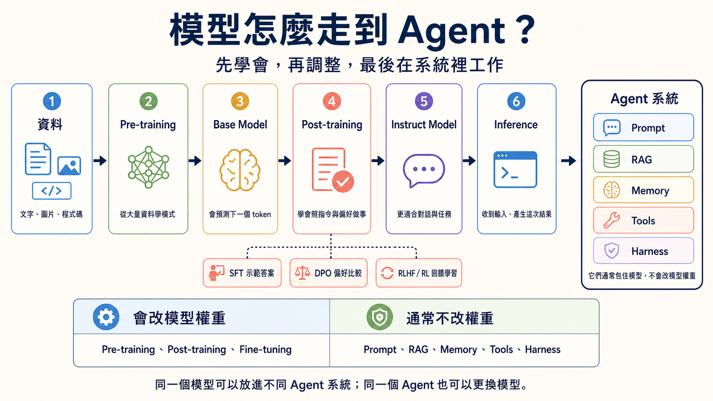

# Stage 1 — LLM 基礎（LLM Basics）

**LLM**（Large Language Model）：能讀寫語言的模型。

> **繁體中文** | [简体中文](./01-llm-basics.zh-Hans.md) | [English](./01-llm-basics.en.md)

> 本章目的：先看懂模型怎麼從資料走到 Agent，再用一條可重複的本機到雲端路徑呼叫 LLM。你會讀懂 **Token（詞元）**、**Context Window（上下文視窗）** 與 **Temperature（溫度）**，也會用成本與延遲解釋模型選擇。

<!-- freshness: canonical=stages/01-llm-basics.md; verified_on=2026-09-22; scope=models,pricing,availability,deprecations,model-lifecycle; max_age_days=90 -->

## 📌 學習目標

完成本階段後，你可以：

- 用 Ollama 的本機模型完成第一次 API（Application Programming Interface，讓程式呼叫服務的介面） 呼叫，再用 Anthropic API 做對照。
- 說出模型從 Pre-training、Post-training 到 Inference 的順序。
- 以簡單例子說明 token、context window 與 temperature。
- 從回應的 usage 欄位讀出輸入與輸出 token。
- 用輸入／輸出單價、延遲與資料敏感度解釋模型選擇。

## 三個核心詞

### 1. **Token（詞元）**

Token 是模型讀寫文字時使用的計算單位，也常是 API 計價單位。可以把它想成句子被切成的一小塊積木；一個英文單字可能是一塊，也可能被切成幾塊，中文一個字也不保證只是一塊。本章會在練習 2 讀取實際 input／output token，再用它估算成本；數量要看 Tokenizer（分詞工具），不能用字數精確猜測。

### 2. **Context Window（上下文視窗）**

Context Window 是模型處理一次請求時可用的 token 空間。它像桌面：指令、資料和歷史對話先占位子，模型還要留位子寫答案；型號也可能另設較小的最大輸出上限，所以兩個數字都要查。本章會用它判斷長文件何時要刪減、摘要或分批。

### 3. **Temperature（溫度）**

Temperature 是控制抽樣變化程度的參數。把模型想成每次都從幾塊候選積木中挑下一塊：低值偏向最可能的候選，適合分類或固定格式；高值更常嘗試其他候選，適合構思但可能更不穩定。本章把它當成輸出穩定度的旋鈕；它不會增加模型知識，也不會保證完全可重現。

## 模型怎麼從資料走到 Agent？

- **Pre-training（預訓練）**：模型先從大量資料學習文字、圖片或程式碼裡的模式。這會改變模型權重（模型內部學到的數值）。
- **Base Model（基礎模型）**：完成預訓練的模型，學會接續內容，但還不一定會照指令回答。
- **Post-training（後訓練）**：再教模型怎麼照指令、比較偏好，並更安全地完成任務。這一步也會改變權重。常見方法如下。
    - **SFT**（Supervised Fine-Tuning）：用好輸入和好答案教模型模仿。
    - **DPO**（Direct Preference Optimization）：用較好、較差的答案配對教模型學偏好。
    - **RLHF**（Reinforcement Learning from Human Feedback）：把人類回饋用於強化學習。
    - **RL**（Reinforcement Learning）：讓模型依獎勵學習；獎勵也可以來自規則。
- **Instruct Model（指令模型）**：再針對遵循指令做事調整過的模型。
- **Fine-tuning（微調）**：拿較小、較專門的資料繼續調整模型權重。Post-training 是廣義的後續訓練階段；Fine-tuning 是其中常見的一類做法。
- **Inference（推論）**：訓練完成後，模型收到這次輸入並產生這次結果。這是在使用模型，不是在重新訓練它。

**RAG**（Retrieval-Augmented Generation）：先找相關資料，再依資料回答。

**Agent** 不是下一個模型版本。它在執行時用模型判斷下一步，可搭配 RAG 和下列零件完成工作；這些零件通常不改模型權重。

- **Prompt（提示詞）**：告訴模型任務與規則。
- **Memory（記憶）**：保存之後要用的資訊。
- **Tools（工具）**：讓系統查資料或執行動作。
- **Harness（執行架構）**：管理工具、規則與停止條件。

`資料 → Pre-training → Base Model → Post-training → Instruct Model → Inference → Agent 系統`



以下三項是進階訓練選修，初學可先認得名字：

- **GRPO**（Group Relative Policy Optimization）：比較同一題的多個答案，再依相對表現學習。
- **LoRA**（Low-Rank Adaptation）：凍結原本權重，再訓練新增的低秩矩陣。
- **PEFT**（Parameter-Efficient Fine-Tuning）：只訓練較少參數的一組方法。

想比較模型教模型的 Distillation（蒸餾），或降低數值精度的 Quantization（量化），請打開[模型訓練與調整選修指南](../resources/model-training-guide.md)。初學本章不用自己訓練模型。

## 場景式模型選擇器

**Typed Decision Model（型別化決策模型）** 只從預設答案中選擇、評分或回傳機率。TypeSafe AI 的 **Jev** 屬於這類，不能用來聊天、摘要或寫程式。

**判斷不是授權**：程式仍須檢查權限；寄信、付款或刪檔前先請人確認。

<div align="center" markdown="1">

| 你的場景 | 先試哪條路 | 選擇理由 |
|:---|:---|:---|
| 第一次學 API、想零費用反覆試 | **Ollama + `gemma4:e4b`** | 本機執行，單次 API 成本為 $0；同一組範例可反覆改寫。 |
| 要比較雲端品質、資料可送出 | **Claude Haiku 5.5／Sonnet 5.5** | Anthropic SDK（Software Development Kit，開發工具與函式庫的工具包） 路徑簡單；按輸入與輸出 token 計費。 |
| OpenAI Agent API | **GPT-6.1 Sol／Terra／GPT-6 Luna** | Sol 寫程式；Terra 看圖與改寫；Luna 做簡單任務。先小測，再查價格。 |
| 文件很長，且要處理圖像或影音 | **Gemini 3.8 Flash 或 Kimi K3.1 Pro** | 先查 context 與多模態支援，用你的文件測試。 |
| 中文 API 任務，希望控制用量 | **DeepSeek V4.1 Flash 或 GLM-5.3** | 先比較官方價格、輸出限制與服務可用性；不要只看模型名稱。 |
| 固定選項的分類、評分或分流，結果要直接交給程式 | **Jev 1.13（服務 Early access）** | 回傳 Choice、Score 或 Noul 的機率結果；低信心或高風險動作仍要交給人或另一個模型。 |
| 隱私、離線或需自行部署 | **Llama 4、Qwen 3.8、Gemma 4 等開放權重** | 先估算硬體與授權，再以 Ollama 或其他推論工具測量實際速度。 |

</div>

**Gemini 4 Carbon** 已公告，但一般開發者還不能直接用。Google 先逐步開放給指定的電腦安全團隊與可信夥伴；先選已開放的模型練習。[官方公告](https://blog.google/innovation-and-ai/models-and-research/gemini-models/introducing-gemini-4-carbon/)。

**Haiku 5.5（2026-10-07 發布，2026-10-08 查核）** 適合分類、摘要與範圍明確的子代理；複雜程式 Agent 仍先評估 Sonnet／Opus。API ID 是固定的 `claude-haiku-5-5`，沒有日期尾碼或另一個 alias。練習 1、3 改用 5.5；temperature 練習與跨章範例保留 Haiku 4.5 相容基線。5.5 預設 adaptive thinking，須依區塊 `type` 取文字、保留 thinking 區塊並重新計算 token；不能只換 ID。參考 [發布公告](https://www.anthropic.com/claude-haiku-5-5) 與 [Haiku 5.5 遷移指南](https://platform.claude.com/docs/en/models/haiku-5-5/migration-guide)。

## 🚪 進入條件

主要路徑使用本機 Ollama；開始前只要確認時間、工具與預算。

<details markdown="1">
<summary>🧭 展開時間、先備、環境與預算</summary>

**時間與先備**

預留約 1 週、5–8 小時。你應能執行 Python script，並對 HTTP／REST 有概念；沒有 API key 也不會卡住，因為本章的主要練習使用本機 Ollama。若還不熟 Python 或命令列，先回 [Stage 0](00-foundations.md)。

**環境**

Path A 需要 [Ollama](https://ollama.com)、`pip install openai`，以及 `ollama pull gemma4:e4b`。低記憶體可改用 `gemma4:e2b`。Stage 3 以後的工具呼叫練習才使用 `qwen2.5:3b`；不要把那些 tag 混到本章的聊天範例。Path B 需要 `pip install anthropic` 與 `ANTHROPIC_API_KEY`。

**預算**

本階段的本機路徑為 $0／次（仍會消耗電力與時間）。若每個練習以 3–5 次作為學習量，雲端總額會隨提示長度與型號變化；先以每次 usage 計算，再把預估次數乘上去。每個練習下方都列出單次與本階段估算，這些是教學估算，不是帳單承諾。

</details>

## 📚 必修閱讀

先知道這七個官方入口；不必讀完才開始練習。

依序閱讀 1–3 後開始練習；4–7 在需要理解模型型號、token 或本機部署時查閱：

1. [OpenAI：模型如何開發](https://openai.com/policies/how-chatgpt-and-our-foundation-models-are-developed/) — 先看資料、訓練與模型之間的關係。
2. [Google Machine Learning：LLM 調整](https://developers.google.com/machine-learning/crash-course/llm/tuning) — 分清 Prompt Engineering、Fine-tuning 與 Distillation。
3. [Anthropic Claude 模型總覽](https://platform.claude.com/docs/en/models/overview) — 型號、context 與價格入口。
4. [OpenAI API 模型文件](https://developers.openai.com/api/docs/models) — 型號與計價欄位。
5. [Google Gemini 模型文件](https://ai.google.dev/gemini-api/docs/models) — GA／Preview 狀態與 context。
6. [Hugging Face LLM Course：Tokenizers](https://huggingface.co/learn/llm-course/chapter6/1) — tokenizer 如何切分文字。
7. [Ollama 官方網站](https://ollama.com) — 本機模型安裝與服務啟動。

## 🛠 動手練習

### 練習 1：LLM API（hello world）

**成果：** 用五行左右的核心呼叫取得一段回應，並從 `usage` 讀出輸出 token。單次預算：Ollama $0；Anthropic Haiku 請依回應的 input／output usage 與 5.5 的 `$0.10/$0.50` 短提示費率（提示超過 100K token 時為 `$0.50/$2.50`）計算。階段預算：本機反覆跑仍為 $0；雲端依 3–5 次與實際 usage 累計。

<details markdown="1" open>
<summary>📋 <b>起手碼 — Path A（本機 Ollama <code>gemma4:e4b</code>、預設）</b>（複製到 <code>practice_1.py</code>、執行 <code>python practice_1.py</code>）</summary>

```python
# 需要：pip install openai      (用 OpenAI-compatible SDK 跟 Ollama 溝通)
# 前置：ollama pull gemma4:e4b && ollama serve
import sys
if hasattr(sys.stdout, "reconfigure"):
    sys.stdout.reconfigure(encoding="utf-8", errors="replace")

from openai import OpenAI

client = OpenAI(
    base_url="http://localhost:11434/v1",
    api_key="ollama",  # Ollama 不檢查、隨便填
)

r = client.chat.completions.create(
    model="gemma4:e4b",
    max_tokens=100,
    reasoning_effort="none",
    messages=[{"role": "user", "content": "用一句話自我介紹。"}],
)

# === 自我驗證 ===
choice = r.choices[0]
text = choice.message.content or ""
print("回應：", text)
print("usage:", r.usage)

assert choice.finish_reason == "stop" and text.strip(), f"Expected complete non-empty response; got finish_reason={choice.finish_reason!r}"
assert r.usage.completion_tokens > 0, "output token 應 > 0"
print("✅ 練習 1 通過 — Ollama gemma4:e4b 已能本機回應、$0/次")
```

</details>

<details markdown="1">
<summary>📋 <b>起手碼 — Path B（Anthropic API、選擇性）</b>（複製到 <code>practice_1_anthropic.py</code>）</summary>

```python
# 需要：pip install anthropic
# 環境變數：export ANTHROPIC_API_KEY=sk-ant-...
import sys
if hasattr(sys.stdout, "reconfigure"):
    sys.stdout.reconfigure(encoding="utf-8", errors="replace")

import anthropic

client = anthropic.Anthropic()
msg = client.messages.create(
    model="claude-haiku-5-5",
    max_tokens=4096,
    output_config={"effort": "low"},
    messages=[{"role": "user", "content": "用一句話自我介紹。"}],
)

# === 自我驗證 ===
text = "".join(block.text for block in msg.content if block.type == "text")
print("回應：", text)
print("usage:", msg.usage)

assert msg.stop_reason in ("end_turn", "max_tokens"), f"非預期 stop_reason: {msg.stop_reason}"
assert len(text) > 0, "回應不應為空"
assert msg.usage.input_tokens > 0 and msg.usage.output_tokens > 0, "token 數應 > 0"
print("✅ 練習 1 通過 — 你已成功打通 Anthropic API")
```

</details>

### 練習 2：Tokens

**成果：** 以同一個提示重複呼叫，觀察語言、temperature 與輸出長度如何改變 token 使用量。單次預算：Ollama $0；Anthropic Haiku 請依該次 input／output usage 與官方費率計算。階段預算：本機為 $0；Path B 以 3–5 組重複測試的實際 `usage` 加總。

<details markdown="1" open>
<summary>📋 <b>起手碼 — Path A（本機 Ollama <code>gemma4:e4b</code>、預設）</b>（複製到 <code>practice_2.py</code>）</summary>

```python
# 需要：pip install openai     (OpenAI-compatible SDK 跟 Ollama 溝通)
# 前置：ollama pull gemma4:e4b && ollama serve
import sys, statistics
if hasattr(sys.stdout, "reconfigure"):
    sys.stdout.reconfigure(encoding="utf-8", errors="replace")

from openai import OpenAI

client = OpenAI(base_url="http://localhost:11434/v1", api_key="ollama")

PROMPTS = {
    "中文": "用一句話描述一隻貓在做什麼。",
    "English": "Describe in one sentence what a cat is doing.",
}

N = 10  # 本機慢、N 小一點；確認 OK 後加大
for label, prompt in PROMPTS.items():
    output_tokens = []
    for _ in range(N):
        r = client.chat.completions.create(
            model="gemma4:e4b",
            max_tokens=80,
            reasoning_effort="none",
            temperature=1.0,  # 拉高 temperature 看 variance
            messages=[{"role": "user", "content": prompt}],
        )
        choice = r.choices[0]
        text = choice.message.content or ""
        assert choice.finish_reason == "stop" and text.strip(), f"Discard incomplete/empty output (finish_reason={choice.finish_reason!r})"
        output_tokens.append(r.usage.completion_tokens)
    print(f"\n[{label}] prompt: {prompt}")
    print(f"  input tokens: {r.usage.prompt_tokens}")
    print(f"  output tokens — min={min(output_tokens)} max={max(output_tokens)} mean={statistics.mean(output_tokens):.1f} stdev={statistics.stdev(output_tokens):.1f}")

# === 自我驗證 ===
assert len(output_tokens) == N and all(n > 0 for n in output_tokens), "應觀察到非空的 output token 數"
print("\n✅ 練習 2 通過 — 已觀察到兩種語言的 output token、本機跑 $0")
print("💡 token 數會受 tokenizer 與實際內容影響；不要只用字數推算，也不要預設某種語言一定較多。")
```

</details>

<details markdown="1">
<summary>📋 <b>起手碼 — Path B（Anthropic API、選擇性）</b>（複製到 <code>practice_2_anthropic.py</code>）</summary>

```python
# 需要：pip install anthropic
import sys, statistics
if hasattr(sys.stdout, "reconfigure"):
    sys.stdout.reconfigure(encoding="utf-8", errors="replace")

import anthropic

client = anthropic.Anthropic()
PROMPTS = {"中文": "用一句話描述一隻貓在做什麼。", "English": "Describe in one sentence what a cat is doing."}

for label, prompt in PROMPTS.items():
    output_tokens = []
    for _ in range(20):
        msg = client.messages.create(model="claude-haiku-4-5", max_tokens=80, temperature=1.0,
                                     messages=[{"role": "user", "content": prompt}])
        output_tokens.append(msg.usage.output_tokens)
    print(f"[{label}] input={msg.usage.input_tokens} output min/max/mean={min(output_tokens)}/{max(output_tokens)}/{sum(output_tokens)/len(output_tokens):.1f}")
```

主要差異：`client.messages.create()`、`usage.input_tokens` 與 Anthropic content block 的回應形狀，和 Ollama 的 OpenAI-compatible 欄位不同。單次成本請用回應的 token 數計算。

</details>

### 練習 3：Pricing / Latency

**成果：** 把同一個小任務的 token 成本與等待時間分開量測。單次預算：Ollama $0；Anthropic Haiku 依本次 input／output usage 與官方費率計算。階段預算：本機為 $0；若用 Path B，先跑 1 次取得實際輸入／輸出 token，再乘以預計次數，避免直接套用平均值。

<details markdown="1" open>
<summary>📋 <b>起手碼 — Path A（本機 Ollama <code>gemma4:e4b</code>、量 latency）</b>（複製到 <code>practice_3.py</code>）</summary>

```python
# 需要：pip install openai
# 前置：ollama pull gemma4:e4b && ollama serve
import sys, time
if hasattr(sys.stdout, "reconfigure"):
    sys.stdout.reconfigure(encoding="utf-8", errors="replace")

from openai import OpenAI

client = OpenAI(base_url="http://localhost:11434/v1", api_key="ollama")

# 量 5 次 latency 與 output token
latencies = []
output_tokens = []
for _ in range(5):
    t0 = time.time()
    r = client.chat.completions.create(
        model="gemma4:e4b",
        max_tokens=200,
        messages=[{"role": "user", "content": "你好！自我介紹一下。"}],
    )
    latencies.append(time.time() - t0)
    output_tokens.append(r.usage.completion_tokens)

# 統計
avg_latency = sum(latencies) / len(latencies)
out_tok_avg = sum(output_tokens) / len(output_tokens)  # 五次平均
tps = out_tok_avg / avg_latency if avg_latency > 0 else 0

print(f"model: gemma4:e4b (本機)")
print(f"5 次 latency (sec): min={min(latencies):.2f} max={max(latencies):.2f} mean={avg_latency:.2f}")
print(f"avg output: {out_tok_avg} tokens、約 {tps:.1f} tokens/sec")
print(f"\n1000 次成本: $0 (本機)、預計時長: {avg_latency * 1000 / 60:.1f} 分鐘")

# === 自我驗證 ===
assert avg_latency > 0, "latency 應 > 0"
assert out_tok_avg > 0, "output token 應 > 0"
print(f"\n✅ 練習 3 通過 — 本機 model $0 但要花 {avg_latency * 1000 / 60:.0f} 分鐘跑 1000 次")
print("💡 對照 Path B Anthropic：請以實際 input/output usage 與官方費率估算 1000 次成本，再和本機等待時間比較。")
```

</details>

<details markdown="1">
<summary>📋 <b>起手碼 — Path B（Anthropic API、算 $ 成本）</b>（複製到 <code>practice_3_anthropic.py</code>）</summary>

```python
# 需要：pip install anthropic
import sys
if hasattr(sys.stdout, "reconfigure"):
    sys.stdout.reconfigure(encoding="utf-8", errors="replace")

import anthropic

# Anthropic 公開計價（每 1M token、USD）— 跑前對照 https://www.anthropic.com/pricing
PRICING = {
    "claude-haiku-5-5":   {"input": 0.10, "output":  0.50},
    "claude-sonnet-5-5":  {"input": 2.00, "output": 10.00},
    "claude-opus-5-5":    {"input": 4.00, "output": 20.00},
    "claude-fable-5-1":   {"input": 10.00, "output": 50.00},
}

def rates_for(model, input_tokens):
    if model == "claude-haiku-5-5" and input_tokens > 100_000:
        return {"input": 0.50, "output": 2.50}
    return PRICING[model]

client = anthropic.Anthropic()
MODEL = "claude-haiku-5-5"

msg = client.messages.create(model=MODEL, max_tokens=4096,
                             output_config={"effort": "low"},
                             messages=[{"role": "user", "content": "你好！自我介紹一下。"}])
in_tok, out_tok = msg.usage.input_tokens, msg.usage.output_tokens
rates = rates_for(MODEL, in_tok)
cost_one = (in_tok * rates["input"] + out_tok * rates["output"]) / 1_000_000

print(f"model: {MODEL}")
print(f"single: input={in_tok} output={out_tok} → ${cost_one:.6f}")
print("1000-call rate-only illustration (not measured cross-model costs):")
for name in PRICING:
    r = rates_for(name, in_tok)
    c = (in_tok * r["input"] + out_tok * r["output"]) / 1_000_000 * 1000
    print(f"  {name:<22} ${c:.4f}")

# === 自我驗證 ===
assert cost_one > 0, "Cloud LLM 一定有成本"
print(f"\n✅ 練習 3 通過（Anthropic）— 已計算本次成本；跨模型數字只比較單價，須各自重新量測 token")
```

</details>

## 🎯 精選 Projects

### 推薦 Capstone：個人文件摘要成本／品質比較器

建立一個小型命令列工具：讀入 3–5 段你有權使用的文字，分別用 Ollama 與一個 Anthropic 型號摘要；記錄輸入／輸出 token、延遲、估算成本，並用固定檢查表標註摘要是否遺漏關鍵事實。它把本章三個核心詞和模型選擇器連在一起，不要求先做 RAG 或 agent。

<details markdown="1">
<summary>📦 Capstone 的驗收清單與其他 Project 入口</summary>

完成後應能展示：

- 同一份輸入的兩條路徑與模型名稱。
- 每次呼叫的 input／output token、延遲與單次成本。
- 一個固定的品質檢查表，而不是只憑主觀印象選模型。
- 一段說明：何時用本機、何時接受雲端成本，以及 context 不足時怎麼分批。

以下表格保留本章原有的 17 個延伸入口；它們是選讀資源，不是本章必做項目。推薦度是編輯判斷，不是 GitHub 熱門度：`⭐⭐⭐⭐⭐` 代表跳過會卡住；本表都是補充入口，所以誠實使用 `⭐⭐⭐⭐`、`⭐⭐⭐` 或歷史參考的 `⭐⭐`，不列會變動的 stars。

<table align="center">
  <thead><tr><th scope="col">分類</th><th scope="col">資源</th><th scope="col">入口</th><th scope="col">推薦度</th><th scope="col">用途／狀態</th></tr></thead>
  <tbody>
    <tr><th scope="rowgroup" rowspan="4" align="center" valign="middle">官方 API 入門</th><td>Anthropic Cookbook</td><td><a href="https://github.com/anthropics/claude-cookbooks">GitHub</a></td><td align="center" valign="middle">⭐⭐⭐⭐</td><td>Claude API notebook；可查 tool use、batch 與 prompt cache。</td></tr>
    <tr><td>Anthropic Courses</td><td><a href="https://github.com/anthropics/courses">GitHub</a></td><td align="center" valign="middle">⭐⭐⭐⭐</td><td>已封存的官方課程；可看舊範例，動手時請對照下方現行 API Quickstart。</td></tr>
    <tr><td>OpenAI Cookbook</td><td><a href="https://github.com/openai/openai-cookbook">GitHub</a></td><td align="center" valign="middle">⭐⭐⭐⭐</td><td>OpenAI API、structured output 與 function calling 範例。</td></tr>
    <tr><td>Anthropic Claude API Quickstart</td><td><a href="https://platform.claude.com/docs/en/get-started">官方文件</a></td><td align="center" valign="middle">⭐⭐⭐</td><td>快速完成第一個 Claude API 呼叫。</td></tr>
  </tbody>
  <tbody>
    <tr><th scope="rowgroup" rowspan="4" align="center" valign="middle">中文教材</th><td>datawhalechina/happy-llm</td><td><a href="https://github.com/datawhalechina/happy-llm">GitHub</a></td><td align="center" valign="middle">⭐⭐⭐⭐</td><td>以中文理解 LLM 原理與訓練流程。</td></tr>
    <tr><td>datawhalechina/llm-universe</td><td><a href="https://github.com/datawhalechina/llm-universe">GitHub</a></td><td align="center" valign="middle">⭐⭐⭐⭐</td><td>從 API 基礎延伸到知識庫與 RAG。</td></tr>
    <tr><td>datawhalechina/llm-cookbook</td><td><a href="https://github.com/datawhalechina/llm-cookbook">GitHub</a></td><td align="center" valign="middle">⭐⭐⭐</td><td>Andrew Ng 課程的中文改編；更新速度較慢。</td></tr>
    <tr><td>jingyaogong/minimind</td><td><a href="https://github.com/jingyaogong/minimind">GitHub</a></td><td align="center" valign="middle">⭐⭐⭐</td><td>從零實作小型模型訓練；Apache-2.0。</td></tr>
  </tbody>
  <tbody>
    <tr><th scope="rowgroup" rowspan="2" align="center" valign="middle">英文課程</th><td>Hugging Face — LLM Course</td><td><a href="https://huggingface.co/learn/llm-course/chapter1/1">課程</a></td><td align="center" valign="middle">⭐⭐⭐⭐</td><td>Transformer、tokenizer 與 Hugging Face 生態。</td></tr>
    <tr><td>LangChain Academy</td><td><a href="https://academy.langchain.com/">課程</a></td><td align="center" valign="middle">⭐⭐⭐</td><td>官方免費課程；包含 RAG 與 agent。</td></tr>
  </tbody>
  <tbody>
    <tr><th scope="rowgroup" rowspan="4" align="center" valign="middle">本機執行</th><td>ollama/ollama</td><td><a href="https://github.com/ollama/ollama">GitHub</a></td><td align="center" valign="middle">⭐⭐⭐⭐</td><td>本章 Path A 的本機執行入口。</td></tr>
    <tr><td>ggml-org/llama.cpp</td><td><a href="https://github.com/ggml-org/llama.cpp">GitHub</a></td><td align="center" valign="middle">⭐⭐⭐⭐</td><td>理解量化與本機推論底層。</td></tr>
    <tr><td>mudler/LocalAI</td><td><a href="https://github.com/mudler/LocalAI">GitHub</a></td><td align="center" valign="middle">⭐⭐⭐</td><td>提供 OpenAI 相容的 self-host 服務。</td></tr>
    <tr><td>ml-explore/mlx</td><td><a href="https://github.com/ml-explore/mlx">GitHub</a></td><td align="center" valign="middle">⭐⭐⭐</td><td>Apple Silicon 的機器學習框架。</td></tr>
  </tbody>
  <tbody>
    <tr><th scope="rowgroup" rowspan="3" align="center" valign="middle">從零理解</th><td>Karpathy — Let's build GPT from scratch</td><td><a href="https://www.youtube.com/watch?v=kCc8FmEb1nY">影片</a></td><td align="center" valign="middle">⭐⭐⭐⭐</td><td>以 PyTorch 示範從零建立 GPT。</td></tr>
    <tr><td>rasbt/LLMs-from-scratch</td><td><a href="https://github.com/rasbt/LLMs-from-scratch">GitHub</a></td><td align="center" valign="middle">⭐⭐⭐⭐</td><td>以書本與程式碼深入 tokenizer、attention 與訓練。</td></tr>
    <tr><td>karpathy/LLM101n</td><td><a href="https://github.com/karpathy/LLM101n">GitHub</a></td><td align="center" valign="middle">⭐⭐</td><td>已封存的課程大綱；屬歷史參考，不是現行教學。</td></tr>
  </tbody>
</table>

**其他 Project（按難度）**

- 入門：多語言 token 計數器、單句摘要器、temperature 對照表。
- 中階：跨供應商 prompt 評測器、錯誤重試包裝器、本機模型延遲儀表板。
- 延伸：小型文件分批摘要流程、可配置的模型路由器、隱私資料的本機推論服務。

</details>

### 練習 4：Cross-Provider 比較

**成果：** 用同一提示比較不同供應商的輸出，並記錄差異而不把單次結果當成排名。單次預算：Path A Ollama $0；Path B 依三家 API 的實際 token 計費。階段預算：本機為 $0；雲端先各跑 1 次，再按 3–5 組評測估算。

<details markdown="1">
<summary>🔬 練習 4 詳細路徑（選做）</summary>

- **Path A（Ollama，主要練習）：** 使用 [`examples/stage-1/04-cross-provider/`](../examples/stage-1/04-cross-provider/) 的 Ollama 呼叫，先讓本機結果成為基準。
- **Path B（Anthropic，選擇性）：** 在同一資料集上加入 Anthropic SDK；若也加入 OpenAI／Google，請逐一記錄型號、參數、token 與失敗情況。
- 比較回答風格、長度、格式遵守度與事實遺漏；把結果視為你的任務小評測，不是官方規格或普遍排名。

這個 starter 含三家 SDK 並行呼叫與 table 對照，缺哪家 key 就 skip 哪家；它是 illustrative 範例，不是 chapter-length 教學。

</details>

### 練習 5：Error Handling

**成果：** 為錯誤分類、重試與停止條件寫出可測試的處理流程。單次預算：Path A Ollama $0；Path B 若只用 mock 不產生 API 費用。階段預算：本機與 mock 測試為 $0；若加入雲端整合測試，限制為 1–2 次並按實際 token 加總。

<details markdown="1">
<summary>🧰 練習 5 詳細路徑（選做）</summary>

- **Path A（Ollama，主要練習）：** 先在 [`examples/stage-1/05-error-handling/`](../examples/stage-1/05-error-handling/) 執行 mock-based test，再用本機端點觀察可恢復的網路錯誤。
- **Path B（Anthropic，選擇性）：** 以 Anthropic SDK 的例外型別接上相同的 retry wrapper；API key 錯誤與 context 過長不應無限重試。
- 至少覆蓋錯誤 API key、提示過長與網路中斷；exponential backoff 要有上限與明確的最大嘗試次數。

這個 starter 讓你不用真的斷網就能驗證重試邏輯；它是 illustrative 範例，不是 chapter-length 教學。

</details>

### 練習 6：Local LLM

**成果：** 在自己的電腦上啟動 Ollama，並以 OpenAI-compatible API 呼叫本機模型。單次預算：Ollama $0（另有硬體電力成本）；Path B 雲端依實際 token 計費。階段預算：本機練習為 $0；若用 Anthropic 做一次品質對照，先限制為 1–3 次並記錄 usage。

<details markdown="1">
<summary>🦙 練習 6 詳細路徑（選做）</summary>

**Path A（Ollama，主要可執行路徑）：**

```bash
# 1. 裝 Ollama: https://ollama.com
ollama pull qwen2.5:3b
ollama serve  # 預設 port 11434
```

```python
# 需要：pip install openai
# 前置：Ollama 已 serve、qwen2.5:3b 已 pull
import sys
if hasattr(sys.stdout, "reconfigure"):
    sys.stdout.reconfigure(encoding="utf-8", errors="replace")

from openai import OpenAI

client = OpenAI(
    base_url="http://localhost:11434/v1",
    api_key="ollama",  # Ollama 不檢查、隨便填
)

r = client.chat.completions.create(
    model="qwen2.5:3b",
    messages=[{"role": "user", "content": "用 3 句話介紹什麼是 ReAct。"}],
)

text = r.choices[0].message.content
print("回應：", text)

# === 自我驗證 ===
assert len(text) > 10, "回應太短、Ollama 可能沒跑起來"
print(f"✅ 練習 6 通過 — 你的本機 Ollama 已能透過 OpenAI-compatible API 呼叫")
print(f"💡 跑這次完全沒花錢（除了你的電力）")
```

**Path B（Anthropic，選擇性）：** 把同一個 ReAct 提示送到 `claude-haiku-4-5`，保存回應與 `msg.usage`，再和 Path A 的格式遵守度、延遲及成本比較。不要把雲端結果當成本機模型的規格保證。

若沒有 Ollama，可把 `base_url` 換成 [LM Studio](https://lmstudio.ai)（`http://localhost:1234/v1`）或 [vLLM](https://github.com/vllm-project/vllm) endpoint；介面相同，但模型 tag 與硬體需求要重新確認。

</details>

<details markdown="1">
<summary>🌐 完整 18 家族資料表（官方規格入口）</summary>

<small>全表查核：2026-09-22 UTC。GPT／Kimi 局部更新：2026-10-26 UTC。Claude 一列更新：2026-10-08 UTC。Gemini 一列更新：2026-10-29 UTC。Muse／Mistral／Jev 與 GPT 選讀更新：2026-10-15 UTC。DeepSeek／Decisions／Clef 選讀更新：2026-10-23 UTC。</small>

沒有可靠公開數字就寫「官方未公布」。價格通常是 USD／每 1M token；供應商若用別的單位，就照官方單位記錄。
**快取（cache）** 像重用已讀過的便條：讀取舊內容與寫入新內容可能有不同價格。

先展開你想查的家族，再看型號、價格與限制。

<details class="model-family" markdown="1">
<summary>Claude</summary>

<table data-model-family="Claude" align="center">
  <thead><tr><th scope="col">欄位</th><th scope="col">內容</th></tr></thead>
  <tbody data-field="models">
    <tr><th scope="rowgroup" rowspan="5" align="center" valign="middle">目前推薦型號</th><td>Fable 5.1（<code>claude-fable-5-1</code>）</td></tr>
    <tr><td>Mythos 5.1（<code>claude-mythos-5-1</code>）</td></tr>
    <tr><td>Opus 5.5（<code>claude-opus-5-5</code>）</td></tr>
    <tr><td>Sonnet 5.5（<code>claude-sonnet-5-5</code>）</td></tr>
    <tr><td>Haiku 5.5 (<code>claude-haiku-5-5</code>)</td></tr>
  </tbody>
  <tbody data-field="status">
    <tr><th scope="row">狀態</th><td>Fable／Opus／Sonnet／Haiku：正式可用；Mythos：限核准使用者</td></tr>
  </tbody>
  <tbody data-field="context">
    <tr><th scope="row">Context</th><td>1M context／128K 最大輸出</td></tr>
  </tbody>
  <tbody data-field="pricing">
    <tr><th scope="row">價格或授權</th><td>Claude API：Fable／Mythos US$10/$50、Opus US$4/$20、Sonnet US$2/$10、Haiku US$0.10/$0.50 (prompt ≤100K), US$0.50/$2.50 (prompt &gt;100K)（每百萬輸入／輸出 token）；Sonnet cache read US$0.10，Opus US$0.20，Fable／Mythos US$0.25</td></tr>
  </tbody>
  <tbody data-field="use">
    <tr><th scope="row">適合做什麼</th><td>長文、程式、長時間 Agent 工作流</td></tr>
  </tbody>
  <tbody data-field="limits">
    <tr><th scope="row">限制</th><td>Mythos 5.1 限資安與生命科學核准使用者；Sonnet 5.5 的工具指定與 temperature 設定不同於舊版，升級既有程式前先看遷移指南；雲端夥伴平台價格另查</td></tr>
  </tbody>
  <tbody data-field="sources">
    <tr><th scope="row">官方來源</th><td><a href="https://platform.claude.com/docs/en/models/overview">Claude 模型總覽</a> · <a href="https://platform.claude.com/docs/en/models/opus-5-5/overview">Opus 5.5</a> · <a href="https://platform.claude.com/docs/en/models/sonnet-5-5/overview">Sonnet 5.5</a> · <a href="https://platform.claude.com/docs/en/models/sonnet-5-5/migration-guide">遷移指南</a> · <a href="https://platform.claude.com/docs/en/models/haiku-5-5/overview">Haiku 5.5</a> · <a href="https://platform.claude.com/docs/en/models/haiku-5-5/migration-guide">Haiku 5.5 migration</a> · <a href="https://platform.claude.com/docs/en/about-claude/pricing">Claude API 價格</a></td></tr>
  </tbody>
</table>

</details>

<details class="model-family" markdown="1">
<summary>GPT</summary>

<table data-model-family="GPT" align="center">
  <thead><tr><th scope="col">欄位</th><th scope="col">內容</th></tr></thead>
  <tbody data-field="models">
    <tr><th scope="rowgroup" rowspan="4" align="center" valign="middle">目前推薦型號</th><td>GPT-6 Astra（<code>gpt-6-astra</code>）</td></tr>
    <tr><td>GPT-6.1 Sol（<code>gpt-6.1-sol</code>）</td></tr>
    <tr><td>GPT-6.1 Terra（<code>gpt-6.1-terra</code>）</td></tr>
    <tr><td>GPT-6 Luna（<code>gpt-6-luna</code>）</td></tr>
  </tbody>
  <tbody data-field="status">
    <tr><th scope="row">狀態</th><td>正式 API 模型；免費層不支援</td></tr>
  </tbody>
  <tbody data-field="context">
    <tr><th scope="row">Context</th><td>1.05M context／128K 最大輸出</td></tr>
  </tbody>
  <tbody data-field="pricing">
    <tr><th scope="rowgroup" rowspan="5" align="center" valign="middle">價格或授權</th><td>Standard API，每百萬 token，US$ 輸入／cache 讀／cache 寫（30 分鐘）／輸出。</td></tr>
    <tr><td>Astra $10/$1/$12.50/$50。</td></tr>
    <tr><td>Sol 6.1 $2/$0.10/$2.50/$10。</td></tr>
    <tr><td>Terra 6.1 $1/$0.05/$1.25/$5；12 小時 cache 寫入 $2.50。</td></tr>
    <tr><td>Luna $0.10/$0.01/$0.125/$0.50。</td></tr>
  </tbody>
  <tbody data-field="use">
    <tr><th scope="row">適合做什麼</th><td>Sol 6.1 用於程式與多步 Agent 工作。Terra 6.1 看圖、操作畫面與改寫文字。Luna 用於聚焦、重複任務。Astra 的成本與品質差異要自行評測。</td></tr>
  </tbody>
  <tbody data-field="limits">
    <tr><th scope="row">限制</th><td>Sol 6.1 與 Terra 6.1 的工具呼叫須用 Responses API。Chat Completions 不支援工具呼叫。超過 272K 輸入時，整次請求輸入與 cache 價為 2 倍、輸出為 1.5 倍。Batch／Flex 半價，Fast 為 2 倍。工具可能另計費。</td></tr>
  </tbody>
  <tbody data-field="sources">
    <tr><th scope="row">官方來源</th><td><a href="https://developers.openai.com/api/docs/models/gpt-6-astra">GPT-6 Astra</a> · <a href="https://developers.openai.com/api/docs/models/gpt-6.1-sol">GPT-6.1 Sol</a> · <a href="https://developers.openai.com/api/docs/models/gpt-6.1-terra">GPT-6.1 Terra</a> · <a href="https://developers.openai.com/api/docs/models/gpt-6-luna">GPT-6 Luna</a> · <a href="https://developers.openai.com/api/docs/pricing">OpenAI API 價格</a></td></tr>
  </tbody>
</table>

</details>

<details class="model-family" markdown="1">
<summary>Jev（TypeSafe AI）</summary>

<table data-model-family="Jev（TypeSafe AI）" align="center">
  <thead><tr><th scope="col">欄位</th><th scope="col">內容</th></tr></thead>
  <tbody data-field="models">
    <tr><th scope="rowgroup" rowspan="3" align="center" valign="middle">目前推薦型號</th><td>TypeSafe direct：穩定 Jev 1.13（<code>jev-1.13.0</code>／<code>jev-latest</code>）</td></tr>
    <tr><td>Preview Jev 1.14（<code>jev-1.14.0</code>／<code>jev-preview</code>）</td></tr>
    <tr><td>Cloudflare route：<code>typesafe/jev</code></td></tr>
  </tbody>
  <tbody data-field="status">
    <tr><th scope="row">狀態</th><td>1.13：正式模型；1.14：Preview。服務仍為 Early access</td></tr>
  </tbody>
  <tbody data-field="context">
    <tr><th scope="row">Context</th><td>TypeSafe direct：64K／request，<code>state</code> 加最長 question 上限 32K。Cloudflare route：32K</td></tr>
  </tbody>
  <tbody data-field="pricing">
    <tr><th scope="row">價格或授權</th><td>TypeSafe direct：US$0.042／百萬 input token，output 不計費。Cloudflare route：以 Cloudflare dashboard 為準</td></tr>
  </tbody>
  <tbody data-field="use">
    <tr><th scope="row">適合做什麼</th><td>固定選項分類、路由、rubric 評分與 guardrail 判斷</td></tr>
  </tbody>
  <tbody data-field="limits">
    <tr><th scope="row">限制</th><td>不產生自由文字；機率不等於正確。程式與 Eval 決定門檻、權限與 fallback。262K 長 context 與圖片須另啟用，屬 experimental，不是預設</td></tr>
  </tbody>
  <tbody data-field="sources">
    <tr><th scope="row">官方來源</th><td><a href="https://docs.typesafe.ai/models">TypeSafe 模型規格</a> · <a href="https://docs.typesafe.ai/introduction">Jev 入門</a> · <a href="https://typesafe.ai/blog/introducing-system-one-models-and-jev">Early access 公告</a> · <a href="https://developers.cloudflare.com/ai/models/typesafe/jev/">Cloudflare route</a> · <a href="https://docs.typesafe.ai/images">圖片限制</a></td></tr>
  </tbody>
</table>

</details>

<details class="model-family" markdown="1">
<summary>Gemini</summary>

<table data-model-family="Gemini" align="center">
  <thead><tr><th scope="col">欄位</th><th scope="col">內容</th></tr></thead>
  <tbody data-field="models">
    <tr><th scope="rowgroup" rowspan="2" align="center" valign="middle">目前推薦型號</th><td>Gemini 3.8 Flash</td></tr>
    <tr><td>Gemini 4 Argon（<code>gemini-4-argon</code>）</td></tr>
  </tbody>
  <tbody data-field="status">
    <tr><th scope="rowgroup" rowspan="2" align="center" valign="middle">狀態</th><td>Flash／Argon：正式可用。</td></tr>
    <tr><td>Gemini 4 Carbon：Preview；限指定夥伴逐步開放，一般 API 尚未開放。</td></tr>
  </tbody>
  <tbody data-field="context">
    <tr><th scope="rowgroup" rowspan="3" align="center" valign="middle">Context</th><td>Flash：1,048,576 context／65,536 最大輸出。</td></tr>
    <tr><td>Argon：1,048,576 輸入與輸出合計；同步輸出預設 65,536。</td></tr>
    <tr><td>Carbon：輸入 context 與最大輸出官方未公布。</td></tr>
  </tbody>
  <tbody data-field="pricing">
    <tr><th scope="rowgroup" rowspan="4" align="center" valign="middle">價格或授權</th><td>每百萬 token，US$。Flash：2026-12-31 前輸入／輸出 $0.75/$3.75。</td></tr>
    <tr><td>Argon Standard 輸入／cache／輸出：2026-11-30 前 $2/$0.10/$10。2026-12-01 起 $4/$0.20/$20。</td></tr>
    <tr><td>Carbon 公告優惠價：輸入／輸出 $2/$10。快取輸入為當期輸入價的 5%（優惠期 $0.10）。</td></tr>
    <tr><td>Carbon 公告優惠後價格：輸入／輸出 $4/$20。優惠結束日期官方未公布。</td></tr>
  </tbody>
  <tbody data-field="use">
    <tr><th scope="rowgroup" rowspan="2" align="center" valign="middle">適合做什麼</th><td>Flash 用於多模態與 Agent 練習。Argon 可比較長任務與程式成果。</td></tr>
    <tr><td>Carbon 的公告方向是長時間程式任務與電腦安全防禦；尚不作一般入門推薦。</td></tr>
  </tbody>
  <tbody data-field="limits">
    <tr><th scope="rowgroup" rowspan="3" align="center" valign="middle">限制</th><td>Argon 無免費層。輸出到 1M 須使用 long decode，不是每次請求的預設。</td></tr>
    <tr><td>Carbon 的 API ID、工具支援與正式開放日期官方未公布。公告價格不表示現在就能呼叫 API。</td></tr>
    <tr><td>本章仍先用本機模型練習。</td></tr>
  </tbody>
  <tbody data-field="sources">
    <tr><th scope="rowgroup" rowspan="2" align="center" valign="middle">官方來源</th><td><a href="https://ai.google.dev/gemini-api/docs/models/gemini-3.8-flash">Gemini 3.8 Flash</a> · <a href="https://ai.google.dev/gemini-api/docs/pricing">Gemini API 定價</a> · <a href="https://ai.google.dev/gemini-api/docs/models/gemini-4-argon">Gemini 4 Argon 規格</a> · <a href="https://blog.google/innovation-and-ai/models-and-research/gemini-models/gemini-4-argon/">發布公告</a></td></tr>
    <tr><td><a href="https://blog.google/innovation-and-ai/models-and-research/gemini-models/introducing-gemini-4-carbon/">Carbon 公告與價格預告</a> · <a href="https://ai.google.dev/gemini-api/docs/models">一般開發者模型清單</a></td></tr>
  </tbody>
</table>

</details>

<details class="model-family" markdown="1">
<summary>DeepSeek</summary>

<table data-model-family="DeepSeek" align="center">
  <thead><tr><th scope="col">欄位</th><th scope="col">內容</th></tr></thead>
  <tbody data-field="models">
    <tr><th scope="rowgroup" rowspan="2" align="center" valign="middle">目前推薦型號</th><td>V4.1 Flash 1017（<code>deepseek-flash</code>）</td></tr>
    <tr><td>V4 Pro 0813（<code>deepseek-v4-pro</code>）</td></tr>
  </tbody>
  <tbody data-field="status">
    <tr><th scope="row">狀態</th><td>兩者 API 正式可用；Flash 1017 另有開放權重。舊 V4 Flash 已退役。</td></tr>
  </tbody>
  <tbody data-field="context">
    <tr><th scope="row">Context</th><td>1M context／384K 最大輸出</td></tr>
  </tbody>
  <tbody data-field="pricing">
    <tr><th scope="row">價格或授權</th><td><p>美元（US$）／每百萬 token；以下依尖峰／離峰列。</p><p>Flash 未命中快取輸入 US$0.30/$0.15、輸出 US$1.20/$0.60、快取命中輸入 US$0.006/$0.003。</p><p>Pro 未命中快取輸入 US$1.32/$0.66、輸出 US$3.96/$1.98、快取命中輸入 US$0.044/$0.022。</p><p>Flash 1017 開放權重為 MIT；自架硬體與執行費另計。</p></td></tr>
  </tbody>
  <tbody data-field="use">
    <tr><th scope="row">適合做什麼</th><td>推理、程式與大量 token 任務</td></tr>
  </tbody>
  <tbody data-field="limits">
    <tr><th scope="row">限制</th><td><p>舊 <code>deepseek-v4-flash</code> 仍導向 Flash 1017。舊 <code>deepseek-v4-flash-vision-exp</code> 同樣導向新版。舊名可用，不代表舊模型仍在服務。</p><p>尖峰：週一至五 UTC 01:00–04:00、06:00–10:00。中國公眾假期不算尖峰；其餘時間為離峰。</p><p>Flash 1017 權重是大型模型，不當作一般筆電的起手式。</p></td></tr>
  </tbody>
  <tbody data-field="sources">
    <tr><th scope="row">官方來源</th><td><a href="https://api-docs.deepseek.com/quick_start/pricing/">DeepSeek 模型與價格</a> · <a href="https://api-docs.deepseek.com/updates/">更新紀錄</a> · <a href="https://huggingface.co/deepseek-ai/DeepSeek-V4.1-Flash-1017">Flash 1017 官方權重</a></td></tr>
  </tbody>
</table>

</details>

<details class="model-family" markdown="1">
<summary>Kimi</summary>

<table data-model-family="Kimi" align="center">
  <thead><tr><th scope="col">欄位</th><th scope="col">內容</th></tr></thead>
  <tbody data-field="models">
    <tr><th scope="rowgroup" rowspan="2" align="center" valign="middle">目前推薦型號</th><td>Kimi K3.1 Pro（<code>kimi-k3.1-pro</code>）</td></tr>
    <tr><td>Kimi K3.1 Pro Highspeed（<code>kimi-k3.1-pro-highspeed</code>）</td></tr>
  </tbody>
  <tbody data-field="status">
    <tr><th scope="row">狀態</th><td>正式可用 API；首次儲值至少 US$1 後解鎖。完整權重預告 2026-11-04 公布，目前不能當成已可下載。</td></tr>
  </tbody>
  <tbody data-field="context">
    <tr><th scope="row">Context</th><td>1,048,576 token。</td></tr>
  </tbody>
  <tbody data-field="pricing">
    <tr><th scope="rowgroup" rowspan="4" align="center" valign="middle">價格或授權</th><td>國際 API，每百萬 token，US$ 輸入／cache 讀／cache 寫（5 分鐘）／輸出；未含稅。</td></tr>
    <tr><td>Pro $2/$0.20/$2/$10。</td></tr>
    <tr><td>Highspeed $4/$0.20/$4/$20。</td></tr>
    <tr><td>重複前綴自動快取；1 小時保留另有寫入費率。API 按量計費，不等於 Kimi 會員或 Kimi Code 訂閱。</td></tr>
  </tbody>
  <tbody data-field="use">
    <tr><th scope="row">適合做什麼</th><td>長程式任務、看圖與影片、整理長文件。先用自己的任務測試，不把供應商分數當成成果保證。</td></tr>
  </tbody>
  <tbody data-field="limits">
    <tr><th scope="rowgroup" rowspan="2" align="center" valign="middle">限制</th><td>固定開啟思考。<code>reasoning_effort</code> 可選 <code>low</code>／<code>high</code>／<code>max</code>，預設 <code>max</code>。工具對話須保留完整 assistant 訊息。</td></tr>
    <tr><td>K3 是前一代。K2 系列自 2026-10-31 不再開放新帳號，官方計畫於 2026 年底退役；不是已全部停用。</td></tr>
  </tbody>
  <tbody data-field="sources">
    <tr><th scope="row">官方來源</th><td><a href="https://platform.kimi.ai/docs/guide/kimi-k3-1-pro-quickstart">K3.1 Pro 指南</a> · <a href="https://platform.kimi.ai/docs/models">型號與遷移</a> · <a href="https://platform.kimi.ai/">國際 API 價格</a> · <a href="https://platform.kimi.ai/docs/pricing/chat">計費說明</a> · <a href="https://platform.kimi.ai/docs/guide/context-caching">快取計費</a></td></tr>
  </tbody>
</table>

</details>

<details class="model-family" markdown="1">
<summary>Hunyuan</summary>

<table data-model-family="Hunyuan" align="center">
  <thead><tr><th scope="col">欄位</th><th scope="col">內容</th></tr></thead>
  <tbody data-field="models">
    <tr><th scope="row">目前推薦型號</th><td><code>Hy3</code>（TokenHub）</td></tr>
  </tbody>
  <tbody data-field="status">
    <tr><th scope="row">狀態</th><td>正式可用</td></tr>
  </tbody>
  <tbody data-field="context">
    <tr><th scope="row">Context</th><td>256K</td></tr>
  </tbody>
  <tbody data-field="pricing">
    <tr><th scope="row">價格或授權</th><td>API：cache hit／輸入／輸出各 CNY 0.25／1／4，每百萬 tokens</td></tr>
  </tbody>
  <tbody data-field="use">
    <tr><th scope="row">適合做什麼</th><td>中文推理與 Tencent Cloud 整合</td></tr>
  </tbody>
  <tbody data-field="limits">
    <tr><th scope="row">限制</th><td><code>hy3-preview</code> 已於 2026-08-31 下線；Hy4 仍是 Preview</td></tr>
  </tbody>
  <tbody data-field="sources">
    <tr><th scope="row">官方來源</th><td><a href="https://cloud.tencent.com/document/product/1823/130051">TokenHub 模型列表</a> · <a href="https://cloud.tencent.com/document/product/1823/130055">TokenHub 定價</a> · <a href="https://cloud.tencent.com/announce/detail/2391">Hy3 遷移公告</a></td></tr>
  </tbody>
</table>

</details>

<details class="model-family" markdown="1">
<summary>MiniMax</summary>

<table data-model-family="MiniMax" align="center">
  <thead><tr><th scope="col">欄位</th><th scope="col">內容</th></tr></thead>
  <tbody data-field="models">
    <tr><th scope="row">目前推薦型號</th><td>MiniMax M3</td></tr>
  </tbody>
  <tbody data-field="status">
    <tr><th scope="row">狀態</th><td>開放權重</td></tr>
  </tbody>
  <tbody data-field="context">
    <tr><th scope="row">Context</th><td>1M</td></tr>
  </tbody>
  <tbody data-field="pricing">
    <tr><th scope="row">價格或授權</th><td>MiniMax API 官網列的優惠價：context ≤512K 為每百萬輸入／cache read／輸出 token US$0.30/$0.06/$1.20；512K–1M 為 US$0.60/$0.12/$2.40；權重採 MiniMax Community License</td></tr>
  </tbody>
  <tbody data-field="use">
    <tr><th scope="row">適合做什麼</th><td>文字、視覺、coding 與自架工作</td></tr>
  </tbody>
  <tbody data-field="limits">
    <tr><th scope="row">限制</th><td>優惠與轉售平台價格可能變動；不是 Apache／MIT，使用或散布權重要先讀授權</td></tr>
  </tbody>
  <tbody data-field="sources">
    <tr><th scope="row">官方來源</th><td><a href="https://huggingface.co/MiniMaxAI/MiniMax-M3">MiniMax M3 model card</a> · <a href="https://platform.minimax.io/subscribe/token-plan?tab=api-enterprise">MiniMax API 定價</a></td></tr>
  </tbody>
</table>

</details>

<details class="model-family" markdown="1">
<summary>Qwen</summary>

<table data-model-family="Qwen" align="center">
  <thead><tr><th scope="col">欄位</th><th scope="col">內容</th></tr></thead>
  <tbody data-field="models">
    <tr><th scope="rowgroup" rowspan="2" align="center" valign="middle">目前推薦型號</th><td>qwen3.8-max（API）</td></tr>
    <tr><td>Qwen3.8 開放權重變體</td></tr>
  </tbody>
  <tbody data-field="status">
    <tr><th scope="row">狀態</th><td>正式可用</td></tr>
  </tbody>
  <tbody data-field="context">
    <tr><th scope="row">Context</th><td>1M</td></tr>
  </tbody>
  <tbody data-field="pricing">
    <tr><th scope="row">價格或授權</th><td>API 依區域定價；例如北京為 CNY 12／36，每百萬輸入／輸出 tokens；開放權重變體依各自授權</td></tr>
  </tbody>
  <tbody data-field="use">
    <tr><th scope="row">適合做什麼</th><td>中文任務、多模態、可自架工作流</td></tr>
  </tbody>
  <tbody data-field="limits">
    <tr><th scope="row">限制</th><td>API 型號與開放權重變體不可混用；各自的可用性與授權要分開確認</td></tr>
  </tbody>
  <tbody data-field="sources">
    <tr><th scope="row">官方來源</th><td><a href="https://help.aliyun.com/en/model-studio/qwen3-8-max">Qwen 3.8 Max</a></td></tr>
  </tbody>
</table>

</details>

<details class="model-family" markdown="1">
<summary>GLM</summary>

<table data-model-family="GLM" align="center">
  <thead><tr><th scope="col">欄位</th><th scope="col">內容</th></tr></thead>
  <tbody data-field="models">
    <tr><th scope="row">目前推薦型號</th><td>GLM-5.3</td></tr>
  </tbody>
  <tbody data-field="status">
    <tr><th scope="row">狀態</th><td>正式可用</td></tr>
  </tbody>
  <tbody data-field="context">
    <tr><th scope="row">Context</th><td>1M（輸出 128K）</td></tr>
  </tbody>
  <tbody data-field="pricing">
    <tr><th scope="row">價格或授權</th><td>API：輸入／cache hit／輸出各 US$1.40／$0.26／$4.40，每百萬 tokens</td></tr>
  </tbody>
  <tbody data-field="use">
    <tr><th scope="row">適合做什麼</th><td>中文 agent、工具使用、推理</td></tr>
  </tbody>
  <tbody data-field="limits">
    <tr><th scope="row">限制</th><td>純文字；reasoning 一律啟用</td></tr>
  </tbody>
  <tbody data-field="sources">
    <tr><th scope="row">官方來源</th><td><a href="https://docs.z.ai/guides/llm/glm-5.3">GLM-5.3 文件</a> · <a href="https://docs.z.ai/guides/overview/pricing">GLM API 定價</a></td></tr>
  </tbody>
</table>

</details>

<details class="model-family" markdown="1">
<summary>Yi</summary>

<table data-model-family="Yi" align="center">
  <thead><tr><th scope="col">欄位</th><th scope="col">內容</th></tr></thead>
  <tbody data-field="models">
    <tr><th scope="row">目前推薦型號</th><td>Yi-34B／Yi-9B 及 200K 變體</td></tr>
  </tbody>
  <tbody data-field="status">
    <tr><th scope="row">狀態</th><td>凍結／歷史</td></tr>
  </tbody>
  <tbody data-field="context">
    <tr><th scope="row">Context</th><td>200K（部分舊型號）</td></tr>
  </tbody>
  <tbody data-field="pricing">
    <tr><th scope="row">價格或授權</th><td>官方 repo 授權；現行 API 價格官方未公布</td></tr>
  </tbody>
  <tbody data-field="use">
    <tr><th scope="row">適合做什麼</th><td>重現既有 Yi 實驗、自架歷史基線</td></tr>
  </tbody>
  <tbody data-field="limits">
    <tr><th scope="row">限制</th><td>官方 repo 未證明目前仍有維護或現行 frontier 後繼型號；新專案先選現行型號</td></tr>
  </tbody>
  <tbody data-field="sources">
    <tr><th scope="row">官方來源</th><td><a href="https://github.com/01-ai/Yi">01.AI Yi repository</a></td></tr>
  </tbody>
</table>

</details>

<details class="model-family" markdown="1">
<summary>Llama</summary>

<table data-model-family="Llama" align="center">
  <thead><tr><th scope="col">欄位</th><th scope="col">內容</th></tr></thead>
  <tbody data-field="models">
    <tr><th scope="rowgroup" rowspan="2" align="center" valign="middle">目前推薦型號</th><td>Llama 4 Scout／Maverick</td></tr>
    <tr><td>Llama 3.3 70B（較實用舊基線）</td></tr>
  </tbody>
  <tbody data-field="status">
    <tr><th scope="row">狀態</th><td>開放權重</td></tr>
  </tbody>
  <tbody data-field="context">
    <tr><th scope="row">Context</th><td>Scout 10M</td></tr>
  </tbody>
  <tbody data-field="pricing">
    <tr><th scope="row">價格或授權</th><td>Llama Community License</td></tr>
  </tbody>
  <tbody data-field="use">
    <tr><th scope="row">適合做什麼</th><td>自架、微調、生態整合</td></tr>
  </tbody>
  <tbody data-field="limits">
    <tr><th scope="row">限制</th><td>Scout 需要 H100 等級硬體；授權不是 Apache／MIT</td></tr>
  </tbody>
  <tbody data-field="sources">
    <tr><th scope="row">官方來源</th><td><a href="https://dev.meta.ai/llama">Meta Llama 文件</a></td></tr>
  </tbody>
</table>

</details>

<details class="model-family" markdown="1">
<summary>Muse</summary>

<table data-model-family="Muse" align="center">
  <thead><tr><th scope="col">欄位</th><th scope="col">內容</th></tr></thead>
  <tbody data-field="models">
    <tr><th scope="rowgroup" rowspan="3" align="center" valign="middle">目前推薦型號</th><td>Muse Wonder（<code>muse-wonder-1.0</code>）</td></tr>
    <tr><td>Muse Spark 1.3（<code>muse-spark-1.3</code>／<code>muse-spark-1.3-contributor</code>）</td></tr>
    <tr><td>Muse Glimmer 30B</td></tr>
  </tbody>
  <tbody data-field="status">
    <tr><th scope="row">狀態</th><td>Wonder／Spark：API 可用；Glimmer：開放權重</td></tr>
  </tbody>
  <tbody data-field="context">
    <tr><th scope="row">Context</th><td>Wonder／Spark：1,048,576；Glimmer：131K</td></tr>
  </tbody>
  <tbody data-field="pricing">
    <tr><th scope="row">價格或授權</th><td>每百萬輸入／cache hit／輸出 token。Wonder Standard：US$4/$0.20/$20。Spark Standard：US$1.25/$0.15/$4.25。Spark Contributor：US$0.10/$0.002/$0.20，允許 Meta 用內容訓練模型。Glimmer：Apache 2.0</td></tr>
  </tbody>
  <tbody data-field="use">
    <tr><th scope="row">適合做什麼</th><td>Wonder 比較長任務與多檔程式工作。Spark 做較聚焦的雲端工作；Glimmer 做本機 Agent</td></tr>
  </tbody>
  <tbody data-field="limits">
    <tr><th scope="row">限制</th><td>產品 Muse、API 模型、開放權重是不同東西。Wonder API 沒有 Contributor。Wonder Full 只在特定 Muse Code 訂閱提供，不能用 max effort 取得。Spark 1.3 音訊支援仍不完整</td></tr>
  </tbody>
  <tbody data-field="sources">
    <tr><th scope="row">官方來源</th><td><a href="https://dev.meta.ai/docs/models">Meta Model API 模型</a> · <a href="https://dev.meta.ai/docs/pricing-rate-limits">價格與資料方案</a> · <a href="https://huggingface.co/meta-models/Muse-Glimmer-30B">Muse Glimmer</a></td></tr>
  </tbody>
</table>

</details>

<details class="model-family" markdown="1">
<summary>Grok</summary>

<table data-model-family="Grok" align="center">
  <thead><tr><th scope="col">欄位</th><th scope="col">內容</th></tr></thead>
  <tbody data-field="models">
    <tr><th scope="row">目前推薦型號</th><td>Grok 4.7（<code>grok-4.7</code>）</td></tr>
  </tbody>
  <tbody data-field="status">
    <tr><th scope="row">狀態</th><td>正式可用</td></tr>
  </tbody>
  <tbody data-field="context">
    <tr><th scope="row">Context</th><td>500K</td></tr>
  </tbody>
  <tbody data-field="pricing">
    <tr><th scope="row">價格或授權</th><td>xAI API：每百萬 token 輸入／cache hit／輸出 US$2/$0.50/$6；提示達 200K 時，整次請求改用 US$4/$1/$12</td></tr>
  </tbody>
  <tbody data-field="use">
    <tr><th scope="row">適合做什麼</th><td>程式、工具呼叫與多步 Agent 任務</td></tr>
  </tbody>
  <tbody data-field="limits">
    <tr><th scope="row">限制</th><td>美國區域端點另加 10%；伺服器工具呼叫可能另計費</td></tr>
  </tbody>
  <tbody data-field="sources">
    <tr><th scope="row">官方來源</th><td><a href="https://docs.x.ai/developers/models/grok-4.7">Grok 4.7 規格</a> · <a href="https://docs.x.ai/developers/pricing">xAI 價格</a></td></tr>
  </tbody>
</table>

</details>

<details class="model-family" markdown="1">
<summary>MiMo</summary>

<table data-model-family="MiMo" align="center">
  <thead><tr><th scope="col">欄位</th><th scope="col">內容</th></tr></thead>
  <tbody data-field="models">
    <tr><th scope="row">目前推薦型號</th><td>MiMo V2.6 Pro（<code>mimo-v2.6-pro</code>）</td></tr>
  </tbody>
  <tbody data-field="status">
    <tr><th scope="row">狀態</th><td>正式可用 API</td></tr>
  </tbody>
  <tbody data-field="context">
    <tr><th scope="row">Context</th><td>1M context／128K 最大輸出</td></tr>
  </tbody>
  <tbody data-field="pricing">
    <tr><th scope="row">價格或授權</th><td>Xiaomi API：每百萬 token 輸入／cache hit／輸出 US$0.435/$0.0036/$0.87；官方另列 CNY 3/0.025/6</td></tr>
  </tbody>
  <tbody data-field="use">
    <tr><th scope="row">適合做什麼</th><td>長任務、工具呼叫與多模態輸入的 Agent</td></tr>
  </tbody>
  <tbody data-field="limits">
    <tr><th scope="row">限制</th><td>要確認帳號可用地區、配額與實際帳單；不要把供應商自述 benchmark 當跨模型排名</td></tr>
  </tbody>
  <tbody data-field="sources">
    <tr><th scope="row">官方來源</th><td><a href="https://mimo.mi.com/models/en-US/mimo-v2.6-pro">MiMo V2.6 Pro 規格與價格</a> · <a href="https://mimo.mi.com/docs/en-US/api/model/list-models">MiMo API 模型列表</a></td></tr>
  </tbody>
</table>

</details>

<details class="model-family" markdown="1">
<summary>Gemma</summary>

<table data-model-family="Gemma" align="center">
  <thead><tr><th scope="col">欄位</th><th scope="col">內容</th></tr></thead>
  <tbody data-field="models">
    <tr><th scope="row">目前推薦型號</th><td>Gemma 4：E2B、E4B、12B、26B A4B、31B</td></tr>
  </tbody>
  <tbody data-field="status">
    <tr><th scope="row">狀態</th><td>開放權重</td></tr>
  </tbody>
  <tbody data-field="context">
    <tr><th scope="row">Context</th><td>小型型號 128K；中型型號 256K</td></tr>
  </tbody>
  <tbody data-field="pricing">
    <tr><th scope="row">價格或授權</th><td>Gemma 4 Terms／license；不是 Apache 2.0</td></tr>
  </tbody>
  <tbody data-field="use">
    <tr><th scope="row">適合做什麼</th><td>Edge、本機與受限硬體實驗</td></tr>
  </tbody>
  <tbody data-field="limits">
    <tr><th scope="row">限制</th><td>授權條款須逐項閱讀；硬體需求依型號</td></tr>
  </tbody>
  <tbody data-field="sources">
    <tr><th scope="row">官方來源</th><td><a href="https://ai.google.dev/gemma/docs/core">Gemma 核心文件</a> · <a href="https://ai.google.dev/gemma/terms">Gemma Terms</a></td></tr>
  </tbody>
</table>

</details>

<details class="model-family" markdown="1">
<summary>Mistral</summary>

<table data-model-family="Mistral" align="center">
  <thead><tr><th scope="col">欄位</th><th scope="col">內容</th></tr></thead>
  <tbody data-field="models">
    <tr><th scope="rowgroup" rowspan="5" align="center" valign="middle">目前推薦型號</th><td>Mistral Large 4（<code>mistral-large-4</code>）</td></tr>
    <tr><td>Medium 3.5（<code>mistral-medium-3-5</code>）</td></tr>
    <tr><td>Small 4</td></tr>
    <tr><td>Large 3</td></tr>
    <tr><td>Ministral 3</td></tr>
  </tbody>
  <tbody data-field="status">
    <tr><th scope="row">狀態</th><td>Large 4：Public Preview。Medium 3.5／Small 4：正式可用</td></tr>
  </tbody>
  <tbody data-field="context">
    <tr><th scope="row">Context</th><td>Large 4：1M。Medium 3.5／Small 4：256K</td></tr>
  </tbody>
  <tbody data-field="pricing">
    <tr><th scope="row">價格或授權</th><td>每百萬 token，US$。Large 4 輸入／cache／輸出：優惠 US$0.68/$0.07/$2.09，牌價 US$1.36/$0.14/$4.18。Medium 3.5 輸入／輸出 $1.50/$7.50，Modified MIT。Small 4：$0.15/$0.60，Apache 2.0</td></tr>
  </tbody>
  <tbody data-field="use">
    <tr><th scope="row">適合做什麼</th><td>比較推理、視覺、程式與工具使用。想自架時，先選已有權重和授權的型號</td></tr>
  </tbody>
  <tbody data-field="limits">
    <tr><th scope="row">限制</th><td>Large 4 權重尚未釋出。優惠是發布後 2 週，不是固定價格。不要把整個家族都當成 Apache 2.0</td></tr>
  </tbody>
  <tbody data-field="sources">
    <tr><th scope="row">官方來源</th><td><a href="https://docs.mistral.ai/models/mistral-large-4-0">Large 4 規格與價格</a> · <a href="https://docs.mistral.ai/resources/changelogs">發布狀態</a> · <a href="https://docs.mistral.ai/models/mistral-medium-3-5-26-04">Medium 3.5</a> · <a href="https://docs.mistral.ai/models/mistral-small-4-0-26-03">Small 4</a></td></tr>
  </tbody>
</table>

</details>

<details class="model-family" markdown="1">
<summary>Phi</summary>

<table data-model-family="Phi" align="center">
  <thead><tr><th scope="col">欄位</th><th scope="col">內容</th></tr></thead>
  <tbody data-field="models">
    <tr><th scope="rowgroup" rowspan="2" align="center" valign="middle">目前推薦型號</th><td>Phi-4 14B</td></tr>
    <tr><td>Phi-4 mini／multimodal</td></tr>
  </tbody>
  <tbody data-field="status">
    <tr><th scope="row">狀態</th><td>開放權重</td></tr>
  </tbody>
  <tbody data-field="context">
    <tr><th scope="row">Context</th><td>Phi-4 multimodal 128K</td></tr>
  </tbody>
  <tbody data-field="pricing">
    <tr><th scope="row">價格或授權</th><td>Phi-4 multimodal MIT；依型號查授權</td></tr>
  </tbody>
  <tbody data-field="use">
    <tr><th scope="row">適合做什麼</th><td>小型推理、多模態、edge</td></tr>
  </tbody>
  <tbody data-field="limits">
    <tr><th scope="row">限制</th><td>不宣稱固定 RAM；量化方法會改變硬體需求</td></tr>
  </tbody>
  <tbody data-field="sources">
    <tr><th scope="row">官方來源</th><td><a href="https://azure.microsoft.com/en-us/products/phi">Microsoft Phi</a> · <a href="https://huggingface.co/microsoft/Phi-4-multimodal-instruct">Phi-4 multimodal</a></td></tr>
  </tbody>
</table>

</details>

想做「聽人說話、立刻用聲音回答」的 Agent，可選讀 [Gemini 3.8 Live](https://ai.google.dev/gemini-api/docs/models/gemini-3.8-live)。它是獨立的穩定語音 API 型號，不等於上表的 Gemini 3.8 Flash；費用與功能要看 [Gemini API 價格頁](https://ai.google.dev/gemini-api/docs/pricing)。

**API 與決策模型選讀**：完成一般請求後，再依任務需求比較。

- **Ultrafast（加價低延遲服務層）**：讓支援的模型更快回應，不是新模型或免費加速。[官方指南](https://developers.openai.com/api/docs/guides/ultrafast-mode) 列出 GPT-6.1 Sol 的用法；費用依服務層另算。
<!-- decision-electives:start -->
- **Decisions API（判斷介面，正式可用）**：讓 `gpt-6-luna` 從固定答案中分類、評分或估計機率。每次請求最多 400 個問題，不會自己執行工具。一般未命中快取輸入為 US$0.10／百萬 token，不收輸出 token 費。快取、長上下文與區域加價另查 [官方指南](https://developers.openai.com/api/docs/guides/decisions)；這不是一般文字生成的價格。
- **Clef（可自架的決策模型）**：把文字、圖片與固定選項交給它，取回各答案的機率，不用它寫文章。Cloudflare 的 27B 權重採 Apache-2.0；它不是 Jev 的型號，也不是聊天模型。[官方模型卡](https://huggingface.co/Cloudflare/clef) 的實測環境使用 H200，不能據此保證一般筆電可跑。這裡只提供選讀，未實測本機執行。

兩者的分數都不是行動許可。先用自己的案例檢查錯誤，再由程式檢查權限；不確定或高風險時交給人。
<!-- decision-electives:end -->

</details>

<details markdown="1">
<summary>🧪 補充解釋、排錯與個人評測工具</summary>

**為什麼 temperature 會改變輸出**

LLM 每一步都會預測下一個 token 的機率分布，再依設定選出候選。低 temperature 讓分布更集中；高 temperature 讓較少見的候選也有機會被選到。`max_tokens` 是輸出上限，不是保證輸出長度。這個模型只是理解參數的簡化圖像；實際行為仍依供應商實作。

**常見問題**

- `Connection refused`：確認 `ollama serve` 正在執行，且 `base_url` 的 port 是 11434。
- 找不到模型：先用 `ollama list`，再以 `ollama pull gemma4:e4b` 安裝；不要自行猜測 tag。
- 回應被截斷：先檢查 `finish_reason`，再確認模型的 context window。若 `finish_reason="length"` 且答案未完成，可適度提高 `max_tokens` 或縮短回答要求；若提示與對話歷史超出 context window，則縮短輸入。
- Ollama 回傳空白內容或 `finish_reason="length"`：`max_tokens` 限制單次生成；回報者使用 `gemma4:e4b` 搭配 Ollama 0.34.2 時，thinking 可能會耗用這個上限。兩個 Path A 範例設為 `reasoning_effort="none"`，並只接受 `finish_reason="stop"` 且非空白的 `content`；此設定僅有該模型／版本的證據，換版或換模型前請先確認相容性。這是單次輸出上限，不是付費 API 額度。
- API 失敗：先保存型號、狀態碼與 request id；只有暫時性網路／服務錯誤才重試，認證與 context 錯誤應先修正輸入。
- 成本對不上：把 input 與 output 分開乘單價；快取命中、批次與方案可能改變實際價格。

**第三方 benchmark**

[Artificial Analysis](https://artificialanalysis.ai/)、[Arena AI](https://arena.ai/leaderboard/chat/text)、[Vellum leaderboard](https://www.vellum.ai/llm-leaderboard)、[Hugging Face Open LLM Leaderboard](https://huggingface.co/spaces/open-llm-leaderboard) 與 [SuperCLUE](https://www.superclueai.com/) 可作為個人任務的評測工具。它們不是供應商的官方規格，也不能取代你的資料、提示與延遲測試。

</details>

## 自我檢查

前往 Stage 2 前，確認你能：

- [ ] 說明 API、token 與 context window 各自解決什麼問題。
- [ ] 跑通練習 1 的 Ollama Path A，並從 `usage` 讀到輸出 token。
- [ ] 用一次實測的 input／output token 算出一個雲端呼叫成本。
- [ ] 為一個場景說明選本機或雲端的理由，並列出一項限制。

若可以，進入 [Stage 2 — Prompt Engineering](02-prompt-engineering.md)。若還不行，先重跑練習 1–3 的 Path A，再按需打開閱讀或排錯區塊。

---

> ✅ **Stage 1 完成？** 接下來 [**Stage 2 — Prompt Engineering**](02-prompt-engineering.md) 會帶你寫出可重用的結構化 prompt，並用 eval 量化改善幅度。
